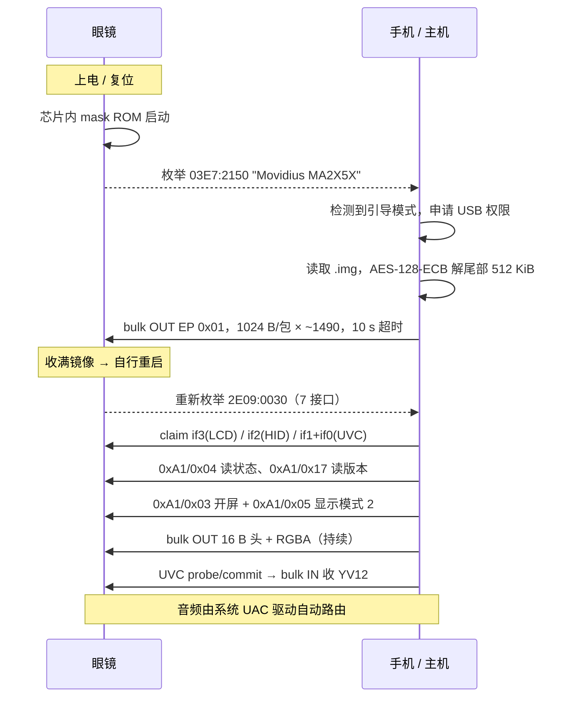

# GLXSS3（G25）AR 眼镜替代项目

> **给一副已经停止维护的 AR 眼镜，重写一套能自己掌控的驱动。**
>
> 亮亮视野 LLVision GLXSS3 / G25 的原厂手机 App（`com.llvision.glxss3.camera` v2.3.7）早已停更，
> 云端 appstore/账户体系也已失效。本仓库用**公开的 USB Host API + 纯 Kotlin** 重新实现了它的主要可用功能：
> 投屏、摄像头、亮度/开关、HID 读取、音频路由、固件加载与自动恢复；并把这套协议逐层写清楚。
>
> 当前状态：**可用**（显示 25 fps、摄像头 20–25 fps、两者可并发；固件卡死可自动恢复）。
>
> 本项目禁止商业使用，见 [LICENSE](LICENSE)；与 LLVision 无任何关联，见 [NOTICE.md](NOTICE.md)。

---

## 1. 这是什么 / 为什么做

### 1.1 一句话

这副眼镜本质上是一个 **USB 显示器 + USB 摄像头 + USB 声卡 + HID 手柄** 的复合设备，
主控是一颗 **Intel Movidius Myriad 2（MA2450）**——和第一代 Intel 神经计算棒 NCS1 同款芯片。
它的固件**不存在眼镜里**：每次上电，主机要先把 `G25_MainFW_*.img` 通过 USB 灌进去，设备才从
"Movidius ROM 引导模式"变成正常设备。

原厂 App 就是那台"主机"。App 停止维护后，这副眼镜就变成了砖——**除非你自己把那台"主机"重新写出来**。

### 1.2 为什么值得做

| 现状 | 本项目的做法 |
|---|---|
| 原厂 App 停更、依赖已失效的账号/应用商店 | 默认路径零 native、零依赖，纯 Kotlin + Android USB Host API |
| 只支持一种 640×400 拉伸投屏，画面变形 | 适应（黑边）/ 裁剪（cover）/ 拉伸三种模式 + 实时缩放/偏移 |
| 没有断线重连，没有错误提示 | 固件半死检测、自动重灌、断线提示 |
| 固件每次上电由主机加载，出错就"黑屏" | 内置 Myriad 引导加载器 + 恢复 SOP，可一键重灌 |
| 协议没有公开文档 | README + 8 章子系统文档，含数据结构、驱动步骤、可运行代码、实测数据与坑 |

### 1.3 一图看懂

```text
手机 / Android
├─ MediaProjection → VirtualDisplay(屏幕比例) → ImageReader(RGBA_8888)
│      └─ 行映射 / 裁剪 / 缩放 → 640×400×4 = 1,024,000 B
│            └─ 16 B 头 + RGBA → USB bulk OUT (EP 0x01)
├─ 控制面: 0xA1/0x01,02,03,04,05,07（亮度 / roll / 开关 / 状态 / 模式 / EEPROM）
├─ UVC   : probe + commit → bulk IN (EP 0x81) → YV12 → Bitmap
├─ HID   : 0xA1/0x16（28 B 报告）/ 0xA1/0x17（24 B 版本）
└─ 固件  : 03E7:2150 → EP 0x01，1024 B/包，10 s 超时
                              │
                     USB 2.0 High-Speed（单根线，7 个接口）
                              │
GLXSS G25（Myriad 2 / MA2450，RTEMS 固件）
├─ LCD   640×400 面板（帧缓冲 + 亮度 / 开关 / roll）
├─ Camera Sony IMX214 → UVC 1.10（YV12，bulk）
├─ HID   按键 / 传感器 / 版本上报
├─ UAC1  扬声器 + 麦克风
└─ 芯片内: 12×SHAVE + SIPP（CNN 加速）—— 本固件不对外暴露 ❌
```

### 1.4 当前能力一览

| 能力 | 状态 | 说明 |
|---|---|---|
| 实时投屏（整屏镜像） | ✅ | 25 fps，640×400 RGBA，单帧 1 MB |
| 画面模式 / 缩放 / 偏移 | ✅ | 适应 / 裁剪 / 拉伸；1.0–2.0× 缩放、双向偏移，实时生效 |
| 亮度 / 开关屏 / roll / 显示模式 | ✅ | 原厂控制命令已全部抓包复现 |
| 读屏状态（8 B） | ✅ | 宽高、屏开关、亮度、roll |
| 读真实固件版本（24 B） | ✅ | `G25_MainFW_1.9.1`，需 claim HID 接口 |
| UVC 摄像头预览 / 拍照 | ✅ | 纯 Kotlin，YV12 640×480，20–25 fps，PNG 存 app 目录 |
| 音频（扬声器 / 麦克风） | ✅ | 标准 UAC，系统自动路由；App 内置测试入口 |
| 固件加载 / 自动恢复 | ✅ | 检测 `03E7:2150` → 灌 1.5 MB → 等重枚举，约 1.5 s |
| HID 报告语义 | ⚠️ | 能收 28 B 报告，字段只解出计数/时间戳 |
| 人脸检测 / NPU | ❌ | 厂商固件内有痕迹，协议未逆向；NPU 无公开入口 |
| 录像 | ❌ | 未实现（原厂在手机侧用 MediaCodec + MediaMuxer） |

---

## 2. 硬件规格

| 项 | 规格 | 证据 |
|---|---|---|
| SoC | **Intel Movidius Myriad 2（MA2450）**，2×LEON4（SPARC V8）+ **12×SHAVE**（128-bit SIMD VLIW）+ SIPP 图像流水线；片上 4 MB + 外挂 DDR | 固件 `ddrInitHeaderForMvcmd.elf`、git 分支 `..._ma2450`、boot ID |
| OS | **RTEMS** 4.11.99.0（`MYRIAD2/w/FPU/ma2x5x`），看门狗线程，MCCI USB 栈 | 固件 strings |
| 相机 | **Sony IMX214**（固件串 `Configuring imx214M10MO camera and datapath`、`CamGeneric/imx214`），MIPI CSI-2 | 固件 strings |
| 相机输出 | UVC 1.10，**未压缩 YV12**（`Y / V / U`），640×480@30 描述符上限，实测 **20–25 fps**；另有 MJPEG 格式与 1080p/720p 档位 | 描述符解析 + 真机抓包 |
| 显示 | **640 × 400**，RGBA8888；帧 = 16 B 头 + 1,024,000 B；单帧 bulk 约 **30 ms（≈35 MB/s）** | 抓包 + 实测 |
| 显示控制 | 亮度 100–254、开关屏、roll、显示模式、8 B 状态、264 B EEPROM 产品信息 | Frida 抓包 |
| 输入 / 传感器 | HID 接口：28 B 报告（计数器 + 疑似 IMU + 时间戳，未完全解出）；固件内有光感与省电逻辑 | 抓包 + strings |
| USB（正常） | **`2E09:0030`** "LLVISION G25 Firmware"，bcdUSB 2.10，High-Speed，7 接口复合设备 | `lsusb -v` |
| USB（引导） | **`03E7:2150`** "Movidius MA2X5X"（NCS1 同款 ROM ID） | dmesg + 抓包 |
| 音频 | UAC 1.0：扬声器 iso OUT `0x02`（256 B）、麦克风 iso IN `0x82`（220 B） | 描述符 |
| 电源 | USB 总线供电；**拔线才断电重启**，切换 USB role 不会给眼镜断电 | 实测 |
| 固件 | `G25_MainFW_1.9.1.img`：1,525,136 B（另有 1.7.4 旧版 1,522,416 B，当前 loader 需改尾部起点才能刷）；**每次上电由主机灌入** | 容器分析 |
| 存储 | 无"固件分区"可回读；EEPROM 仅 256 B 产品信息；是否有 SPI NOR 未确认 | 全量命令枚举 |

### 2.1 USB 复合设备拓扑（实测）

| 接口 | Class | 端点 | 用途 |
|---|---|---|---|
| if0 | `0x0e/0x01` | — | UVC VideoControl |
| if1 | `0x0e/0x02` | `0x81` BULK IN 512 | UVC VideoStreaming（**alt=0 就带端点**，无 alt=1） |
| if2 | `0x03` | `0x83` INT IN 64（interval 8） | HID：按键 / 传感器 / 版本 |
| if3 | `0xff/0x01` | **`0x01` BULK OUT 512** | 厂商 LCD：投屏帧 + 控制请求 |
| if4 | `0x01/0x01` | — | UAC Control |
| if5 | `0x01/0x02` | `0x02` ISOC OUT 256（alt1） | 音频输出（扬声器） |
| if6 | `0x01/0x02` | `0x82` ISOC IN 220（alt1） | 音频输入（麦克风） |

> 关键点：厂商 LCD 接口**只有 OUT 端点**，没有用来回读固件的 bulk IN。
> 全部厂商控制请求的最大读取长度只有 264 B（EEPROM 产品信息），不存在"读 flash"命令。

---

## 3. 驱动状态矩阵

> 图例：✅ 完全驱动（功能可用且有实测） / ⚠️ 部分（能通但语义/稳定性未完整） / ❌ 未通 / — 不适用。
> "手机端驱动"指本仓库 App；"眼镜端固件"指设备内厂商固件提供的能力。

| 子系统 | 手机端驱动 | 眼镜端固件 | 一句话说明 |
|---|:---:|:---:|---|
| **显示**（LCD 640×400） | ✅ | ✅ | 16 B 头 + RGBA 已验证，投屏 25 fps；固件实现完整，但媒体流水线会卡死，需重灌恢复 |
| **UVC 摄像头** | ✅ | ✅ | 纯 Kotlin 实现，YV12 640×480、20–25 fps；固件的 30 fps 只是描述符上限 |
| **HID**（按键/传感器/版本） | ⚠️ | ✅ | 28 B 报告与 24 B 版本串都能拿到；报告里只解出计数器与疑似时间戳，IMU/按键语义未解 |
| **音频**（UAC1） | ✅ | ✅ | 系统自动路由扬声器/麦克风，无私有协议；App 有播放/录音测试入口 |
| **USB 复合 / 连接管理** | ✅ | ✅ | 7 接口枚举、权限、claim、断连都能处理；HID 的 claim 是按 fd 的，会被 UVC 抢（已加 `ensureHid()`） |
| **固件加载** | ✅ | ✅ | `03E7:2150` 裸 bulk，1024 B/包、10 s 超时，1.5 MB 约 460 ms；检测 + 自动重灌已实现 |
| **NPU**（CNN 加速） | ❌ | ❌ | 固件不暴露推理接口；NCSDK 工具链要求"接管整个固件"，与显示/相机互斥 |
| **人脸检测** | ❌ | ⚠️ | 厂商固件有回传人脸坐标/DTR 的痕迹（1.8.4 的 CameraReportData、2.3.7 的 FaceDtr），协议未逆向 |
| **录像** | ❌ | — | 原厂在**手机侧**用 MediaCodec + EasyMuxer 录 mp4；本项目未实现 |

### 3.1 实测性能

| 指标 | 实测值 | 备注 |
|---|---|---|
| 单帧投屏 bulk 传输 | 1,024,016 B / ~30 ms ≈ **35 MB/s** | USB 2.0 HS 上限附近 |
| 投屏帧率 | **25 fps** | 静态/动画一致，缓冲区复用 |
| UVC 帧率 | **20–25 fps** | 设备侧上限约 20–25，非解码瓶颈 |
| 投屏 + UVC 并发 | **24.6 fps + 25 fps** | 两者走不同接口，实测不互斥 |
| 固件灌写 | 1,525,136 B / **~460 ms** | 1490 次 1024 B bulk |
| 灌写后重枚举 | **约 1.5 s（1.3–1.8 s）** | `03E7:2150` → `2E09:0030` |
| 开机到可用 | 数百 ms + 灌写时间 | 每次上电都要重来一遍 |

---

## 4. 眼镜初始化流程（从上电到可用）



逐步说明：

1. **ROM 引导**：Myriad 2 的 USB boot ROM 在芯片内，不可改；它把设备枚举成 `03E7:2150`，并等待主机写入镜像。
2. **主机灌固件**：主机读出 `G25_MainFW_1.9.1.img`，把**最后 512 KiB 用 AES-128-ECB 解密**，然后原样按 1024 B 切片写到 EP 0x01。
   **没有命令包、没有 ACK、没有 ZLP**——协议全在镜像容器里，由设备 ROM 解析。
3. **设备重启**：设备收满后自行重启，重新枚举为 `2E09:0030`。主机从 `bulkTransfer` 的返回值**看不出成功**，
   唯一可靠的判定是"`2E09:0030` 重新出现"。
4. **子系统上线**：显示控制面立刻可用；UVC 需要标准 probe/commit；HID 需要 claim 接口；
   音频在枚举后由 Android 音频框架自动接管。
5. **异常态**：固件可能进入"USB 控制面活着、媒体流水线停摆"的半死状态（`0xA1/0x04` 有返回、1 MB 帧 30 ms 收完，
   但 UVC 0 帧、面板不刷新）。**没有私有复位命令**，唯一恢复是重灌固件，见
   [ch-firmware.md](docs/ch-firmware.md#7-半死现象与恢复-sop)。

> **为什么每次上电都要灌？** 因为眼镜没有"从自己的 flash 启动固件"这条路径（至少没有对外暴露）：
> 每次上电都是 ROM → 主机灌入 → 运行。这也解释了"为什么拔插后必须重灌"和"固件卡死只能重灌"。

---

## 5. 快速开始

### 5.1 构建

```powershell
$env:JAVA_HOME = "C:\Program Files\Microsoft\jdk-17.0.10.7-hotspot"
cd app
C:\gradle\gradle-8.9\bin\gradle.bat assembleDebug --no-daemon --console=plain
# 产物: app/app/build/outputs/apk/debug/app-debug.apk
```

完整依赖（JDK 17 / Gradle 8.9 / SDK 35 / AGP 8.7.3）见 [app/BUILDING.md](app/BUILDING.md)。

### 5.2 安装与使用

```powershell
adb install -r app\app\build\outputs\apk\debug\app-debug.apk
adb shell am start -n com.wzqvip.glxsscast/.MainActivity
```

1. 插上眼镜。若它是 `03E7:2150`，App 会自动灌固件（需要固件文件，见 5.3）；
2. 等它变成 `2E09:0030`，点「连接眼镜」；
3. 点「开屏（switch=1 + 显示模式 2）」或直接「发送测试色条」；
4. 「开始投屏」→ 系统录屏授权 → 眼镜实时显示手机画面（首次启动 UVC 前需授予相机权限）。

### 5.3 固件文件（可选，但自动恢复需要）

本仓库**不分发固件**。若你合法持有原厂 App，可从中取出 `G25_MainFW_1.9.1.img`，放到 App 的专属目录：

```text
/sdcard/Android/data/com.wzqvip.glxsscast/files/G25_MainFW_1.9.1.img
```

没有这个文件时，投屏 / 摄像头 / 控制命令依然可用（眼镜已经启动的情况下）；
只有"引导模式 → 自动灌固件"这一步会提示缺少文件。原理与校验方法见 [ch-firmware.md](docs/ch-firmware.md)。

### 5.4 只想在 PC 上验证协议？

```bash
pip install pyusb
sudo python3 code/poc_send_frame.py --list
sudo python3 code/poc_send_frame.py --pattern bars --fps 5
```

见 [code/poc_send_frame.py](code/poc_send_frame.py)（Linux + pyusb，发送 16 B 头 + 色条帧）。

---

## 6. 仓库结构

```text
README.md                 本文件：硬件、状态矩阵、初始化、快速开始
docs/
  README.md               ★ 文档索引（从这里开始）
  ch-display.md           显示子系统：16 B 头、RGBA、行映射、控制命令
  ch-uvc.md               摄像头：UVC 描述符、probe/commit、12 B header、YV12
  ch-hid.md               HID：28 B 报告、版本查询、claim 语义
  ch-audio.md             音频：UAC 接口、系统路由、测试方法
  ch-usb.md               USB 复合设备与连接管理
  ch-firmware.md          固件容器、AES 尾部、灌写协议、恢复 SOP
  ch-app.md               App 架构、构建、调试、已知问题、下一步
  ch-npu.md               NPU 现状与研究空间
  soc-myriad2.md          SoC 证据留档（Myriad 2 / NCS1 关系）
  usb-capture.md          原始抓包记录（证据）
  firmware-extraction.md  固件提取/回读可行性（证据）
  firmware-boot-protocol.md 引导协议逆向（证据，含反汇编地址）
  vendor-flash-capture.md 原厂刷机抓包与 -206 根因（证据）
  device-recovery.md      "画面全无"诊断与恢复 SOP（证据）
  uvc-camera-plan.md      摄像头方案决策记录（A/B/C/D 对比）
  apk-versions.md         三个 APK 版本对比与 1.7.4 固件
  open-questions.md       仍然待验证的项
  glasses-overview.md / device.md / protocol.md / app-replacement.md
                          早期笔记（已并入 README 与章节，保留为跳转）
  img/                    实拍截图
app/                      Android 工程（Kotlin + Compose）
  BUILDING.md             构建说明
  app/src/main/java/com/wzqvip/glxsscast/
    usb/                  UsbLink / BootLoader / MyriadBootLoader / Peripherals
    lcd/                  LcdProtocol（帧头）/ LcdControl（控制命令）
    cast/                 CastService（MediaProjection → 640×400 → USB）
    uvc/                  UvcCamera / Yuv / UvcPreview
    MainActivity.kt       Compose UI
code/                     PC 端 PoC 与工具
dist/                     CI/本地构建的可安装 APK
LICENSE                   非商业使用许可（中英）
NOTICE.md                 免责声明与合规
```

---

## 7. 章节索引

| 章节 | 你会看到 |
|---|---|
| [docs/README.md](docs/README.md) | 全部文档的索引、阅读路径、证据分级约定 |
| [第 1 章 · 显示](docs/ch-display.md) | 16 B 帧头逐字段、RGBA 布局、行映射与裁剪、VirtualDisplay 管线、亮度/开关/roll |
| [第 2 章 · 摄像头](docs/ch-uvc.md) | UVC 描述符、34 B probe/commit、12 B payload header、YV12 排布、逐字节对齐的坑、帧同步 |
| [第 3 章 · HID](docs/ch-hid.md) | 28 B 报告、已解/未解字段、24 B 版本查询、如何 claim 接口 |
| [第 4 章 · 音频](docs/ch-audio.md) | UAC 接口、系统路由、麦克风/扬声器测试 |
| [第 5 章 · USB](docs/ch-usb.md) | 复合设备拓扑、单例连接、claim 按 fd、HID 被抢、断开处理 |
| [第 6 章 · 固件](docs/ch-firmware.md) | MA2x 容器、AES 尾部、灌写协议、恢复 SOP、半死现象 |
| [第 7 章 · App](docs/ch-app.md) | 模块划分、构建、调试、已知问题、下一步 |
| [第 8 章 · NPU](docs/ch-npu.md) | Myriad 2 的 SHAVE/NN 能力、NCS1 工具链为什么用不了、可能路线 |

**证据分级**（贯穿全部文档）：

- **【验】**：有二进制证据、抓包或真机实测输出；
- **【推】**：由代码/数据结构强推断，未在真机单独验证；
- **【未】**：未确认，文档里会明确标注"待验证"。

**旧文档怎么读**：早期笔记 `glasses-overview.md`、`device.md`、`protocol.md`、`app-replacement.md`
已被 README 与各章节吸收，原文件只保留跳转；`usb-capture.md`、`firmware-*.md`、`vendor-flash-capture.md`、
`device-recovery.md`、`apk-versions.md` 是**原始证据**，章节里引用它们而不重复抄写。

---

## 8. 免责声明与许可

- 本项目与 LLVision（亮亮视野）**无任何关联**，未获授权；相关商标归其权利人所有。
- 仓库**不包含**原厂 APK、固件或厂商二进制（`.gitignore` 已排除 `*.so` / `*.img` / `*.apk`；
  `dist/` 下仅本项目的构建产物）；
  `app/src/main/jniLibs/` 若存在厂商 `.so`，只是本地构建用的可选文件，不会被提交。
- 所有分析仅用于**互操作性**与**个人硬件研究**；请勿用于侵犯他人权利、破解付费服务或攻击设备。
  详见 [NOTICE.md](NOTICE.md)。
- 许可：**非商业使用**（Non-Commercial）。允许个人学习、研究、教学与非商业项目使用、修改与再分发
  （须保留许可与署名）；**禁止任何商业使用**。完整条款见 [LICENSE](LICENSE)。

---

## 9. 致谢与参考

- Intel Movidius Myriad 2 / NCSDK `usb_boot.c`（Myriad ROM 引导主机侧实现，`libboot.so` 与之同源）；
- serenegiant / UVCCamera（原厂 UVC 栈的上游，Apache-2.0）；
- Android USB Host API 与 MediaProjection 文档；
- 本仓库 `docs/` 下的全部抓包、反汇编与实拍记录。
