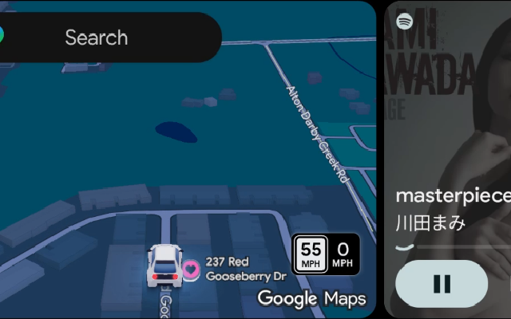

# 第 7 章 · App 架构与开发指南

> 本章讲清楚：这个重新实现的 App 是怎么分层的、每一层负责什么、怎么构建/调试、
> 现在有哪些已知问题、下一步该做什么。
>
> 代码根目录：[`app/app/src/main/java/com/wzqvip/glxsscast/`](../app/app/src/main/java/com/wzqvip/glxsscast/)
> 构建说明：[app/BUILDING.md](../app/BUILDING.md)

---

## 1. 设计原则

| 原则 | 落地 |
|---|---|
| **零 native（默认路径）** | 只依赖 `android.hardware.usb`，不打包任何厂商 `.so`；`UVC`/`LCD`/`引导` 全部纯 Kotlin。`BootLoader.kt` 是可选 fallback，需自备 `.so` |
| **零厂商 SDK** | 不引用 `com.llvision.*`；`BootLoader.kt` 是可选 fallback，需要自备 `.so` |
| **进程内单连接** | `UsbLink` 单例 + 一个 `UsbDeviceConnection`，Activity/Service 共用 |
| **失败要可解释** | 状态栏直接给"为什么失败 + 下一步做什么"（例如固件卡死 → 拔插重灌） |
| **缓冲区复用** | 投屏 1 MB/帧、UVC 460 KB/帧，全部复用，避免 GC 抖动 |
| **控制与数据分离** | `lcd/LcdControl` 只发 control，`usb/UsbLink` 只发 bulk |

---

## 2. 模块划分

```
com.wzqvip.glxsscast
├─ MainActivity.kt        Compose UI、权限/热插拔、测试入口、画面调整
├─ usb/
│   ├─ UsbLink.kt         单例连接、接口/端点选择、HID claim、发帧
│   ├─ MyriadBootLoader.kt 纯 Kotlin 固件加载（默认路径）
│   ├─ BootLoader.kt      厂商 libboot.so 的 JNI 绑定（可选、需自备 .so）
│   └─ Peripherals.kt     HID 中断读取、扬声器测试音、麦克风 RMS
├─ lcd/
│   ├─ LcdProtocol.kt     16 B 帧头、纯色/色条测试图
│   └─ LcdControl.kt      亮度/开关屏/roll/模式/状态/版本/EEPROM/自动亮度/LED
├─ cast/
│   └─ CastService.kt     MediaProjection → VirtualDisplay → ImageReader → 映射 → USB
├─ nav/                   导航 HUD（0.1.8）：Maps 通知 → 手机渲染 → 直推眼镜
│   ├─ NavListenerService.kt  读 com.google.android.apps.maps 的导航通知
│   ├─ NavParser.kt       指令/距离/机动/ETA/路名 解析 + 图标相似度兜底
│   ├─ NavProtocol.kt     NavFrame / Maneuver / UDP JSON
│   ├─ NavBus.kt          最近一帧、授权状态、UDP 发送、直推回调
│   ├─ NavHudRenderer.kt  640×400 RGBA Canvas 渲染（箭头/距离/指令/路名）
│   ├─ NavHudPusher.kt    1 Hz 直推调度 + 开屏 + PNG 抓图
│   └─ NavHudSection.kt   页面：授权、开关、实时预览、模拟/抓帧
└─ uvc/
    ├─ UvcCamera.kt       描述符解析、probe/commit、收流组帧、YUV 解码、拍照
    ├─ Yuv.kt             YV12/I420/NV12/NV21/YUY2/UYVY → ARGB（整数运算）
    └─ UvcPreview.kt      Compose 预览 + 拍照按钮 + 生命周期
```

| 模块 | 行数（约） | 关键职责 | 依赖 |
|---|---:|---|---|
| `MainActivity.kt` | 652 | UI、权限、广播、测试按钮、画面调整 | 全部 |
| `cast/CastService.kt` | 545 | 投屏前台服务、旋转适配、三种映射 | `UsbLink`、`LcdControl` |
| `nav/NavHudPusher.kt` | 380 | 导航 HUD 1 Hz 直推、开屏、PNG 抓图 | `UsbLink`、`LcdControl`、`NavBus` |
| `nav/NavHudRenderer.kt` | 440 | 640×400 深色 HUD（无罗盘） | `LcdProtocol` |
| `nav/NavParser.kt` | 650 | Maps 通知字段解析、路名抽取、图标比对 | `Notification` |
| `nav/NavListenerService.kt` | 120 | 通知监听 + 启动时重扫 | `NavBus` |
| `uvc/UvcCamera.kt` | 1022 | UVC 全流程 | `Yuv`、`UsbManager` |
| `usb/UsbLink.kt` | 205 | 连接与 bulk | — |
| `usb/MyriadBootLoader.kt` | 109 | 固件解密 + 灌写 | `UsbManager` |
| `usb/BootLoader.kt` | 76 | 厂商 JNI 路径 | `libboot.so`（可选） |
| `usb/Peripherals.kt` | 96 | HID/音频测试 | `UsbLink` |
| `lcd/LcdControl.kt` | 109 | 控制请求封装 | `UsbDeviceConnection` |
| `lcd/LcdProtocol.kt` | 69 | 帧格式 | — |
| `uvc/Yuv.kt` | 122 | 颜色转换 | — |
| `uvc/UvcPreview.kt` | 120 | Compose 预览 | `UvcCamera` |

**技术栈**：Kotlin 2.0.21、AGP 8.7.3、Compose BOM 2024.10.01、`minSdk 26 / targetSdk 35`、JDK 17。
无第三方运行时依赖（只有 AndroidX）。

### 2.1 导航 HUD（0.1.8 起，方案 A：手机直推眼镜）

`NotificationListenerService` 读 Google 地图导航通知 → `NavParser` 解析 → `NavHudRenderer`
画 640×400 RGBA（大箭头 + 距离 + 指令 + 路名 + ETA）→ 复用投屏的 `LcdProtocol` 16 B 头 +
1 MB bulk OUT **直推眼镜**，每秒一帧、数据变化立即补一帧。不需要 Pi/UDP，投屏进行中自动暂停。
无眼镜时可把渲染结果抓成 PNG 到 `getExternalFilesDir/nav-hud/` 检查。
完整用法/字段/实测见 [nav-hud.md](nav-hud.md)。

### 2.2 Android Auto 投屏（AA 画面 → 眼镜）

把 **OpenHeadUnit 里跑着的 Android Auto 画面**投到眼镜上，并且能把我们的 HUD 叠在 AA 之上。
新增/改动文件：

| 文件 | 作用 |
|---|---|
| `cast/CastGeom.kt` | 抓屏帧 → 640×400 的几何映射 + **AA 内容区（letterbox）自动识别** |
| `cast/CastHud.kt` | HUD 叠加层（时间 / lux / 水平仪气泡 / 导航箭头），局部 alpha 混合 |
| `cast/CastHudSection.kt` | 页面上的「内容区识别 + HUD」设置面板 |
| `cast/CastService.kt` | 每帧：`content.tick()` → `CastGeom.map()` → `CastHud.compose()` → 翻转 → USB |

#### 2.2.1 为什么「没显示全 / 宽高比不对」

三层比例套在一起，实测（LG G850N，2340×1080 横屏，OpenHeadUnit 3.5.0 + AA 无线）：

```
手机屏  2340×1080 (2.167)  ┌ 黑边 210 ┬  AA 内容 1920×1080 (16:9)  ┬ 黑边 210 ┐
抓屏     866×400 (2.165)   ← 高度固定 400，宽度按屏幕比例（400*2340/1080）
眼镜     640×400 (1.60)
```

- **AA 侧改不成 16:10**：AA 协议只协商固定档位，实测 OHU 日志
  `[RES_CAP] resolutionId=2 chosen=_1280x720 capped=_1280x720`，画布永远是 16:9。
  OHU 的 `resolutionId`/DPI/inset 只能改变 AA 画布**在手机屏上的落位**，改不了 AA 的宽高比。
  所以「显示不全」只能由 App 侧解决。
- 旧 `cover`：`scale = max(640/866, 400/400) = 1.0` → 只取中间 640 列 = 屏幕 x∈[305,2033]，
  **左右各切掉 113/866 ≈ 13%**（AA 内容被切掉 10%）。
- 旧 `fit`：整幅塞进 640×400 → 内容只有 **640×295**，上下各 52 px 黑边（浪费 26% 屏高）。
- 旧 `stretch`：内容全在，但横向被压缩 **35%**，界面明显变扁。

#### 2.2.2 现在的做法：先剥黑边，再按模式映射

`CastGeom.detect()` 每 10 帧（≈0.33 s）用 96×54 网格找一次「有内容的矩形」：从四边剥掉
**近黑（max(R,G,B) ≤ 12）** 的行列，再用真实像素把四条边对齐到第 1 个亮列/行
（网格边界误差 ≤ 9 px，不对齐会在内容边缘留一条黑缝）。带迟滞：变化 < 1.5% 直接接受，
变化大要连续 2 次一致才切换；整帧全黑（AA 启动闪屏）时返回 null，退回整幅，不会「裁到 0」。

| 模式 | 结果 | 内容丢失 | 变形 | 边 |
|---|---|---|---|---|
| 适应（推荐，AA 一键按钮） | 640×360 居中 | **0** | 0 | 上下各 20 px（5%） |
| 裁剪 | 640×400 居中 | 左右各 5%（旧版 13%） | 0 | 0 |
| 拉伸 | 640×400 满铺 | 0 | 横向 +11% | 0 |

「画面模式」三档不变（老用户不受影响）；内容区识别默认开，可在页面里关掉做对比
（关掉即旧行为，`cover` 重新变成切 13%）。识别结果会显示在通知栏 / 页面状态行
（例如 `AA 内容 710×400`）。

> iPhone/普通投屏场景：整屏没有黑边时识别直接返回「全屏」，三档行为与旧版一致。

#### 2.2.3 HUD 叠加（时间 / lux / 水平仪 / 导航）

`CastHud` 在映射之后、180° 翻转之前把 HUD 混合进 640×400 RGBA（同一帧，不再二选一）：

- **只重画变化的部分**：Canvas 画到一张透明 Bitmap 上，时钟 1 Hz、姿态 ~10 Hz、
  导航变化时；每帧只对每个元素记录的矩形做 alpha 混合（约 1 万像素/帧，占整屏 4%），
  静态画面几乎零成本。
- **数据来源**：时间（服务内自己算）、导航（`NavBus`，通知监听服务常驻）、
  lux/水平仪（`MainActivity` 的 HID 姿态回调 `applySensorReport()` 推进来，28 B 报告里的 u16 lux）。
  姿态超过 4 s 没更新就画成灰色，不会假装有数据。
- **三种版式**：四角（水平仪左上 / 时间+lux 右上 / 导航贴底）、顶部条、底部条。
  顶部条 24 px 正好落在「适应」模式的上留边里 → **完全不挡 AA 画面**。
- 透明度 20–100%，可「极简：只画导航箭头」。通知栏第 4 个动作 `HUD 开/关` 可在息屏时切换。
- 文字都带黑色描边，浅色地图上也读得清。

#### 2.2.4 后台与息屏

- **后台**：投屏是前台 Service（`FOREGROUND_SERVICE_TYPE_MEDIA_PROJECTION`），切到桌面继续出帧，
  通知栏常驻 `画面模式 / 停止投屏 / 画面模式 / 息屏 / HUD`。
- **息屏**：`AM_PROJECTION` 抓的是**显示器的合成结果**，屏幕真关掉就没有新帧。实测
  （`input keyevent 26` → `mWakefulness=Dozing`）**10 s 内 0 帧**，眼镜画面直接冻住。
  所以不能用「关屏」，只能用 `BlackoutActivity`：屏幕保持常亮 + 纯黑遮罩 + 本窗口亮度 0
  （`KEEP_SCREEN_ON`，退出即恢复系统亮度）。
- **必须选「单个应用 → OpenHeadUnit」**：黑遮罩是我们自己的窗口，选「整个屏幕」会把黑遮罩
  也抓进去 → 眼镜上全黑（`CastService.blackoutWarning` 连续 45 帧全黑时会在通知栏告警）。
  单应用抓取只拿 OpenHeadUnit 的窗口，黑遮罩不进画面。
- **限制**：OHU（head unit 模拟器）退到后台时 AA 会暂停/掉线（`连接中断 正在重试`），
  所以单应用抓取期间 OHU 必须保持在前台（或用 OHU 的「画中画 / 移至背景/保持待命」）。
  息屏投屏期间不要锁屏太久：Android 14 的 MediaProjection 在锁屏后仍会继续，
  但**用户点「停止」或拔线**会立刻结束（`BlackoutActivity` 的看门狗 2 s 内退出并恢复亮度）。

#### 2.2.5 实测记录（LG G850N，2026-11-22，OpenHeadUnit 3.5.0）

| 项 | 数据 |
|---|---|
| 抓取尺寸 | `started capture=866x400`（高度固定 400 = 眼镜屏高，1:1 垂直，无二次缩放） |
| 帧间隔 / 单帧 bulk OUT | 36 ms / 25–28 ms → **实测 27–28 fps**（上限 30） |
| AA 协商分辨率 | `[RES_CAP] resolutionId=2 chosen=_1280x720`，画布恒为 16:9 |
| 旧 fit（未剥黑边） | 内容 640×295，上下各 52 px 黑边 → `screenshots/aa-mode-fit-legacy-640x295.png` |
| 旧 cover（未剥黑边） | 左右各切 113/866 = 13% → `screenshots/aa-mode-cover-crop-13pct.png` |
| 内容区识别 + 三档映射 | `CastGeomTest` 8/8 通过（合成 866×400 帧，断言精确到 ±3 px） |
| HUD 叠加 | 真机抓帧 → `screenshots/aa-hud-corners-640x400.png`： |
| | 水平仪（左上，无姿态数据时灰色）、`20:27:35` 时间 + lux（右上）、 |
| | 底部导航条「箭头 + 现在 + 驶向Red Iris Dr」（来自真实 Google 地图导航通知） |
| 真关屏（Doze） | `mWakefulness=Dozing` 起 **10 s 内 0 帧** → 眼镜画面冻住，「关屏」路线不可行 |
| 单应用抓取 | 可行（`screenshots/aa-singleapp-frame.png`）：黑遮罩不进画面 |

> 抓帧命令（不用点 UI）：`adb shell su -c "am startservice -n com.wzqvip.glxsscast/.cast.CastService -a com.wzqvip.glxsscast.DUMP_FRAME"`
> → `/data/data/com.wzqvip.glxsscast/files/cast-frame.png`（就是这一帧真正发给眼镜的 640×400 像素）。
> 切模式同理：`-a com.wzqvip.glxsscast.SET_MODE --ei mode 0|1|2`；HUD 开关：`-a com.wzqvip.glxsscast.TOGGLE_HUD`。

#### 2.2.6 推荐的完整操作顺序

1. OpenHeadUnit：分辨率 1280×720，画布落位保持默认（AA 16:9 + 左右黑边）；
2. App 里点 **「▶ AA 投屏」** → 系统对话框选 **「单个应用」→ OpenHeadUnit** → 开始；
3. 回到 OpenHeadUnit（AA 画面），必要时开 **「HUD 叠加」**（顶部条最不挡画面）；
4. 需要省电/防漏光：通知栏点 **「息屏」**（黑屏 + 亮度 0，点屏幕任意处退出）；
5. 排障：`adb shell am broadcast -n com.wzqvip.glxsscast/.diag.DebugReceiver --es cmd cast`
   （授权仍需在系统对话框点一下）；「抓帧存 PNG」把当前真正发出去的 640×400 帧落盘
   （`/data/data/com.wzqvip.glxsscast/files/cast-frame.png`），这是最直接的证据。


---

## 3. 数据流

### 3.1 投屏（前台 Service）

```
MainActivity: MediaProjectionManager.createScreenCaptureIntent()
   └─ onActivityResult → startForegroundService(CastService.ACTION_START, resultData)
        └─ CastService.startCasting()
             ├─ 确保 UsbLink 已连接
             ├─ LcdControl.setDisplayMode(2)
             ├─ ImageReader(RGBA_8888, 2) + VirtualDisplay(屏幕比例)
             └─ onFrame():
                  acquireLatestImage → 映射到 640×400 → 拷进 frameBuf[16..]
                  → UsbLink.sendFrame() → 统计 fps
```

### 3.2 摄像头（Activity 内）

```
UvcPreview(camera)
   ├─ camera.open(dev, reuse = null)      // claim VC + VS + HID, probe/commit
   ├─ camera.start()                       // UvcReader 线程
   └─ Listener.onFrame(bitmap, bytes, fps)
        └─ ImageView.setImageBitmap()      // 不走 Compose 重组
```

### 3.3 控制 / 固件 / 音频

```
MainActivity 按钮 → LcdControl.xxx(usb.connection)      // 亮度/开关/模式/状态/版本
MainActivity.autoFlashBoot() → MyriadBootLoader.flash()  // 03E7 出现时自动
Peripherals.playTone()/micRms()                          // 音频测试
```

---

## 4. 构建、安装与运行

完整环境见 [app/BUILDING.md](../app/BUILDING.md)。最短路径：

```powershell
$env:JAVA_HOME = "C:\Program Files\Microsoft\jdk-17.0.10.7-hotspot"
cd app
C:\gradle\gradle-8.9\bin\gradle.bat assembleDebug --no-daemon --console=plain
adb install -r app\app\build\outputs\apk\debug\app-debug.apk
adb shell am start -n com.wzqvip.glxsscast/.MainActivity
```

运行前检查：

| 项 | 要求 |
|---|---|
| USB 权限 | 首次插上会弹窗；勾选"默认打开"可免重复 |
| 相机权限 | Manifest 已声明，启动时申请；UVC 需要它才给 USB 权限 |
| 录音权限 | 麦克风测试需要 |
| 通知权限 | Android 13+ 前台服务通知需要（`POST_NOTIFICATIONS`） |
| 固件文件 | 自动恢复需要 `/sdcard/Android/data/com.wzqvip.glxsscast/files/G25_MainFW_1.9.1.img` |

---

## 5. 调试指南

### 5.1 logcat

```powershell
adb logcat -s UsbLink CastService UvcCamera MyriadBoot Peripherals BootLoader
```

| TAG | 关键行 | 含义 |
|---|---|---|
| `UsbLink` | `opened if=3 ep=0x1 mps=512` | 连接成功、选对端点 |
| `UsbLink` | `claim HID if=2 -> true` | HID 已拿到（否则 `0xA1/0x17` 会 -1） |
| `CastService` | `pipeline 640×… mode=…` / `fps=25.0` | 投屏正常 |
| `UvcCamera` | `VS formats: …` | 描述符解析结果 |
| `UvcCamera` | `selected: format=YV12(idx=1) …` | 协商结果 |
| `UvcCamera` | `buffers: frameSize=460800 urbSize=460822` | URB 对齐原厂 |
| `UvcCamera` | `fps=25.0 (YV12 640x480)` | 出流正常 |
| `UvcCamera` | `invalid UVC payload … n=461824` | **固件异常**（旧版缓冲区大小），去重灌 |
| `MyriadBoot` | `decrypted tail: cipher=524288` / 无 `bulk fail` | 固件灌写正常 |

### 5.2 现场自证：抓原始 UVC 字节

UI：「打开摄像头」→「抓原始 UVC 字节（诊断）」，会写 30 个 URB 到
`Android/data/com.wzqvip.glxsscast/files/Pictures/uvc/uvc_raw_*.bin`。
格式：每个 URB 前 4 B 小端长度 + 原始字节。

```powershell
adb pull /sdcard/Android/data/com.wzqvip.glxsscast/files/Pictures/uvc/
```

健康数据：每个 URB 以 `0C 0F/0E` 开头、长度 460812；
异常数据：`n == urbSize`、首字节是亮度值（没有帧边界）。

### 5.3 设备侧状态

```powershell
adb shell "su -c 'lsusb'"
adb shell "su -c 'dmesg | grep -E \"idVendor|USB disconnect\" | tail -20'"
adb shell dumpsys usb | Select-String -Pattern "2e09|03e7"
```

App 内「读取状态」返回 8 B，格式见 [ch-display.md §3.2](ch-display.md#32-状态-8-b-布局)；
「读取真实固件版本」走 `0xA1/0x17`。

### 5.4 常见症状 → 章节

| 症状 | 先看 |
|---|---|
| 发了色条/投屏，屏幕不亮 | [ch-display.md §7 坑 3](ch-display.md#7-坑与注意事项)（屏 switch 被关） |
| UVC 一直 timeout | [device-recovery.md §1](device-recovery.md#1-三态判定表30-秒分清)（三态判定） |
| UVC 彩色噪点 | [ch-uvc.md §8 坑 1–3](ch-uvc.md#8-坑与注意事项) |
| 读固件版本失败 | [ch-hid.md §2](ch-hid.md#2-接口与-claim-语义最重要的一节)（claim） |
| 画面被压扁/裁错 | [ch-display.md §4](ch-display.md#4-手机端管线从-mediaprojection-到-640400)（映射模式） |
| 刷固件 -206 | [ch-firmware.md §4.3](ch-firmware.md#43-为什么原厂-app-会--206历史坑已修) |

---

## 6. 已知问题

| # | 问题 | 影响 | 现状/绕过 |
|---|---|---|---|
| 1 | HID 28 B 报告语义未解 | 无法做传感器类功能 | 只显示 hex；见 [ch-hid.md §4.2](ch-hid.md#42-怎么继续解建议) |
| 2 | 拔线后投屏 Service 不自动停 | 后台继续跑、每帧失败 | 手动「停止投屏」；待改成 DETACHED 自动停 |
| 3 | 旋转时 `resize()` 可能失败 | 抓取尺寸不匹配，画面裁错 | 状态栏提示；用「画面调整」zoom/offset 补偿 |
| 4 | 亮度不持久化 | 每次启动从 180 开始 | 设备端亮度其实是持久的；可加 SharedPreferences |
| 5 | 无帧率上限 | 源有多少帧就发多少 | USB 上限约 25–30 fps，实际由设备消费速度决定 |
| 6 | 拉伸模式不清屏 | 源宽 < 640 时右侧可能残留 | 用适应/裁剪；或给 `mapStretch` 加 `Arrays.fill` |
| 7 | UVC 没有前台 Service | App 退到后台可能被回收 | 投屏有前台 Service；UVC 目前只在 Activity |
| 8 | HID 中断端点读取是实验性的 | UI 开关可能收不到包 | 可靠路径是 `0xA1/0x16` 轮询 |
| 9 | 拍照只存 app 专属目录 | 不进系统相册 | 零权限；需要时接 MediaStore |
| 10 | 没有录像 | 缺功能 | 原厂用 MediaCodec + EasyMuxer，可参考 |
| 11 | 固件文件需手动放置 | 自动恢复不可用 | 提示明确；可加"从文件选择器导入" |
| 12 | 单设备 | 多眼镜需重启 App | 未做多设备管理 |

---

## 7. 下一步

按"价值 / 成本"排序：

| 优先级 | 事项 | 说明 |
|---|---|---|
| P0 | 拔线自动停投屏 + 重连恢复 | 体验硬伤；DETACHED 里停 Service，ATTACHED 里自动重连 |
| P0 | 亮度/模式持久化 | SharedPreferences，几行代码 |
| P1 | HID 报告解码 | 静止/旋转/遮光三组实验，见 [ch-hid.md §4.2](ch-hid.md#42-怎么继续解建议) |
| P1 | 帧率上限 / 带宽自适应 | 10/15/20/25 档；投屏 + UVC 同开时自动降 |
| P2 | 录像（MediaCodec + MediaMuxer） | 投屏/UVC 都能录；参考原厂 `EasyMuxer` |
| P2 | UVC 前台 Service | 后台预览/录制 |
| P2 | 1080p / MJPEG 实验 | 先测带宽，见 [ch-uvc.md §9](ch-uvc.md#9-待验证) |
| P3 | 人脸检测 / DTR 通道 | 协议未逆向，属于研究项，见 [ch-npu.md](ch-npu.md) |
| P3 | 多设备 / 国际化 / 主题 | 打磨 |

---

## 8. 扩展指南

### 8.1 加一条控制命令

1. 在 `lcd/LcdControl.kt` 里加一个 `controlTransfer(REQ_CTRL, bRequest, wValue, wIndex, buf, len, TIMEOUT)`；
2. `wIndex`：LCD=3，HID/AUX=2；
3. 先在 PC 上用 pyusb 验证，再进 App；
4. 把请求写进 [ch-display.md §3.1](ch-display.md#31-请求总表) 的表里。

### 8.2 加一种画面映射

1. 在 `CastService` 加 `MODE_XXX`；
2. 实现 `mapXxx(buf, w, h, rowStride, pixelStride, dst)`，**必须填满 dst**；
3. 在 `onFrame()` 的 `when(fillMode)` 里分派；
4. UI 的模式循环改成 `% 4`。

### 8.3 接一个新 UVC 格式

1. 在 `PixelMapping` 加枚举；
2. `estimateFrameBytes()` 加净荷估算；
3. `deliver()` 加解码分支；
4. `mappingOf(guid)` 加 GUID 映射。

### 8.4 写新 App 的最小骨架

只需要三样东西就能投屏：

```kotlin
// 1) 找设备 + 权限
val dev = usbManager.deviceList.values.first { it.vendorId == 0x2E09 && it.productId == 0x0030 }

// 2) 打开 + claim 厂商接口 + 找 bulk OUT
val conn = usbManager.openDevice(dev)!!
val itf = (0 until dev.interfaceCount).map { dev.getInterface(it) }
    .first { it.interfaceClass == 0xFF }
conn.claimInterface(itf, true)
val ep = (0 until itf.endpointCount).map { itf.getEndpoint(it) }
    .first { it.type == UsbConstants.USB_ENDPOINT_XFER_BULK && it.direction == UsbConstants.USB_DIR_OUT }

// 3) 组帧 + 发送（16 B 头见 ch-display.md）
conn.controlTransfer(0xA1, 0x03, 1, 3, ByteArray(1), 1, 5000)  // 开屏
conn.controlTransfer(0xA1, 0x05, 2, 3, ByteArray(1), 1, 5000)  // 显示模式 2
conn.bulkTransfer(ep, frame16PlusRgba, frame16PlusRgba.size, 5000)
```

更完整的 Python 版本见 [code/poc_send_frame.py](../code/poc_send_frame.py)；
PC 端完整调试 CLI（状态/控制/HID/EEPROM/UVC/刷写/解码）见
[code/glxss.py](../code/glxss.py) 与 [code/README.md](../code/README.md)。

---

## 9. 许可与合规

- 本项目**禁止商业使用**，见 [LICENSE](../LICENSE)；
- 仓库不包含 APK/固件/厂商 `.so`；
- 若你自行把厂商 `.so` 放进 `jniLibs/` 使用 `BootLoader` 路径，请自行确认许可与合规，
  并在分发时保留上游（serenegiant / Apache-2.0）声明；
- 与 LLVision 无关联，见 [NOTICE.md](../NOTICE.md)。

---

## 10. Android Auto 界面投屏（OpenHeadUnit → 眼镜）

把 LG 上 OpenHeadUnit 显示的 Android Auto 界面，经 MediaProjection 抓屏、缩放到 640×400、
USB bulk 推到眼镜。整条链路不需要 Pi：`Pixel → WiFi → OpenHeadUnit → 本 App → 眼镜`。

### 10.1 OpenHeadUnit 侧（必须一次设对）

在 LG 的 OpenHeadUnit（`com.andrerinas.headunitrevived`，3.5.0 实测）里设置：

| 设置项 | 值 | 原因 |
|---|---|---|
| 屏幕方向 / Screen orientation | **横屏 Landscape** | AA 画布变成 2340×1080；竖屏下 AA 是 1080×1920，裁到 640×400 只剩中间一条，不可用 |
| HUD Mode (Horizontal Flip) | **关** | 开着会把整个 AA 画面左右镜像，眼镜上文字全反 |
| 分辨率 / Resolution | **720p（1280×720）** | 目标只有 640×400，720p 足够且解码轻松；实测 AA 解码 30 fps |
| 视频适配 / Video fit | **Fit with bars (CONTAIN)** | 不让 OpenHeadUnit 把 16:9 的 AA 拉伸成 21:9 |
| Custom Insets | **0** | 恢复全屏；设了左右 inset 会把 AA 缩到中间并留黑边 |
| 连接方式 | WiFi（Native AA） | USB 口要留给眼镜 |

> OpenHeadUnit 3.5.0 的 Resolution 只有 Auto / 480p / 720p / 1080p / 1440p / 2160p，
> **没有 1280×800**。别按 2:1 或 1280×800 去设，否则会找不到对应项。

设置改完若 AA 没重连：点 OpenHeadUnit 的 **WiFi** 按钮，或
`adb shell am broadcast -a com.andrerinas.openheadunit.ACTION_START_WIRELESS -p com.andrerinas.headunitrevived`。

### 10.2 App 侧

1. 眼镜插在 LG 上，App 里点「连接眼镜」（状态显示「眼镜：已连接」）。
2. 点 **「▶ AA 投屏（一键：完整 AA 画面、无裁切）」**：
   - 自动把画面模式设为 `MODE_AA`（适应 + AA 内容区识别），zoom/offset 归位并持久化；
   - 拉起系统投屏授权。
3. 系统对话框选 **「整个屏幕」** → 开始（选「单个应用 → OpenHeadUnit」见 10.4）。
4. 切到 OpenHeadUnit 的 AA 界面。App 是前台 Service，切走不会停。

`MODE_AA` 会先识别 AA 内容区（剥掉 OpenHeadUnit 的 letterbox 黑边），再按「适应」等比缩放：
OpenHeadUnit 输出 16:9 内容 + 左右黑边时 → **640×360 居中**，上下各 20 px 黑边，
完整保留左右应用栏和音乐面板；如果 AA 内容铺满整屏（没有可识别的黑边），会退化为整幅 fit
（约 640×295，上下各 52 px 黑边）。想要满屏无黑边就手动切「裁剪(填满)」，代价是左右各裁 ~13%。

如果 AA 在后台、抓到的却是桌面/App：把 OpenHeadUnit 的投影界面切回前台
（`adb shell am broadcast -a com.andrerinas.openheadunit.ACTION_RAISE_PROJECTION -p com.andrerinas.headunitrevived`）。

### 10.3 实测结果（LG G8X / Android 14 / OpenHeadUnit 3.5.0）

- 整屏抓取 866×400 → 640×400（cover），**25–27 fps**（AA 自身解码 29–30 fps），
  USB bulk 每次约 25 ms，连续 1000+ 帧无失败、无撕裂。
- 整屏 cover 实帧可读：地图、转弯 banner、限速、当前路名、右侧音乐面板
  （专辑封面/曲名/暂停键）都在；但最左侧应用栏会被裁掉。



- 代价：眼镜 16:10、AA 画面约 21:9，cover 左右各裁 ~13%。要完整画面用 10.2 的「AA 投屏」
  （fit + 内容区识别）；要满屏用 cover，两者二选一。
- 单应用抓取实测：系统对话框选「单个应用 → OpenHeadUnit」后，抓到的 866×400 帧里
  **没有状态栏/通知**，只有 AA 画面（`app/screenshots/aa-singleapp-frame.png`，26–28 fps）。
- 息屏（手机变暗、眼镜继续显示 AA）见 [10.5](#105-息屏模式手机变暗眼镜继续显示-aa)：
  能用，但遮罩必须**透明**，不透明黑窗会把抓取一起变成黑屏。

### 10.4 已知问题

- OpenHeadUnit 的 HUD Mode 必须关；如果它被别的自动化重新打开，眼镜上会左右镜像。
  可在 OpenHeadUnit 设置里再关，或让 App 的 AA 面板通过
  `ACTION_SET_SETTINGS`（需 OpenHeadUnit 开启 Allow external configuration）下发
  `{"hud_mirroring":false,"screen-orientation":2,"video-fit-mode":1,"resolutionId":2}`。
- 单应用投影（系统对话框选「单个应用」→ OpenHeadUnit）能避开状态栏，但 AA 的
  SurfaceView/TextureView 在不同 ROM 上可能被系统判定为不可捕获；整屏投影最稳。
- **息屏不要用不透明黑窗**：实测它会盖住 OpenHeadUnit，Android 14 单应用抓取拿到的
  每一帧都是全黑（`cast-frame.png` 仅约 1.9 KB）。现改为**全透明窗口 + 窗口亮度 0**
  （`windowIsTranslucent`），被投的 AA 仍保持可见/继续出帧；整屏抓取时状态栏会进画面，
  建议 OpenHeadUnit 的 Screen mode 选 Immersive。

---

## 10.5 息屏模式（手机变暗、眼镜继续显示 AA）

结论：**可行，但遮罩必须是透明的**。手机看起来"灭屏"，眼镜上的 AA 照常刷新。

### 10.5.1 三种做法实测对比（LG G8X / Android 14）

| 做法 | 手机屏幕 | 抓到的帧 | 结论 |
|---|---|---|---|
| 不透明黑窗口盖住 App + 亮度 0 | 全黑 | **全黑**（PNG 1956 B） | ✗ 眼镜跟着黑 |
| **透明窗口 + 窗口亮度 0**（默认） | 背光 227 → **13**/365 | 实时画面正常（19 228 B） | ✓ 推荐，免 root |
| 透明窗口 + root 关面板背光 | 面板真正熄灭 | 同上（不遮挡） | ✓ 需一次性 root 授权 |

根因：Android 14 的 `MediaProjection`（包括「单个应用」抓取）读的是**合成后的显示内容**。
一个不透明的窗口把被投 App 完全盖住后，系统会把它从合成里摘掉 —— 于是抓到的每帧都是黑。
透明窗口不遮挡，被投 App 仍然算"可见"，继续出帧。

### 10.5.2 实测数据（20:33，单应用抓取 OpenHeadUnit）

- 抓帧取证：息屏进行中（`blackout=true`）dump 到的那一帧是**实时画面**，不是黑屏 ——
  oplog 里 `dump frame … (frames=445 blackout=true 全黑帧连续=0)`，PNG 19 228 B，
  帧内 HUD 时钟 `20:33:43` 与系统时间一致
  （`app/screenshots/aa-blackout-transparent-frame.png`）；
- 亮度：`/sys/class/backlight/panel0-backlight/brightness` **227 → 13**（窗口 `screenBrightness=0f`
  经框架下发），点屏幕退出息屏后**自动回到 227**，不需要任何手动恢复动作；
- 息屏期间 framebuffer 仍有画面（画面没变黑，只是背光被压到 3.5%）；
- 帧率：抓取 866×400（横屏）/640×1386（竖屏），AA 有动画时 24–28 fps，
  静止画面只在内容变化时出新帧（AA 停在不动的地图上是 1 fps 量级）；
- 静止画面取证：`DUMP_FRAME` 等不到新帧时会在 0.4 s 后落盘最近一帧
  （`dump frame: 无新帧，落盘最近一帧`），否则 AA 静止时取证会一直卡住；
- 投屏被停（停止/拔线/连续发帧失败）：息屏窗口 2 s 内自动退出并复原亮度（看门狗）。

对比：同一台机器上**不透明黑窗口**版本在息屏期间 dump 到的帧是纯黑
（1956 B，随后 `全黑帧连续` 计数触发告警），所以"黑遮罩 + 抓屏"这条路是走不通的。

### 10.5.3 用法

1. 「Android Auto 投屏（单应用 + 息屏）」面板里点 **「息屏（亮度 0）」**，
   或下拉通知栏点投屏通知里的 **「息屏」**（投屏中通知第 3 个动作）；
2. 手机变暗，AA 继续在眼镜上跑；
3. 退出：**点屏幕任意位置**（透明窗口照样吃触摸）或按返回键，亮度立即恢复；
   也可以再点一次通知里的「退出息屏」（窗口是 singleTop，第二次进入即退出）。

### 10.5.4 深度息屏（root，真正关背光）

窗口亮度 0 在 LG 上是 13/365，夜里仍能看见一点画面。想彻底黑：

1. 点 **「深度息屏(root)」**：先 `su -c id` 探一次 root（Magisk/APatch 的授权弹窗
   此时屏幕还亮着，能看见并点"允许"）；
2. 授权后把 `/sys/class/backlight/panel0-backlight/brightness` 写 0，退出时写回原值；
3. 原值写在 `blackout-root` 这个 SharedPreferences 里，**进程被杀/崩溃**也不会丢：
   `GlxssApp.onCreate` 每次启动都会先尝试还原（幂等，还原成功就清标记）。

未授权 root 时日志是 `深度息屏失败：读不到背光（未授权 root？）→ 仅用窗口亮度 0`，
功能自动退化为方案 2，不会卡住用户。

### 10.5.5 锁屏 / 息屏相关注意

- 息屏窗口带 `setShowWhenLocked` + `FLAG_KEEP_SCREEN_ON`：屏幕不会自动灭、锁屏不会盖上来；
- 不要用系统电源键灭屏：物理显示关掉后 AA 停止渲染，MediaProjection 也就没有新帧了
  （`adb shell input keyevent 26` 可复现）。"看起来灭屏"靠的就是本节的透明窗口 + 亮度；
- 息屏只改亮度，不改抓取范围 —— 想让眼镜干净就别选整屏（状态栏会进画面）。

