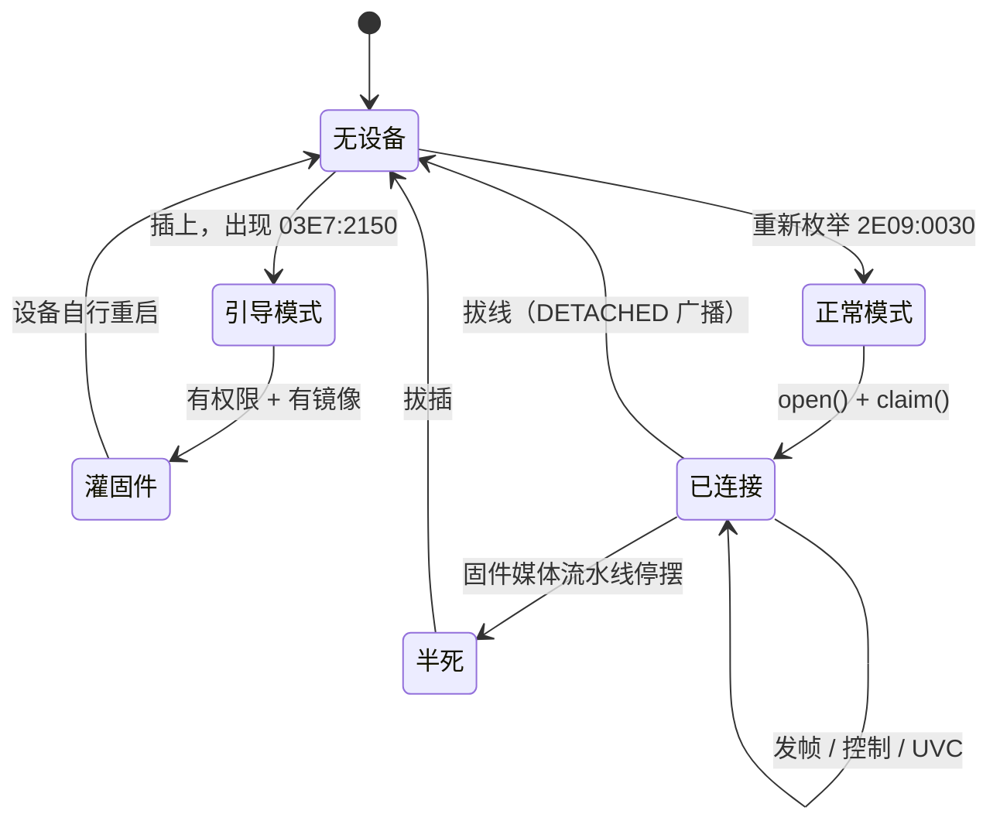

# 第 5 章 · USB 复合设备与连接管理

> 本章讲清楚：一条 USB 线上 7 个接口怎么共存、Android 的 `claimInterface` 到底锁住了什么、
> 为什么"读固件版本"会被 UVC 搞坏、以及拔线/重枚举时该怎么收场。
>
> 对应代码：[`usb/UsbLink.kt`](../app/app/src/main/java/com/wzqvip/glxsscast/usb/UsbLink.kt)、
> [`MainActivity.kt`](../app/app/src/main/java/com/wzqvip/glxsscast/MainActivity.kt)、
> [`cast/CastService.kt`](../app/app/src/main/java/com/wzqvip/glxsscast/cast/CastService.kt)、
> [`uvc/UvcCamera.kt`](../app/app/src/main/java/com/wzqvip/glxsscast/uvc/UvcCamera.kt)
>
> 描述符实测：[usb-capture.md §1](usb-capture.md#1-设备描述符实测)；
> 刷写期间的所有权问题：[vendor-flash-capture.md §4](vendor-flash-capture.md#4--206-根因分析)

---

## 1. 原理：一个设备，七个接口，四种功能

正常模式下眼镜是一个 **USB 复合设备**（`bDeviceClass=0xEF`，用 IAD 把接口分组）：

```
2E09:0030  "LLVISION G25 Firmware"   bcdUSB 2.10  High-Speed
│
├─ if0  UVC VideoControl      (0x0e/0x01)  无端点
├─ if1  UVC VideoStreaming    (0x0e/0x02)  0x81 BULK IN 512
├─ if2  HID                   (0x03)       0x83 INT IN 64 (interval 8)
├─ if3  厂商 LCD              (0xff/0x01)  0x01 BULK OUT 512
├─ if4  UAC Control           (0x01/0x01)  无端点
├─ if5  UAC Streaming OUT     (0x01/0x02)  0x02 ISOC OUT 256 (alt1)
└─ if6  UAC Streaming IN      (0x01/0x02)  0x82 ISOC IN 220 (alt1)
```

| 功能 | 接口 | 谁在用 | 冲突风险 |
|---|---|---|---|
| 投屏 | if3 | 我们（`UsbLink`）+ 原厂 `liblcd` | 低：只有一个 bulk OUT |
| 摄像头 | if0 + if1 | 我们（`UvcCamera`）+ 原厂 `libuvc` | 中：alt/claim 会互相踢 |
| 按键/传感器/版本 | if2 | 我们（`UsbLink` 的 HID claim）+ 原厂 `libhid` + 内核 `hid-generic` | **高**：claim 会被抢 |
| 音频 | if4–6 | 系统 USB 音频栈 | 高：App 一 claim 就没声音 |

四个功能共享一条 USB 2.0 High-Speed 链路（理论 ~40 MB/s 有效）。实测投屏 25.6 MB/s
+ UVC 9–12 MB/s 可以并发，已经接近上限，再加 1080p UVC 就会挤爆。

### 1.1 两种模式

| 模式 | VID:PID | 用途 | 谁在控制 |
|---|---|---|---|
| 正常 | `2E09:0030` | 投屏 / 摄像头 / HID / 音频 | RTEMS 固件（已灌入） |
| 引导 | `03E7:2150` | 接收固件镜像（裸 bulk 写） | 芯片内 ROM |

插拔后到底是哪种模式，取决于"固件有没有在跑"：掉电重启 → ROM（03E7）→ 主机灌入 → 正常（2E09）。
所以**任何"拔插一下"都会让设备回到 03E7**，需要重新灌固件。

---

## 2. Android USB Host API 的连接流程

```
USB_DEVICE_ATTACHED 广播 / device_filter 匹配
   │
   ├─ UsbManager.deviceList 找到设备
   ├─ hasPermission()? ── 否 ──► requestPermission(PendingIntent) → 系统弹窗
   │                                  └─ 广播 EXTRA_PERMISSION_GRANTED
   └─ openDevice(dev) → UsbDeviceConnection（内部是一个 usbfs fd）
          │
          ├─ claimInterface(itf, force = true)   ← 告诉内核"这接口归我"
          └─ bulkTransfer / controlTransfer
```

几个 Android 特有的点：

- **权限是按设备授予的**，拔插后会失效（除非勾选"默认打开"）；
- `usb_device_manager.xml` 会记住"默认处理某个 VID/PID 的 App"，原厂和我们 App 会互相抢；
- 本项目在 `res/xml/device_filter.xml` 里同时声明了 `2E09:0030` 和 `03E7:2150`，
  所以插上就能被系统拉起（见 [`MainActivity`](../app/app/src/main/java/com/wzqvip/glxsscast/MainActivity.kt#L163-L181)）；
- `claimInterface(force=true)` 会 **detach 内核驱动**（`hid-generic`、`uvcvideo`），
  这正是我们能读 HID 版本、能自己跑 UVC 的前提。

### 2.1 驱动步骤（最小可用）

```
1) Manifest / device_filter 声明 VID:PID（正常 2E09:0030 + 引导 03E7:2150）
2) USB_DEVICE_ATTACHED → UsbManager.deviceList 按 VID/PID 找设备
3) hasPermission()? 否则 requestPermission(PendingIntent) 并等广播
4) openDevice(dev) → UsbDeviceConnection
5) claimInterface(目标接口, force = true)：LCD(if3) / HID(if2) / UVC(if0,if1)
   —— 绝对不要 claim 音频接口(if4–6)
6) 按 class/方向选端点（厂商 0xFF 的 bulk OUT 优先）
7) 传输；DETACHED 时 close()，重新插上后从第 2 步重来
```

---

## 3. 单例与连接生命周期

### 3.1 为什么必须单例

`UsbDeviceConnection` 本身可以被多个组件共用（Activity、前台 Service），
但 **claim 是按 fd 的**：如果每个组件各开一个 fd、各 claim 一次，
就会出现"HID 被抢走""alt setting 被重置"这类问题。

本项目的做法：**进程内一个 `UsbLink` 单例，一个 connection，一个 LCD 端点**。

```kotlin
// usb/UsbLink.kt
companion object {
    @Volatile private var shared: UsbLink? = null
    fun get(context: Context): UsbLink =
        shared ?: synchronized(this) {
            shared ?: UsbLink(context.applicationContext).also { shared = it }
        }
}
```

- `MainActivity` 和 `CastService` 都通过 `UsbLink.get(this)` 拿同一个实例；
- `CastService.onDestroy()` **不关闭**连接（Activity 可能还在用），只在用户点「断开」时关；
- `UsbLink.open()` 会先 `close()` 旧的，再打开新的（换设备/重连时安全）。

### 3.2 端点选择

厂商 LCD 接口的 bulk OUT 是 `0x01`，但代码不硬编码地址，而是**扫描 + 打分**：

```kotlin
// usb/UsbLink.kt
var chosen: Triple<UsbInterface, UsbEndpoint, Int>? = null
for (i in 0 until dev.interfaceCount) {
    val itf = dev.getInterface(i)
    for (e in 0 until itf.endpointCount) {
        val ep = itf.getEndpoint(e)
        val bulkOut = ep.type == UsbConstants.USB_ENDPOINT_XFER_BULK &&
                ep.direction == UsbConstants.USB_DIR_OUT
        if (!bulkOut) continue
        val score = if (itf.interfaceClass == 0xFF) 2 else 1   // 厂商接口优先
        if (chosen == null || score > chosen!!.third) chosen = Triple(itf, ep, score)
    }
}
```

这样即使将来固件改了接口号，只要还是"厂商接口 + bulk OUT"就能选对。
UVC 侧则按 `class=0x0e/sub=0x02 + bulk IN` 选，不依赖固定接口号。

### 3.3 连接状态机



---

## 4. claim 是按 fd 的（本章最重要的事实）

### 4.1 现象

| 操作序列 | `0xA1/0x17`（读版本） |
|---|---|
| `UsbLink.open()`（claim HID） | ✅ `G25_MainFW_1.9.1` |
| 再 `UvcCamera.open(dev)`（另一个 fd，也 claim HID） | ✅ 仍然可读（UVC 活着） |
| `UvcCamera.close()`（release 自己的 fd） | ❌ 变回 -1 |
| `UsbLink.ensureHid()` 重新 claim | ✅ 恢复 |

### 4.2 解释

- usbfs 的 "claim" 记录在**每个打开的文件描述符**上；
- `claimInterface(hid, force=true)` 会把接口从**其他 fd** 手里夺过来（kernel 先 detach，
  再把这个 fd 设为 owner）；
- 当 owner fd 被 `releaseInterface`/`close`，接口回到"无 owner"状态，
  但**不会自动还给之前那个 fd**——所以必须重新 claim。

### 4.3 代码对策

```kotlin
// usb/UsbLink.kt
fun ensureHid(): Boolean = claimHid(conn ?: return false, device ?: return false)
```

调用点：

- `MainActivity` 的「读取真实固件版本」前；
- 任何准备发 `0xA1/0x16` / `0x17` 的地方；
- UVC 关闭之后。

### 4.4 UVC 应该复用连接吗

`UvcCamera.open(dev, reuse = usb.connection)` 可以复用 `UsbLink` 的连接：

| 方式 | 优点 | 缺点 |
|---|---|---|
| 复用（`reuse != null`） | 少一个 fd；claim 冲突更少 | 生命周期耦合；UVC `close()` 不会关连接（代码已处理） |
| 独立 `openDevice` | 解耦；任何一方挂了不影响另一方 | 两个 fd 会互相抢 HID/alt，需要 `ensureHid()` |

当前 UI 里 UVC 走独立连接（`cam.open(dev, null)`），并在读版本前 `ensureHid()`。

---

## 5. 断开与热插拔

### 5.1 广播处理

```kotlin
// MainActivity.kt
override fun onReceive(context: Context, intent: Intent) {
    when (intent.action) {
        UsbManager.ACTION_USB_DEVICE_ATTACHED -> {
            val dev = intent.getParcelableExtra(UsbManager.EXTRA_DEVICE, UsbDevice::class.java)
            if (dev != null && dev.vendorId == 0x03E7) autoFlashBoot(dev)   // 引导模式 → 自动灌
            if (dev != null && dev.vendorId == UsbLink.VID) connect(dev)   // 正常模式 → 连接
        }
        UsbManager.ACTION_USB_DEVICE_DETACHED -> {
            usb.close()
            status = "设备已断开"
        }
    }
}
```

### 5.2 正在传输时拔线

| 场景 | 行为 | 处理 |
|---|---|---|
| 投屏 `bulkTransfer` | 立即返回 -1 | `sendFrame` 返回 false → UI 显示"发送失败" |
| UVC 读循环 | `bulkTransfer` 立即 -1 | 用耗时区分"超时/已断开"；连续 5 次快速失败 → 报错并退出 |
| 控制请求 | 返回 -1 | UI 显示 ACK 失败 |
| 灌固件 | `bulkTransfer` -1 | 原厂语义：`NO_DEVICE` 视为"写完了"；本项目最多重试 3 次后报错 |

> 投屏 Service **不会**因为 DETACHED 自动停止：它还在跑，只是每帧发送失败。
> 这是已知问题（见 [ch-app.md](ch-app.md)），需要用户手动「停止投屏」；
> 重新插上并连接后，下一帧会自动继续。

### 5.3 重枚举后的 fd 失效

设备从 `03E7:2150` 变成 `2E09:0030` 后，**旧的 `UsbDevice` / fd 全部作废**。
所以灌完固件不能"复用连接"，必须等新设备出现后重新 `openDevice`。
本项目的 `autoFlashBoot` 只负责灌，连接由随后到来的 `ATTACHED` 广播触发。

---

## 6. 实测数据

| 项 | 值 |
|---|---|
| 设备描述符 | `2e09:0030`，`bcdUSB 2.10`，7 接口，IAD `0xef/0x02/0x01` |
| 接口/端点 | 见 §1；LCD 只有一个 bulk OUT，UVC 只有一个 bulk IN |
| 权限 | 首次插上需弹窗；勾选"默认"后自动授予 |
| 多 fd | 允许（`openDevice` 多次返回不同 fd）；claim 会互相影响 |
| 热插拔 | `ATTACHED`/`DETACHED` 广播可稳定收到 |
| 拔线后 UVC | 旧实现 3 秒 1500 万次日志热循环；现实现 5 次快速失败即退出 |
| 灌固件期间多 owner | 会导致 `bulkTransfer` 失败（历史 -206 的 P1 因素） |

---

## 7. 坑与注意事项

1. **claim 不是全局锁**。它属于 fd，别假设"我 claim 了别人就用不了"，也别假设"别人 release 了我就能用"。
2. **HID 是最容易被抢的接口**：UVC、原厂 App、内核 `hid-generic` 都会碰它。读版本前先 `ensureHid()`。
3. **不要 claim 音频接口**（if4–6），否则系统没声音。
4. **`force=true` 会 detach 内核驱动**。在 PC 上调试同理（libusb auto-detach）；在 Android 上是必要行为。
5. **不要发 `SET_CONFIGURATION`**。原厂 `libcommon.so` 也没发；Android 已经配置好设备，重设可能失败或复位端点。
6. **`openDevice` 返回 null 优先查权限**（`hasPermission`），其次查设备是否已被别的进程独占。
7. **一个设备只允许一个"刷写 owner"**。刷写期间不要同时开 UVC/投屏，也不要把原厂 App 拉起来轮询。
8. **拔插会换 `deviceName` 和 fd**：不要缓存 `UsbDevice`/端点跨重枚举使用。
9. **USB role 切换不等于断电**：切 host/device 只会复位数据线，眼镜仍以 `2e09` 枚举；
   要让它回 `03e7`，必须真正断电（拔线）。
10. **线材/供电**：1 MB/帧 + iso 音频对线材敏感；劣质线会出现随机 `-1`/重枚举。
11. **别在 UI 线程做大传输**：1,024,016 B 的 bulk 会阻塞；本项目的发送在 IO/Service 线程。
12. **`bulkTransfer` 的 -1 是二义的**（超时 or 设备错误），必须结合耗时判断。

---

## 8. 待验证

- [ ] 两个 fd 同时 claim **不同**接口是否 100% 稳定（当前只在 UVC + LCD 上验证）。
- [ ] 原厂 App 与本 App 同时运行时的 claim 竞争边界。
- [ ] USB 3.0 主机/线材下是否仍枚举为 High-Speed（当前所有测试都是 HS）。
- [ ] `UsbRequest` 异步读 HID 中断端点的稳定性（现在用同步 `bulkTransfer`）。
- [ ] 热插拔后自动恢复投屏（目前需要手动重连）。
