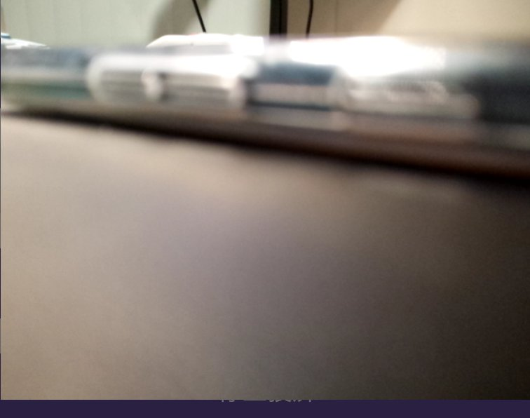
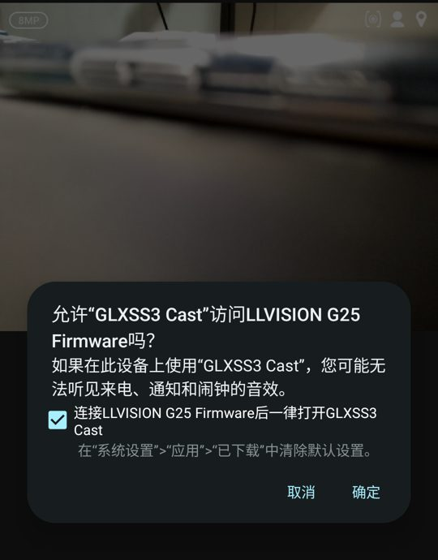
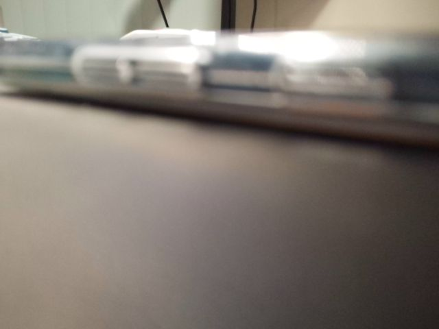
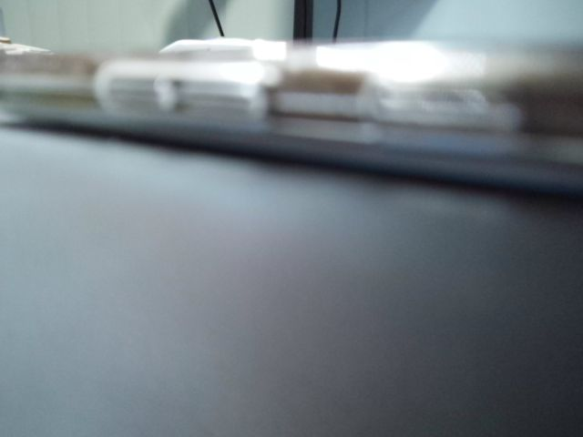
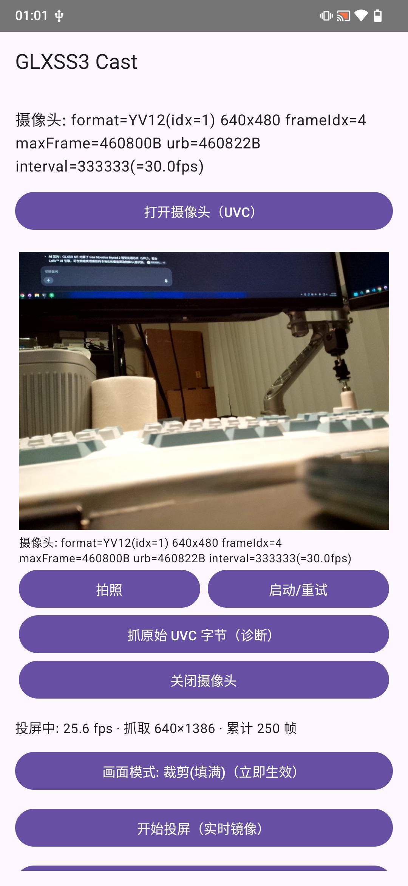

# 第 2 章 · 摄像头（UVC）

> 本章讲清楚：怎么**不依赖任何 native 库**，用纯 Kotlin 把眼镜摄像头跑起来。
> 关键结论：它是**标准 UVC 1.10 + bulk 端点 + 未压缩 YV12**；设备侧一帧就是一个 UVC
> payload（12 B header + 460800 B），但**主机侧单次 URB 最多 16 KiB**（见 §5.3），
> 所以 App 要按 16 KiB 分块读、自己重组帧。
> 之前所有"彩色噪点/花屏"都不是协议问题，而是**固件卡死时在灌无边界垃圾流**。
>
> 对应代码：[`uvc/UvcCamera.kt`](../app/app/src/main/java/com/wzqvip/glxsscast/uvc/UvcCamera.kt)、
> [`uvc/Yuv.kt`](../app/app/src/main/java/com/wzqvip/glxsscast/uvc/Yuv.kt)、
> [`uvc/UvcPreview.kt`](../app/app/src/main/java/com/wzqvip/glxsscast/uvc/UvcPreview.kt)
>
> 原始抓包与排障记录：[uvc-camera-plan.md §4](uvc-camera-plan.md#4-真机抓包与修复2026-11-21已完成)；
> 固件卡死：[device-recovery.md](device-recovery.md)；选型对比：[uvc-camera-plan.md §2](uvc-camera-plan.md#2-四个方案横向对比)

---

## 1. 原理：一个"不标准但很规矩"的 UVC 摄像头

UVC 摄像头通常分两部分：

- **VC（VideoControl，if0）**：能力描述、probe/commit 协商；
- **VS（VideoStreaming，if1）**：真正出图像数据的接口 + 端点。

普通 USB 摄像头多用 **isochronous** 端点（等时传输，保证带宽、允许丢包）；这副眼镜用的是
**bulk IN（`0x81`，512 B）**——不保证带宽，但**不丢数据**，而且带宽可以吃满。

```
手机                                                    眼镜
────                                                    ────
claim if0 (VC) + if1 (VS)
   │
   ├─ GET_CUR(probe, 34B) ─────────────────────────────► 返回当前/默认参数
   ├─ SET_CUR(probe, 34B) ─────────────────────────────► 试参数
   ├─ GET_CUR(probe, 34B) ◄───────────────────────────── 看设备认可了什么
   ├─ SET_CUR(commit, 34B) ────────────────────────────► 正式生效
   │
   └─ bulkTransfer(0x81, 16384B) × N ◄────────────────── 16 KiB 一块，
                                                          自己按 12+460800 组帧
```

### 1.1 设备事实（实测，别再猜）

| 项 | 值 |
|---|---|
| 接口 | if0 `0x0e/0x01`（VC，无端点）；if1 `0x0e/0x02`（VS） |
| VS 端点 | `0x81` BULK IN，`wMaxPacketSize=512` |
| **alt setting** | **本设备 VS 只有一个 alt（alt=0）就带 `0x81`**，不需要切 alt=1 |
| UVC 版本 | `bcdUVC = 0x0110`（1.10）→ probe 结构 34 B（UVC 1.0 是 26 B） |
| 格式 | `bFormatIndex=1` → **YV12 未压缩**（`idx2` 是 MJPEG） |
| 帧档位 | 1920×1080、1280×720、640×480；实测选中 `bFrameIndex=4` → 640×480@30 |
| 实际帧率 | **29.7–30.4 fps**（2026-11-22 Pixel 10 Pro Fold 实测；描述符上限 30） |
| 一帧 | `460800 = 640×480×1.5`，**无 stride padding** |
| 一帧总长 | `460812 = 460800 + 12`（12 B UVC payload header，整帧只有这 1 个 header） |
| 原厂 transfer | `460822 = frameSize + 22`（libusb `frameBufferSize` 日志；libusb 内部拆 16 KiB URB） |
| Android 单 URB | **16384 B 上限**：`bulkTransfer(…, 460822, …)` 直接返回 -1（见 §5.3） |

> ⚠️ 早期文档按"常见摄像头"假设了 `alt=1`、`2 B header`、`iso 端点`，全部被真机抓包推翻。
> 本文以抓包为准：[uvc-camera-plan.md §4](uvc-camera-plan.md#4-真机抓包与修复2026-11-21已完成)。

### 1.2 为什么是 YV12 而不是 MJPEG

厂商日志里有 `frameSize=(640,480)@YV12`、`frameBufferSize=460822`，而且：

- `460822 = 640×480×1.5 + 22`，只有未压缩 YUV420 才符合这个量级；YUY2 应是 614400，MJPEG 完全不该是 1.5×w×h；
- 把同一帧按 `Y|V|U`（YV12）和 `Y|U|V`（I420）各解一张，`Y|V|U` 的暖色木纹与白色纸盒与原厂预览一致，
  `Y|U|V` 整幅偏冷偏蓝（见 §7 实拍）；
- probe 回填 `bFormatIndex=1`，与 VS 描述符里的 YV12 对应。

所以：**主线按 YV12 做，MJPEG 只当备选分支**。代码运行时解析描述符，不写死。

---

## 2. 描述符与参数结构

### 2.1 接口/端点

| 接口 | Class/Subclass | 端点 | 说明 |
|---|---|---|---|
| if0 | `0x0e/0x01` | — | VideoControl；probe/commit 走这里（`wIndex` = VS 接口号 1） |
| if1 | `0x0e/0x02` | `0x81` BULK IN 512 | VideoStreaming；alt=0 即带端点 |

> `wIndex` 注意：控制请求本身是 **class interface 请求**，`wIndex` 填的是 **VS 接口号（1）**，
> 不是 VC 的 0。填错会返回 `-1`。

### 2.2 probe/commit 请求表

| 用途 | bmRequestType | bRequest | wValue | wIndex | wLength |
|---|---|---|---|---|---|
| GET_CUR probe | `0xA1` | `0x81` | `0x0100` | 1 | 26 / 34 |
| GET_MIN probe | `0xA1` | `0x82` | `0x0100` | 1 | 34 |
| GET_MAX probe | `0xA1` | `0x83` | `0x0100` | 1 | 34 |
| GET_DEF probe | `0xA1` | `0x87` | `0x0100` | 1 | 34 |
| **SET_CUR probe** | `0x21` | `0x01` | `0x0100` | 1 | **34** |
| GET_CUR commit | `0xA1` | `0x81` | `0x0200` | 1 | 34 |
| **SET_CUR commit** | `0x21` | `0x01` | `0x0200` | 1 | **34** |

### 2.3 34 B probe 结构

| 偏移 | 长度 | 字段 | 实测/建议值 |
|---|---|---|---|
| 0–1 | 2 | `bmHint` | `0x0001`（bit0 = `dwFrameInterval` 有效） |
| 2 | 1 | `bFormatIndex` | 1（YV12） |
| 3 | 1 | `bFrameIndex` | 4（640×480@30） |
| 4–7 | 4 | `dwFrameInterval` | `333333`（100 ns 单位 → 30 fps） |
| 8–9 | 2 | `wKeyFrameRate` | 0 |
| 10–11 | 2 | `wPFrameRate` | 0 |
| 12–13 | 2 | `wCompQuality` | 0 |
| 14–15 | 2 | `wCompWindowSize` | 0 |
| 16–17 | 2 | `wDelay` | 0 |
| 18–21 | 4 | `dwMaxVideoFrameSize` | `460800`（本档净荷） |
| 22–25 | 4 | `dwMaxPayloadTransferSize` | `16384`（原厂值） |
| 26–29 | 4 | `dwClockFrequency` | 0（UVC 1.0 结构到此为止，共 26 B） |
| 30 | 1 | `bmFramingInfo` | 0 |
| 31–33 | 3 | `bPreferedVersion/bMinVersion/bMaxVersion` | 0 |

实测 GET_CUR 回填（34 B，节选）：

```
01 00 | 01 | 04 | 15 16 05 00 | ... | 00 08 07 00 | 00 40 00 00
bmHint fmt  frm   333333              460800        16384
```

> `GET_MAX` 会回 `dwMaxVideoFrameSize=0x012c7f80 (19,693,440)`、`maxPayload=0x012c7f8c`
> ——这是设备/格式的**全局上限**，不是当前档位，**不能拿来当 URB 尺寸**。
> 但原厂 SET_CUR 里的字节**就是**这个全局上限（见 §2.4），所以 probe 基底必须以
> `GET_MAX` 回读为准；URB 仍按"当前档位净荷"算。

### 2.4 原厂完整启动序列（Frida 逐字节抓包，2026-11-22）

来源：`re/liangliang/uvc40.txt` 94–131 行 / `vendor_uvc_full.log` 93–130 行
（hook 原厂 `:llvision_G25` 的 `libusb_control_transfer` / `libusb_submit_transfer`）。
`type=0x-5f` 是 0xA1 的有符号打印。

```
t      请求                                                  说明
────── ──────────────────────────────────────────────────── ─────────────────────────
 1  0xA1/0x05 wValue=0x0001 wIndex=3 wLen=1 → 00            读显示模式
 2  0xA1/0x04 wValue=0x0000 wIndex=3 wLen=8 → 8002900101d50a00   读 LCD 状态
 3  0xA1/0x05 wValue=0x0001 wIndex=3 wLen=1 → 00            再读一次
 4  0x21/0x01 wValue=0x0d0d wIndex=0x0400 wLen=1 data=01    XU entity 4：相机开关
 5  0xA1/0x81 wValue=0x0100 wIndex=1 wLen=34                 GET_CUR（frame=4）
 6  0xA1/0x82 wValue=0x0100 wIndex=1 wLen=34                 GET_MIN（frame=1）
 7  0xA1/0x83 wValue=0x0100 wIndex=1 wLen=34                 GET_MAX（全局上限）
 8  0xA1/0x81 + 0x82 + 0x83 再一轮                             （原厂来回读两轮）
 9  0x21/0x01 wValue=0x0100 wIndex=1 wLen=34 frame=3          SET_CUR probe（热身档）
10  0xA1/0x81 ×2 + 0x82 + 0x83 ×2 轮                          读回/再看上限
11  0x21/0x01 wValue=0x0100 wIndex=1 wLen=34 frame=4          SET_CUR probe（目标档）
12  0xA1/0x81 ×2 + 0x82 + 0x83 ×2 轮
13  0x21/0x01 wValue=0x0100 wIndex=1 wLen=34 frame=4          SET_CUR probe（再发一次）
14  0xA1/0x81 wValue=0x0100 wIndex=1 wLen=34                  最后一次读回
15  0x21/0x01 wValue=0x0200 wIndex=1 wLen=34                  SET_CUR commit（34 B）
16  0x21/0x01 wValue=0x0606 wIndex=0x0400 wLen=1 data=00      XU：连发两次
17  0xA1/0x04 wValue=0 wIndex=3 wLen=8                        收流前再读一次状态
```

原厂 SET_CUR / commit 的 34 字节（`0x012c7f80 = 19,693,440`）：

```
01 00 | 01 | 04 | 15 16 05 00 | 01 00 00 00 00 00 00 00 | 80 7f 2c 01 | 8c 7f 2c 01 | 00 00 00 00 | 00 00 00 00
bmHint fmt  frm   333333        wKeyFrameRate…wDelay       maxFrameSize   maxPayload      clock          ver
```

> 第 9 步的 `frame=3` 在抓包里只用来"热身"：设备回读仍是 3，随后才 SET 到 4。
> 本实现照抄（若 UI 选的就是 frame=3，则跳过热身）。

**我们的实现**（`UvcCamera.select()` / `probeAndCommit()` / `vendorPreProbe()` /
`vendorPostCommit()`，2026-11-22 起）：

- claim 顺序保持 **VC(if0) → HID(if2) → VS(if1)**（与原厂一致，HID 已由 `UsbLink` claim）；
- `vendorPreProbe()`：步骤 1–4（显示模式/状态读走 `LcdControl.setDisplayMode/readStatus`，
  XU 走 `LcdControl.vendorXuSwitch`）；
- `probeAndCommit()`：步骤 5–15。probe 基底取 `GET_CUR`，`18..25` 用 `GET_MAX` 覆盖，
  先 SET frame=3 再 SET frame=4（目标档连发两次），commit 内容 = 最后一次 `GET_CUR` 回读；
- `vendorPostCommit()`：步骤 16（`LcdControl.vendorXuStreamStart()` 连发两次 `0x0606`）；
- 收流：16 KiB 分块 `bulkTransfer` + 自己组帧（§5.3 / §6）。

> **0x0d0d / 0x0606 是否必需？** 本轮实测：设备在 probe/commit **之前**就已经在
> 吐 `0c 0f …` 数据（见 §6 的 `bulkProbe` 日志），所以这两条 XU 不是出流的唯一开关。
> 之所以照做，是为了和原厂逐字节一致、排除"相机侧开关"这个变量。
> 真正阻塞出流的是 **URB 尺寸**（§5.3）。

---

## 3. UVC payload header（12 B）

每个 bulk transfer 的开头是标准 UVC 1.1 payload header：

```
0c 0f | b4 02 00 00 | b4 02 00 00 b4 02 | <460800 B YV12>
│  │    │             └ SCR（6 B，bmHeaderInfo bit3 置位时存在）
│  │    └ PTS（4 B LE，bmHeaderInfo bit2 置位时存在）
│  └ bmHeaderInfo
└ bHeaderLength = 12（2 + PTS 4 + SCR 6）
```

| 字段 | 值 | 含义 |
|---|---|---|
| `bHeaderLength` | 12 | 本 header 的字节数，合法范围 2–12 |
| `bmHeaderInfo` bit0 `FID` | 0/1 | 帧内包序号翻转；本设备每帧翻一次 |
| `bmHeaderInfo` bit1 `EOF` | 1 | **一帧结束**（本设备每帧都置位） |
| `bmHeaderInfo` bit2 `PTS` | 1 | 后面有 4 B 时间戳 |
| `bmHeaderInfo` bit3 `SCR` | 1 | 后面有 6 B 源时钟 |
| `bmHeaderInfo` bit6 `ERR` | 0 | 置位表示本帧作废 |
| PTS | `0x000002b4 = 692` | 设备时钟；下一帧 693 |
| SCR | `b4 02 00 00 b4 02` | 6 B 源时钟参考 |

抓包实录：

```
XCB#1 ep=0x81 actual=460812  head=0c 0f b4 02 00 00 b4 02 00 00 b4 02 9f a1 a4 a5 ...
XCB#2 ep=0x81 actual=460812  head=0c 0e b5 02 00 00 b5 02 00 00 b5 02 a2 a3 a3 a5 ...
                                     ↑ FID 翻转（0x0F → 0x0E），PTS 692 → 693
```

> **最容易踩的坑**：以为 header 只有 2 B（`bHeaderLength` + `bmHeaderInfo`），
> 从 byte[2] 开始取像素。实际有 12 B，错 10 个字节 → 整帧斜向错位、颜色像彩虹噪点。
> 判据很简单：`buf[0] == 0x0C` 且 `buf[1] & 0x02 != 0`。

---

## 4. YV12 布局

```
偏移 0                    307200              384000            460800
     ┌───────────────────┬──────────────────┬──────────────────┐
     │ Y  平面 640×480    │ V 平面 320×240    │ U 平面 320×240    │
     │ 1 B / 像素         │ 1 B / 2×2 像素    │ 1 B / 2×2 像素    │
     └───────────────────┴──────────────────┴──────────────────┘
      = Y | V | U（YV12）        ← 不是 I420（I420 是 Y | U | V）
```

| 平面 | 偏移 | 长度 | 采样 |
|---|---|---|---|
| Y | 0 | `640×480 = 307,200` | 每像素 1 B |
| V (Cr) | 307,200 | `320×240 = 76,800` | 2×2 共享 |
| U (Cb) | 384,000 | `320×240 = 76,800` | 2×2 共享 |
| 合计 | — | **460,800** | 无 padding、无 stride |

转换公式（BT.601 limited range，整数运算，见
[`Yuv.yuv420ToArgb()`](../app/app/src/main/java/com/wzqvip/glxsscast/uvc/Yuv.kt#L23-L47)）：

```kotlin
val y = (buf[yBase + i].toInt() and 0xff) - 16
val u = (buf[uOff + cBase + (i / 2)].toInt() and 0xff) - 128
val v = (buf[vOff + cBase + (i / 2)].toInt() and 0xff) - 128
val c = if (y < 0) 0 else y
val r = (298 * c + 409 * v + 128) shr 8
val g = (298 * c - 100 * u - 208 * v + 128) shr 8
val b = (298 * c + 516 * u + 128) shr 8
```

`uOff` / `vOff` 由格式决定：

```kotlin
// UvcCamera.yv12ToBitmap()
val ySize = w * h
val cSize = ySize / 4
val vOff = if (uFirst) ySize + cSize else ySize   // YV12: V 在前；I420: U 在前
val uOff = if (uFirst) ySize else ySize + cSize
Yuv.yuv420ToArgb(argb, src, uOff, vOff, w, h)
```

---

## 5. 驱动步骤（与代码一一对应）

```
1. 找设备 2E09:0030，拿 USB 权限
2. openDevice（可复用 UsbLink 的连接；单 fd 与原厂一致）
3. claim if0 (VC)
4. claim if2 (HID)            ← 共用一个 fd 时 UsbLink 已 claim，UvcCamera 不重复 claim
5. claim if1 (VS alt=0) + setInterface(alt=0)
6. 解析 rawDescriptors → VS_FORMAT_* / VS_FRAME_*
7. XU 前置：0xA1/0x05 显示模式、0xA1/0x04 状态、0x21/0x01 0x0d0d=01（§2.4 步骤 1–4）
8. probe/commit：GET_CUR/MIN/MAX 两轮 → SET frame=3 → SET frame=4 ×2 → commit（§2.4 5–15）
9. XU 后置：0x21/0x01 0x0606=00 ×2（§2.4 步骤 16）
10. CLEAR_FEATURE(HALT, 0x81)
11. 分配 transferBuf=16384、rxBuf=frameSize+12+16384
12. 线程循环 bulkTransfer(0x81, 16384) → 字节流组帧（§6）
13. 停止：setInterface(alt0) → CLEAR_FEATURE(HALT) → releaseInterface(VS)，共享连接不 close
```

### 5.1 选接口与端点

```kotlin
// uvc/UvcCamera.kt —— 找 VS 里带 bulk IN 的 alt setting
for (i in 0 until dev.interfaceCount) {
    val itf = dev.getInterface(i)
    if (itf.interfaceClass != 0x0e || itf.interfaceSubclass != 0x02) continue
    if (itf.alternateSetting == 0 && (zeroAlt == null || zeroAlt!!.id == itf.id)) {
        zeroAlt = itf
    }
    for (e in 0 until itf.endpointCount) {
        val ep = itf.getEndpoint(e)
        if (ep.type == UsbConstants.USB_ENDPOINT_XFER_BULK &&
            ep.direction == UsbConstants.USB_DIR_IN
        ) { foundAlt = itf; foundEp = ep }
    }
    if (foundAlt != null) break
}
```

> 本设备 `foundAlt.alternateSetting == 0`，所以代码不强行 `alt=1`；
> 有些机型要求"先 claim alt0 再切 alt1"，所以 `setInterface` 失败时只记日志、继续跑。

### 5.2 probe/commit（仓库真实代码，节选）

```kotlin
// uvc/UvcCamera.kt :: probeAndCommit()
val base = ByteArray(34)
var len = ioIn("GET_CUR(probe)", UVC_GET_CUR, VS_PROBE, 34, base)   // 基底
if (len <= 0) len = ioIn("GET_DEF(probe)", UVC_GET_DEF, VS_PROBE, 34, base)
...
// 原厂在 probe 前把 GET_CUR/MIN/MAX 来回读两轮；18..25 以 GET_MAX 为准
repeat(2) {
    ioIn("GET_CUR", ...); val nMin = ioIn("GET_MIN", ...); val nMax = ioIn("GET_MAX", ...)
    if (nMax >= 26) { baseMaxFrame = u32(maxb, 18); baseMaxPayload = u32(maxb, 22) }
}
putU32(base, 18, baseMaxFrame)      // 19,693,440（原厂 SET_CUR 里的字节）
putU32(base, 22, baseMaxPayload)    // 19,693,452

fun buildProbe(frameIndex: Int) = base.copyOf().apply {
    this[0] = 1; this[1] = 0
    this[2] = f.index.toByte()
    this[3] = frameIndex.toByte()
    putU32(this, 4, fr.defaultInterval)
}

setProbe("warm#3", 3)               // 热身档（抓包 105–118 行）
readRound("warm"); readRound("warm+")
setProbe("target#${fr.index}", fr.index)   // 目标档（119–125 行）
readRound("target"); readRound("target+")
setProbe("target#${fr.index}#final", fr.index)  // 再发一次（126 行）
val back = ByteArray(34)
val n = ioIn("GET_CUR(probe,back)", UVC_GET_CUR, VS_PROBE, 34, back)
ioOut("SET_CUR(commit)", VS_COMMIT, if (n >= 26) back else buildProbe(fr.index), 34)
```

> 最强诊断行是 **`probe result:`**——它告诉你设备最终认可了哪个 format/frame/maxFrame。
> 例：`probe result: bFormatIndex=1 bFrameIndex=4 maxVideoFrame=19693440 maxPayload=19693452`
> 与原厂 SET_CUR 的字节完全一致。
> 失败时按这个顺序降级：34 B → 26 B → `bmHint=0` → 改 `dwMaxPayloadTransferSize`。

### 5.3 收流：单 URB 上限 16 KiB（本轮真正的坑）

**现象**：probe/commit 全部成功（`rc=34`），但读线程里 `bulkTransfer` 立刻返回 -1：

```
15:45:02.313 UvcCamera: bulkProbe len=460822 n=-1 dt=130ms
15:45:02.314 UvcCamera: bulkProbe len=512    n=512 dt=1ms 0c0fd9750000d9750000d975   ← UVC header!
15:45:02.315 UvcCamera: bulkProbe len=16384  n=16384 dt=0ms acacaeadacacaeadacacacaa
15:45:02.316 UvcCamera: bulkProbe len=460822 n=-1 dt=1ms
```

- 512 / 16384 都能拿到数据（而且首字节就是 `0c 0f`，说明设备一直在出流）；
- 只有 **460822** 失败，且 `dt≈0` ——这不是"设备没数据"，是 URB 提交被拒。

**原因**：Android usbfs 单次 URB 最多 **16384 B**（与 libusb 的
`MAX_BULK_BUFFER_LENGTH` 一致）。原厂 libusb 能写 `transferBufferSize=460822`，
是因为 **libusb 内部把它拆成 ~29 个 16 KiB URB 再重组**，对 App 隐藏了拆分。
`UsbDeviceConnection.bulkTransfer` 不拆，直接把 460822 交给内核 → `-EINVAL/-1`。

**修法**：读线程改成每次 `bulkTransfer(ep, 16384)`，用 1 帧 + 1 chunk 的
`rxBuf` 做字节流组帧（§6）。改完后 Pixel 上稳定 **29.7–30.4 fps**。

> 该上限与 "URB 尺寸 = frameSize+22" 不矛盾：460822 是**协议层面的逻辑帧长**，
> 16 KiB 是**主机侧单次 USB 请求**的限制。两者一个用于组帧，一个用于读。

---

## 6. 帧同步算法（16 KiB 分块 + 字节流组帧）

设备侧行为（本轮实测 + 原厂抓包一致）：

- 一帧 = **12 B header + 460800 B 净荷**，**整帧只有 1 个 header**，
  `bmHeaderInfo` 的 bit1(EOF)=1（样本 `0c 0f d9 75 00 00 d9 75 00 00 d9 75`）；
- header 之后是连续净荷，后续 16 KiB 块里没有 header（首字节直接是亮度值）；
- 帧与帧首尾相接，没有 gap。

[`readLoop()`](../app/app/src/main/java/com/wzqvip/glxsscast/uvc/UvcCamera.kt) 的逻辑：

```
循环:
  n = bulkTransfer(ep, chunkBuf, 16384, timeout=1000)
  if n < 0:
      若耗时很短（< 500 ms）→ fastFails++；连续 5 次 → 报错退出（设备拔了/接口被抢）
      否则是"设备在线但没数据" → 限流日志，继续
      continue

  把 chunk 追加到 rxBuf（1 帧 + 1 chunk 的环形/线性缓冲）
  解析 rxBuf:
      未同步:
          逐字节找 header（0x0C + EOF=1 + ERR=0 + SCR/PTS 自洽）
          找到前的半帧全部丢弃（流可能从帧中间开始）
      已同步:
          若已收满 hdrLen + frameSize → 整块拷进 frameBuf → deliver()
          否则等下一块
          交帧后校验下一帧起点仍是合法 header，不是就重新同步
  把已消费字节移出 rxBuf
```

三条设计原则：

1. **只认合法 header**，且用 header 自身的冗余位做校验：
   `bHeaderLength ∈ 2..12`、EOF=1、ERR=0、带 SCR 时 `SCR[0..1] == PTS[0..1]`。
   误判概率 ~1e-10，远低于"扫 0x0C"（后者在 460 KB 里平均会误判十几次）。
2. **未同步时丢弃**。打开摄像头时设备早就在发，第一块从帧中间开始是常态；
   不丢就会整帧永久错位 → 彩色噪点/斜移。
3. **同步后按长度切帧，不依赖 EOF 位置**。本设备 EOF 打在帧首的 header 上，
   按 `hdrLen + frameSize` 切才稳；下一帧 header 校验用来发现漏字节。

> 连续丢弃 > 4 MB 仍没同步 → 回调一次 `onError`（"固件媒体流水线可能已卡死"），
> 而不是无限刷日志。真正的"垃圾流"（`n == 缓冲区大小`、首字节是亮度值）会命中这条。

---

## 7. 实测数据（2026-11-22，Pixel 10 Pro Fold / 2E09:0030）

| 项 | 值 |
|---|---|
| 协商结果 | `format=YV12(idx=1) 640x480 frameIdx=4 maxFrame=460800B interval=333333(=30.0fps)` |
| probe 回读 | `bFormatIndex=1 bFrameIndex=4 maxVideoFrame=19693440 maxPayload=19693452`（= 原厂 SET_CUR 字节） |
| 缓冲 | `frameSize=460800 chunk=16384 rxBuf≈477 KB urbSize=460822（仅日志）` |
| 单次 bulk | `n = 16384`（分块上限），一帧由 ~29 块组成 |
| 帧率（App 广播 `uvc_start`） | **29.7–30.4 fps**，首秒 17.8（组帧/同步） |
| 帧率（UI「打开摄像头 → 枚举/启动」） | **29.8–30.4 fps**；停止再启动同样 30 fps |
| 解码 | YV12→ARGB 纯 Kotlin；Bitmap A/B 双缓冲，每帧零分配 |
| 整机 CPU | 约 53%（30 fps 解码 + Compose 预览同跑） |
| 截图 | `/sdcard/Android/data/com.wzqvip.glxsscast/files/Pictures/uvc/*.png`（UI「拍照」/广播 `uvc_snapshot`） |

本次真机日志（节选）：

```
15:53:20.660 UvcCamera: SET_CUR(commit) frame=4 len=34 -> 34
15:53:20.662 UvcCamera: vendor post-commit: xu(0x0606) x2 -> true
15:53:20.663 UvcCamera: negotiated: format=YV12(idx=1) 640x480 frameIdx=4 maxFrame=460800B urb=460822B interval=333333(=30.0fps)
15:53:21.678 UvcCamera: fps=17.7 (YV12 640x480)
15:53:22.704 UvcCamera: fps=30.2 (YV12 640x480)
15:53:23.732 UvcCamera: fps=30.1 (YV12 640x480)
```

逐块实测（`bulkProbe`，见 §5.3）：

```
len=512    n=512    dt=1ms   head=0c0fd9750000d9750000d975   ← 合法 12 B header
len=16384  n=16384  dt=0ms                                  ← 帧内净荷
len=460822 n=-1     dt=1ms                                  ← 超过单 URB 上限
```

实拍对比（同一时刻）：

| 我们 App（修复后） | 原厂 App |
|---|---|
|  |  |

同一帧按两种 U/V 顺序解码——只有左边与原厂画面一致：

| YV12（Y\|V\|U，正确） | I420（Y\|U\|V，整体偏冷） |
|---|---|
|  |  |

2026-11-21 恢复后 UVC 25 fps + 投屏并发（历史截图；2026-11-22 分块组帧后为 30 fps）：



---

## 8. 坑与注意事项

1. **header 是 12 B 不是 2 B**。按 2 B 取像素 = 整帧斜移 10 B，看起来像"彩虹噪点"。
2. **单次 `bulkTransfer` 必须 ≤ 16384 B**（usbfs 单 URB 上限）。超过不会超时，
   而是**立刻 -1**（`dt≈0`），很容易误判成"设备没出流 / 接口被抢"。
   原厂 libusb 的 `transferBufferSize=460822` 是 libusb 内部拆 URB，不能直接照抄到
   Android 的 `bulkTransfer`。这是本轮"probe/commit 都成功但 0 帧"的真正原因。
3. **一帧只有一个 header**：`0C 0F|0E` 在帧首，后面 460800 B 净荷里没有 header。
   必须按 `hdrLen + frameSize` 切帧；指望"每块都以 0C 开头"会永远组不出帧。
4. **不要在未同步时追加数据**。流从帧中间开始时，追加 = 永久错位。
   同步时用 header 的 `SCR[0..1]==PTS[0..1]` 做校验，别只扫 `0x0C`。
5. **U/V 顺序**：YV12 是 `Y|V|U`；I420 是 `Y|U|V`。偏色先换这个，不要先怀疑白平衡。
6. **alt setting 别照抄教程**：本设备 alt=0 就带端点；强行 `setInterface(alt=1)` 可能直接失败。
7. **claim 顺序**：VC(if0) → **HID(if2)** → VS(if1)（HID 不 claim 时读版本会 -1，
   部分固件也不出流，见 [ch-hid.md](ch-hid.md)）。
8. **`setInterface` 返回 false 不等于没生效**：日志记录后继续跑，真没数据再排查。
9. **Android 的 `bulkTransfer` 用 -1 表示"超时"和"设备错误"两种事**：用耗时区分，
   否则拔线后会变成 100% CPU 热循环（实测 3 秒 1500 万次日志）。区分出的
   `dt≈0` 还要再分两种：尺寸超限（本文）和端点/接口被抢。
10. **不要同时开两个 App 抢 UVC**：原厂 App 和我们 App 同时 claim 会互相踢掉 alt，表现为 0 帧。
11. **固件半死时 UVC 一定 0 帧**，而控制面/状态查询都正常。别改代码，先按
    [ch-firmware.md §7](ch-firmware.md#7-半死现象与恢复-sop) 重灌。
12. **1080p 档位**：净荷 3,110,400 B；20 fps 就是 62 MB/s，已经超过 USB 2.0 HS 的实际上限，
    还要和投屏抢带宽。当前代码支持改 `TARGET_W/H`，但没有实测，标【未】。
13. **MJPEG 档不是"同样长度的帧"**：JPEG 压缩后帧长可变，本文的"12+frameSize 定长切帧"
    不适用（`bFrameIndex` 也只暴露 3264×2448 / 4128×3104 两档，均未实测）。
14. **厂商宣称的 800 万像素拍照 / 720p 录像不是这条 UVC 流**（见 [apk-versions.md §6](apk-versions.md#6-代码功能差异184--237)），
    很可能走另一条 vendor 通道，未逆向。

---

## 9. 待验证

- [ ] 1920×1080 / 1280×720 档位的实际帧率（当前只跑 640×480；1280×720 可试）。
- [ ] MJPEG（`bFormatIndex=2`）是否真的可用，以及它的 `dwMaxVideoFrameSize`；
      JPEG 变长帧需要另一种边界判定（按 JPEG SOI/EOI 扫描）。
- [ ] `bmFramingInfo` / FID 在长帧时是否需要参与组帧（本设备每帧 1 个 header，暂不需要）。
- [ ] 原厂 XU `0x21/0x01 wValue=0x0d0d` 与 `0x0606` 的真实作用：本轮已照抄发送；
     对照实验（发/不发）只影响"是否逐字节一致"，不影响出帧。
- [ ] 相机自动对焦 / 曝光控制（2.3.7 有 `nativeGetmAutoFocus`，UVC PU 控制未试）。
- [ ] 8 MP 静像与 720p 录像的数据通道。
- [ ] 30 fps 下整机 CPU ~53%（解码 + Compose 预览），可考虑把 YUV→ARGB 换 `RenderScript`
      替代 / native / 直接在 `ImageReader` 上做，当前未优化。
