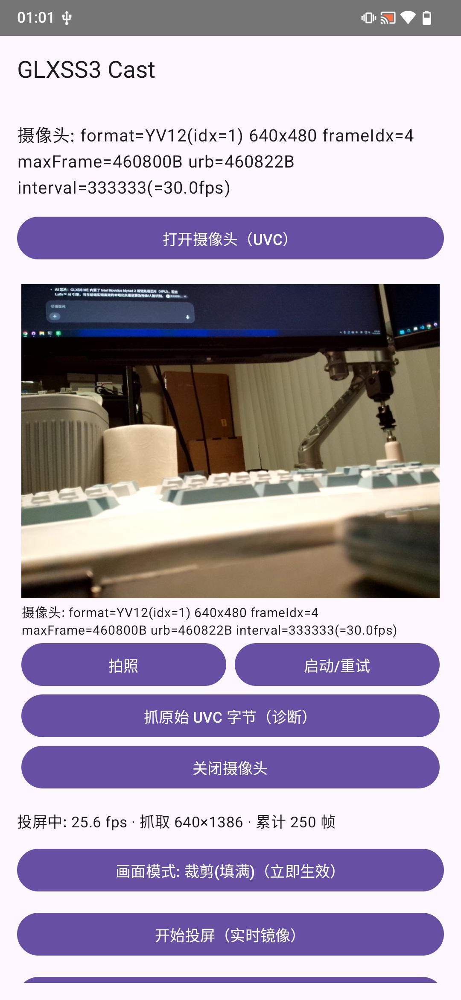

# 眼镜"画面全无"——诊断、固件行为与恢复 SOP

> 场景：GLXSS G25 插在 LG G8（`192.168.3.88:37003`，root）上，枚举正常（`2e09:0030`），
> 但 **UVC 不出图、LCD 测试色条/投屏也不出图**。
> 本文记录 2026-11-21 的完整诊断过程、固件侧证据、代码修复与可复现的恢复流程。
>
> 标注沿用其它文档：**【验】= 本机实测/二进制证据**；**【推】= 由结构推断**；**【未】= 未确定**。

---

## 0. 一句话结论

**根因是眼镜固件（Myriad 2 / RTEMS 侧）的"媒体流水线"停摆，不是 USB、不是协议、也不是我们 App 漏了什么初始化命令。**

| 层 | 卡死时状态 | 证据 |
|---|---|---|
| USB 枚举 | 正常 `2e09:0030`，7 接口全在 | `lsusb`、`dumpsys usb` |
| LCD 控制面 | **完全正常**：`0xA1/0x04` 返回 8B、`0x05`/`0x03`/`0x01` 全部 ACK、bulk OUT 1 MB 帧 30 ms 收完 | Frida 直连实测（§2.2） |
| UVC 控制面 | 正常：GET_CUR/SET_CUR probe+commit 全部成功 | 我们 App 与原厂 App 的 logcat |
| UVC 数据面 | **0 帧**：3 个 460822B URB 全部 `status=2 (TIMED_OUT)` | 原厂 App + 我们 App 同时如此（§2.3） |
| 面板显示 | 固件仍报 `bopen=1`（屏"开"），但画面不刷新 | `0x04` 状态字节 |

**唯一有效恢复 = 让固件完整重启一次**：拔插 → 设备以 `03E7:2150` 出现 → 主机灌 `G25_MainFW_1.9.1.img` → 重枚举回 `2E09:0030`。
实测重灌后 UVC 25 fps、原厂 App 预览出图、投屏/色条都正常（§6）。

> ⚠️ 注意：**固件卡死 ≠ 设备坏了**。卡死态的 USB 一切正常，所以"控制请求有返回"不能证明固件是健康的；
> 反过来"UVC 没帧"也不一定是我们的代码问题——先用 §1 的判定表分清三态。

---

## 1. 三态判定表（30 秒分清）

先看 `lsusb`，再在 App 里点「读取状态」：

| # | 现象 | 判定 | 处理 |
|---|---|---|---|
| A | `lsusb` 里没有 `2e09:0030` | 设备掉线/没枚举 | 等重枚举；若是 `03e7:2150` 见 §6 |
| B | 有 `2e09:0030`；「读取状态」返回 8 字节且 `屏=开`；但 UVC 一直 `bulk in timeout`、色条/投屏也不出图 | **固件媒体流水线卡死** | §6 恢复 |
| C | 有 `2e09:0030`；UVC 能收到数据，但 `n == urbSize`、首字节不是 `0x0C` | 固件在灌无边界垃圾流（同属卡死，较轻） | §6 恢复 |
| D | UVC 正常（`n=460812`、首字节 `0x0C`、20–25 fps） | 健康 | — |

补充：B/C 两种状态下，**原厂 App 同样收不到帧**（§2.3），可以据此排除"我们代码的锅"。

---

## 2. 实测证据（2026-11-21）

### 2.1 时间线

```
00:28  设备经历一次 03E7 → 2E09 重载（拔插+刷机），之后 UVC 仍然 0 帧
00:38  我 App 的 UVC 循环：每 1 s 一次 460822B bulk IN 超时（ret=-1）
00:40  原厂 :llvision_G25 同样：3 个 URB status=2 TIMED_OUT（libuvc "retrying transfer, status = 2"）
00:44  我用 App 内置 MyriadBootLoader 灌 1.9.1（03E7 → 2E09，耗时 ~1.5 s）
00:45  原厂 App 预览出图（手机截图可见实景）
00:46  我们 App UVC fps=20.0 → 稳定；发测试色条 1,024,016B 全部写完
00:49  我们 App UVC fps=25.0
00:55  同时跑投屏（25 fps）+ UVC（24.6 fps）互不干扰
```

### 2.2 卡死态下 USB 仍然"健康"【验】

用 Frida 在我们 App 进程里直接打 USB（`re/liangliang/probe_lcd.js`，见附录 A）：

```
== GET_STATUS ret=8 80 02 90 01 01 b4 0a 00      ← 640x400, bopen=1, 亮度=180
== SET_MODE(2) ret=1
== SET_BRIGHTNESS(180) ret=1
== SEND_FRAME(bars) ret=1024016 dt=30ms          ← 1MB 全收，≈35 MB/s
== GET_STATUS after frame ret=8
```
同时 `SET_CUR(probe/commit)` 全部成功，但读循环 0 帧。

⇒ 卡死只发生在**媒体流水线（camera 采集 / 面板刷新）**，USB 栈、控制请求、LCD bulk OUT 全部照常。

### 2.3 原厂 App 在卡死态也收不到帧【验】

`re/liangliang/vendor_now2.log`（hook 原厂 `libusb100.so`）：

```
CLAIM iface=0/1 ... SET_CUR probe/commit 均成功
SUBMIT#1 ep=0x81 len=460822
XCB#24 ep=0x81 status=2(TIMED_OUT) actual=0
XCB#25 ep=0x81 status=2(TIMED_OUT) actual=0
XCB#26 ep=0x81 status=2(TIMED_OUT) actual=0
```
logcat 里 `libuvc/stream: retrying transfer, status = 2` 刷屏。

⇒ **不是我们 App 的问题**：同一台机器、同一时刻，原厂那套 proven 的 libuvc 也拿不到数据。

### 2.4 dmesg 里的 `input irq status -75` 是正常现象，别误判【验】

每次枚举后 `hid-generic` 会打 4–6 条 `input irq status -75`（EOVERFLOW），健康状态（重灌后立刻开流）**同样有**：

```
[6759.709] hid-generic ... LLVISION G25 Firmware ... hidraw0
[6759.735] usb 1-1: input irq status -75 received   ×5
```
所以它**不是**固件挂掉的证据（`uvc-camera-plan.md §9.4` 当时把它当成证据，这里更正）。
真正和 HID 有关的事实是：**HID 接口没被 claim 时，`0xA1/0x16` / `0xA1/0x17` 会返回 -1**（§5.1）。

---

## 3. 固件侧行为（`fw-1.9.1.dec.bin` strings）【验】

把解密镜像里的可打印串全导出来（`re/liangliang` 有现成脚本，附录 A），和这条链路相关的：

### 3.1 USB 栈 = MCCI，独立于相机/显示任务

```
00121ff0  vsc2.uvc_streamin.fn.mcci.com
00122010  vsc2.uvc_control.fn.mcci.com
00122088  uvc send fail =0x%x
00122060  send fail: 0x%x       00122078  list full
001220ca   STILL_COMMIT---USB_bRequest_Video_GET_CUR
00122118  UVC open              00122128  uvc close
00122030 Could not initialize Leon IPC Rx. Error: %d
```
- UVC 功能是 MCCI 的 USB device 栈实现的，跑在独立的 USB 任务里；
- 它的数据来源是 **LEON IPC**（`send`/`list full`）——即"USB 任务"把请求丢给"相机任务"，相机任务回帧。
- **『list full』= 发往相机任务的队列满了**，这与"USB 正常、相机不干活"的卡死形态完全吻合【推】。

### 3.2 相机 / 显示任务

```
001045c8 ../common/components/LcdGeneric/leon/Lcd.c    001045f8 LCDEnableInterface
00104008 handle lcd message ok                          00104020 lcd_switch:%d
001040b1  Could not stop the camera(%d).
001040d9  Camera configuration failed (%d).
00104101  Camera failed to start (%d).
00104080 camera loops over run@1                         00104098 camera loops over run@2
001041c0 Configuring imx214M10MO camera and datapath
00104210 ../common/components/CamGeneric/arch/ma2x5x/leon/common/src/CamGeneric_ma2x5x.c
001221c0 watch_dog_thread_function
0011e270 perform_power_saving_off                        0011e290 oled_resume
0011e2a0 perform_power_saving_on                         0011e1b0 light_sensor_suspend
```
- 系统是 **RTEMS**（`MoviciusRTEMS.master` 路径、`Unexpected trap` 表、watchdog 线程）；
- 相机是 IMX214 + MIPI/CIF/SIPP（`CamStart`/`SippCamHandler`/`CifCamHandler`）；
- 面板走 `Lcd.c` 的 `LCDEnableInterface` + `lcd_switch`；
- 还有一套 **power saving**（`perform_power_saving_on/off` + `oled_resume` + 光感 suspend）。

### 3.3 有没有"主机能发、我们没发"的复位/上电命令？——没有【验】

把 `liblcd.so` / `libhid.so` 里所有 `libusb_control_transfer` 调用点静态枚举（见 `firmware-extraction.md §3.2`），
再用原厂真机抓包交叉核对，**全部 vendor 请求只有这些**：

| 接口 | 请求 | 用途 |
|---|---|---|
| LCD(3) | `0xA1/0x01`、`0x02`、`0x03`、`0x04`、`0x05`、`0x07` | 亮度/旋转/屏开关/状态/显示模式/读 264B EEPROM |
| HID(2) | `0xA1/0x16`、`0x1A`、`0x04`、`0x05`、`0x06`、`0x17`、`0x19`、`0x18`、`0x10`–`0x15` | 传感器/版本/LED/配置 |
| LCD(3) | `0x21/0x06` | **写 EEPROM（危险，不要发）** |

**没有 reset / reboot / power-on / camera-enable 之类的私有命令。**
UVC 出流的唯一开关就是标准 `SET_CUR(probe)` + `SET_CUR(commit)`，而这个在卡死态是"成功但无数据"。

⇒ 所以**不存在"补一条命令就能救回来"的路径**；固件卡死只能重载。

---

## 4. 原厂 App 的完整初始化序列（健康设备，hook `libusb100.so`）

来自本次**健康固件**下的完整抓包 `re/liangliang/vendor_init.log`（App 冷启动 → 第一帧，t=482…1651 ms）：

| # | t(ms) | 动作 | 参数 | 备注 |
|---|---|---|---|---|
| 1 | 482 | `CLAIM iface=2` | HID | **把内核 hid-generic 摘掉**（之后 `0x16` 才有 28B 返回） |
| 2 | 482 | `0xA1/0x16` | wIndex=2 wLen=28 | HID 传感器报告 `00 71 00…` |
| 3 | 482 | `0xA1/0x06` | wIndex=2 wLen=16 | HID 描述符 |
| 4 | 494 | `CLAIM iface=3` | LCD | |
| 5 | 494 | `0xA1/0x07` | wValue=0x100 wIndex=3 **264B** | 读 EEPROM 产品信息（`LCD.lcdInit()` 成功后自动调） |
| 6 | 514 | `0xA1/0x04` ×2 | wIndex=3 wLen=8 | 状态 `80 02 90 01 01 b4 06 00` |
| 7 | 544 | bulk OUT `ep 0x01` | **1,024,016B** | 一帧 16B 头 + RGBA（黑底，`00 00 00 ff`…） |
| 8 | 588 | `0xA1/0x05` | wValue=**1** wIndex=3 | 显示模式切到 1（logo/待机） |
| 9 | 595 | `CLAIM iface=0` | VideoControl | |
| 10 | 595 | `0x21/0x01` | wValue=**0x0d0d** wIndex=**0x0400** wLen=1 data=`01` | **vendor XU 写**（entity 4）：相机侧一个 1 字节开关；**我们不发也照样出流** |
| 11 | 640 | bulk OUT `ep 0x01` | 1,024,016B | 第二帧（`01 01 01 ff` 近黑）——**原厂也是 LCD+UVC 并发** |
| 12 | 1598 | `CLAIM iface=1` | VideoStreaming | |
| 13 | 1598–1628 | `0xA1/0x81/0x82/0x83` + `0x21/0x01(wValue=0x100)` | wLen=34，wIndex=1 | libuvc 枚举候选格式：format=1，frame 3/4，逐轮 probe |
| 14 | 1631 | `0x21/0x01` | wValue=**0x0200** wLen=34 | **SET_CUR(commit)**，payload 与最后一次 probe 相同 |
| 15 | 1651 | 收流 | 1 URB = 1 帧 `actual=460812` | `0c 0e/0f …` + 460800B YV12，间隔 ~10–40 ms |

probe/commit 的 34B 回填（GET_CUR）：

```
01 00 | 01 | 04 | 15 16 05 00 | ... | 00 08 07 00 | 00 40 00 00
bmHint=1  fmt=1 frm=4  333333(30fps)   460800B       16384
```

> 之后是纯收流 + 每 ~300 ms 一次 `0xA1/0x16` 轮询 HID。
> **没有**"摄像头上电/复位"这类私有流控制；UVC 出流的唯一开关就是 probe + commit。

**我们 App 与原厂的差异（都不影响出流，属于稳健性/一致性）：**
1. 原厂会 claim HID 接口(2) → 我们也补上了（`UsbLink.open`、`UvcCamera.open`）；
2. 原厂会读 264B EEPROM 产品信息（`0xA1/0x07`）→ 我们不需要（只影响版本显示）；
3. 原厂会发一条 XU 写 `0x21/0x01 wValue=0x0d0d wIndex=0x0400 data=01` → 我们不发，实测 25 fps 正常；
4. 原厂送帧前会确保屏已开（`LCDService.c()`：`!bopen` → `setSwitch(true)`）→ 我们补上了（§5.2）。

---

## 5. 代码修复（`glxss3-touying`）

### 5.1 `usb/UsbLink.kt`：claim HID 接口

卡死排查中发现的**真实 bug**：HID 接口被内核 `hid-generic` 占着时，
`0xA1/0x17`（读真实固件版本）和 `0xA1/0x16`（HID 报告）都返回 **-1**。
补上 `claimInterface(hid, force=true)` 后：

```
修复前：读取真实固件版本 → "读固件版本失败"   (0xA1/0x17 ret=-1)
修复后：读取真实固件版本 → "G25_MainFW_1.9.1" (ret=24)
```
（与 `re/liangliang/vendor_now1.log` 里原厂启动就 `CLAIM iface=2` 一致。）

### 5.2 `lcd/LcdControl.kt` + `MainActivity.kt`：开屏必须显式发 `0xA1/0x03`

原厂 `LCDService` 的行为（`jadx-out/.../LCDService.java`）：

```java
private void c() { // 每次开始投屏/显示前
    if (!lcd.getLCDInfo().bopen) lcd.setSwitch(true);   // 0xA1/0x03 → 1
}
private void d() { // 停止投屏
    if (lcd.getLCDInfo().bopen) lcd.setSwitch(false);   // 0xA1/0x03 → 0
}
// 还有一个 30 秒的 "Switch-LCD" 线程：没有在投屏时 setSwitch(false)
```

也就是说：**原厂 App 退出/停止投屏会把屏"关掉"，而 `setDisplayMode(2)` 并不会重新点亮它。**
我们原来的「发送测试色条」只发 `0x05 mode=2`，如果屏 switch 已经被关，帧写进去了但面板不亮 —— 正好是
"发送测试色条后眼镜没反应"的一种可能来源。

修复：
- `LcdControl.setScreenOn(conn, true)`（`0xA1/0x03`）、`setRoll`（`0xA1/0x02`）、`readStatus()`（解析 `LCDInfo`）；
- 「发送测试色条 / 纯色 / 黑屏」在发帧前**先 `setScreenOn(true)` 再 `setDisplayMode(2)`**，
  ACK 情况写进状态栏（`（警告：开屏命令没 ACK）`）；
- 「开屏」按钮改成 `switch=1 + mode=2`，并把状态字节（`屏=开/关`、亮度、roll）显示出来；
- 「读取状态」用 `LCDInfo` 解析：`width,height,bopen,luminance,roll`。

### 5.3 `uvc/UvcCamera.kt`：卡死/掉线不再"静默空转"

| 问题 | 原来 | 现在 |
|---|---|---|
| 设备拔掉后 `bulkTransfer` 立刻返回 -1 | 读循环 100% CPU 热自旋（实测 3 秒内 15,751,200 次 "bulk in timeout" 日志） | 用耗时区分"超时 vs 立即失败"，连续 5 次快速失败 → `onError("USB 传输连续失败…请重新插拔")` 并退出循环；快速失败时 sleep 20 ms；日志 3 秒限流 |
| 固件灌垃圾流（`n==urbSize`、首字节非 `0x0C`） | `onInvalidUrb()` 是死代码，永远不会报错，UI 只显示 "device idle" | 无合法 header 时真正调用 `onInvalidUrb()`；连续 10 次 → `onError`，文案直接给出"拔插 → App 自动重灌"的步骤 |
| `start()` 复用实例 | 计数器不清零 | 每次 start 重置 `invalidStreak/invalidTotal/invalidReported/unSync/frameLen` |

### 5.4 `MainActivity.kt`：权限回调分派

- 授予权限的设备是 `03E7:2150` 时 → 走 `autoFlashBoot()`（原来会误当正常设备去 `open()`）；
- 恢复提示写进界面（拔插 → 自动灌固件 → 重连）。

---

## 6. 恢复 SOP（实测有效）

```text
1) 拔掉眼镜 USB，等 2 秒，再插上
   → 设备以 03E7:2150（"Movidius MA2X5X"）出现
2) App 收到 attach 广播，自动读 /sdcard/Android/data/com.wzqvip.glxsscast/files/G25_MainFW_1.9.1.img
   → 解密尾部 512 KiB（AES-128-ECB, key b5Q8JBFRYYIRawl3）
   → 1490 次 1024B bulk 写到 EP 0x01（约 1.5 秒）
   若没自动灌：点「加载固件（引导模式 03E7:2150）」
3) 设备自行重启并重枚举为 2E09:0030（dmesg: idVendor=2e09, idProduct=0030）
4) App 点「连接眼镜」→「开屏（switch=1 + 显示模式 2）」→ 发色条 / 开摄像头 / 开始投屏
```

**判定成功**：不是"bulk 写完"，而是 `2e09:0030` 重新出现 **且 UVC 能收到 `n=460812`、首字节 `0C`**。

恢复后的真机截图（同一时刻：UVC 25 fps + 投屏 25.6 fps、累计 250 帧）：



固件镜像自检（本机已做，可复现）：

```text
APK 内 assets/G25_MainFW_1.9.1.img  md5 9cea02e400fcf6c126aac12e1fb4765c (1,525,136 B)
设备上同名文件                     md5 同上（就是原厂加密镜像）
用 App 的 prepareImage(AES/ECB/NoPadding 解尾部 0x80000) 解出来
  == re/liangliang/fw_1.9.1.dec.bin  (md5 8e878a410d67187099f82e9a6d9ec275)
  0x101485 处 = 7f 45 4c 46 (ELF)，0x101474 处 = "G25_MainFW_1.9.1\n"
```
⇒ 灌进去的就是原厂 1.9.1，不存在"刷错固件"。

### 6.1 可以自动化到什么程度

- **拔插**：必须人工（眼镜是 USB 供电，拔掉才会掉电重启；切 host/device role 只能软复位数据线，**不会**给眼镜断电——实测切回 host 后仍枚举成 `2e09`，不会进 `03e7`）。
- **之后全自动**：attach → 申请权限（首次会弹窗，勾选"一律打开"后不再弹）→ 灌固件 → 等 `2e09` → 连接。
- 恢复后**先等 1–2 秒再开 UVC**，让固件的 camera 任务把 IMX214 拉起来；刚枚举就抢着 commit 属于未证实的风险项【未】。

---

## 7. 为什么"卡死"会发生（现状：机制未完全确定）

已经排除的：

- ❌ 协议错（probe/commit 参数、URB 尺寸、header、YV12 顺序）——健康固件下同一份代码 25 fps；
- ❌ 少发初始化命令——原厂全部 control 请求已枚举，没有 camera 上电/复位命令；
- ❌ 主机侧端点/alt 状态残留——软复位 USB role（重新枚举）不能恢复，只有固件重载能恢复；
- ❌ 内核 `uvcvideo`/`hid-generic` 抢占——两个 App 都在 force claim，且卡死时原厂也拿不到帧。

仍然未知的（下次复现时优先查）：

1. 触发条件：长期 `force-stop`（主机单方面丢掉 alt=1 的流）、LCD+UVC 并发、还是固件自身 watchdog？
2. `list full`（LEON IPC 队列满）是否就是卡死点？——需要 UART/console 才能看到固件日志【未】；
3. `perform_power_saving_on` 是否会把 camera/LCD 任务停掉而 USB 任务照跑？strings 里 `light_sensor_suspend` 暗示有"光感/佩戴"省电逻辑【推】。

**工程结论**：不管触发条件是什么，恢复路径是确定且可自动化的（§6），所以 App 侧的正确做法是
"**快检测 + 明确提示 + 一键重灌**"，而不是去猜私有命令。

---

## 8. 复查命令速查

```powershell
# 设备在不在、是哪个模式
adb -s 192.168.3.88:37003 shell "su -c 'lsusb'"

# 枚举/重载历史
adb -s 192.168.3.88:37003 shell "su -c 'dmesg | grep -E \"idVendor|USB disconnect\" | tail -20'"

# UVC 是否真的出帧（应有 fps=20~25；卡死时是 bulk in timeout）
adb -s 192.168.3.88:37003 logcat -s UvcCamera

# 原厂对照抓包（Frida，脚本在 re/liangliang）
adb forward tcp:27042 tcp:27042
python re/liangliang/frida_uvc.py uvc.log attach com.llvision.glxss3.camera:llvision_G25 60

# 直接打一遍 LCD 控制请求 + 一帧（Frida，在 App 进程里）
python re/liangliang/run_agent.py re/liangliang/frida_build/probe_lcd_app.bundle.js probe.log "GLXSS3 Cast" 20
```

状态字节解析（`0xA1/0x04`，8B，与厂商 `LCDInfo` 一致）：

```
80 02 90 01 01 b4 06 00
│     │     │  │  └── roll = 0x0006
│     │     │  └───── luminance = 0xb4 = 180
│     │     └──────── bopen = 1（屏开）
│     └────────────── height = 0x0190 = 400
└──────────────────── width  = 0x0280 = 640
```

---

## 附录 A：本次用到的工具（都在 `re/liangliang/`）

| 文件 | 作用 |
|---|---|
| `frida_build/probe_lcd_app.js` / `.bundle.js` | 在 App 进程里 hook `UsbDeviceConnection` 并主动发：状态/版本/mode/亮度/HID + 4 帧 1MB |
| `frida_build/probe_lcd_state.js` | LCD 状态矩阵（switch/mode/brightness 前后读状态 + 12 帧） |
| `frida_build/flash_now.js` | 在 App 进程里直接调 `MyriadBootLoader.flash()`（本次恢复就用的它） |
| `run_agent.py` | 编译后的 Frida bundle → 指定进程，日志落盘 |
| `uvc_hook.js` + `frida_uvc.py` | hook 原厂 `libusb100.so`，抓 control/bulk/URB 回调 |
| `vendor_healthy2.log` | 健康设备上原厂 25 fps 收流实录 |
| `vendor_now2.log` | **卡死**设备上原厂同样的 3×TIMED_OUT 实录（关键反证） |

> `probe_*.js` 用 `frida-compile` 打包（Frida 17 起 Java bridge 不再内置）：
> `cd re/liangliang/frida_build && npx frida-compile probe_lcd_app.js -o probe_lcd_app.bundle.js`
