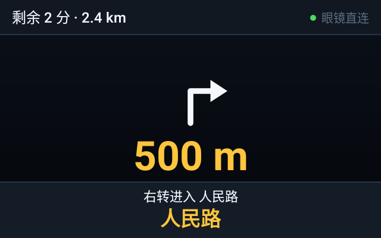
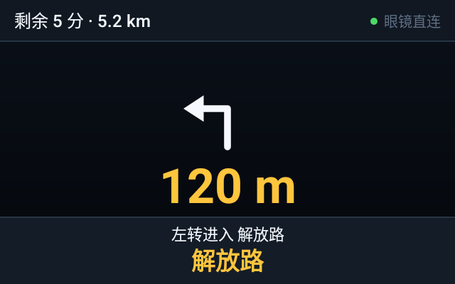
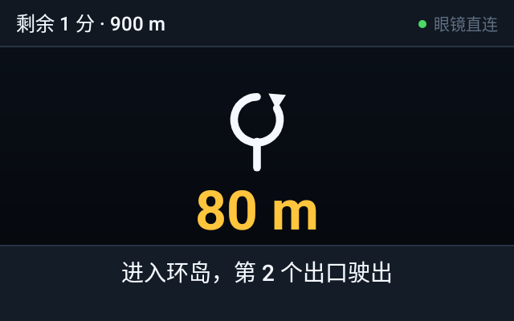
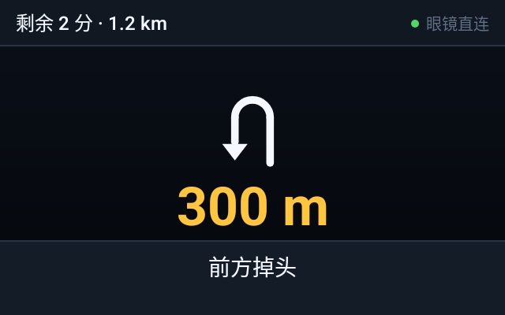
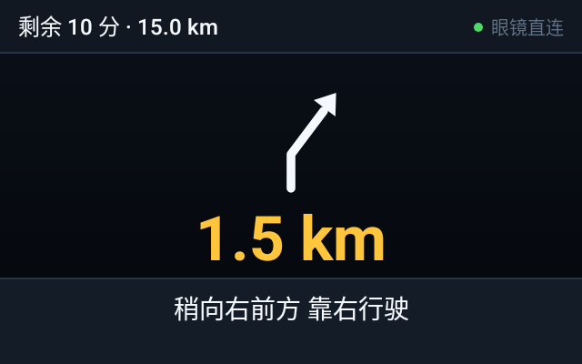
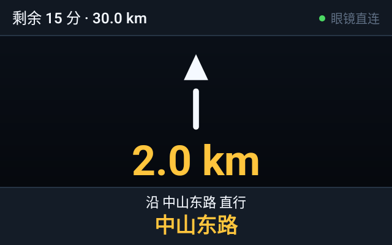
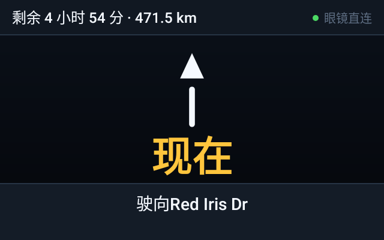

# 导航 HUD：手机直接把导航画面推给眼镜

> 方案 A。手机读 Google 地图的导航通知 → 自己渲染 640×400 RGBA → 复用投屏的 USB 帧管线
> 直推眼镜。**不需要 Pi、不需要 Wi-Fi、不需要 UDP**（Pi 的 `glxss hud` 保留为独立场景）。
>
> 相关代码：[`nav/`](../app/app/src/main/java/com/wzqvip/glxsscast/nav/) ·
> 显示协议：[ch-display.md](ch-display.md) ·
> App 架构：[ch-app.md](ch-app.md)

---

## 1. 数据流

```
Google Maps 导航通知（com.google.android.apps.maps）
        │  NotificationListenerService（用户授权「通知使用权」）
        ▼
nav/NavListenerService ──► nav/NavParser ──► nav/NavBus
                                             │
              ┌──────────────────────────────┴───────────────┐
              ▼                                              ▼
   nav/NavHudPusher（1 Hz + 数据变化立即）          旧链路：UDP JSON → Pi:9999
   nav/NavHudRenderer（640×400 RGBA）
              │
              ▼
   LcdProtocol 16 B 头 + 1,024,000 B payload
              │
              ▼
   UsbLink.sendFrame（单次 bulk OUT，UsbGate 串行）
```

| 模块 | 职责 |
|---|---|
| `nav/NavListenerService.kt` | 监听 Maps 通知；连上时**主动扫一遍现有通知**（App 重启后不必等 Maps 下一次更新） |
| `nav/NavParser.kt` | 解析指令 / 距离 / 机动 / ETA / 剩余距离 / 路名；图标相似度兜底机动类型 |
| `nav/NavBus.kt` | 运行时总线：最近一帧、授权状态、UDP 1 Hz 发送、直推回调 |
| `nav/NavHudRenderer.kt` | 纯 Canvas 渲染 640×400 RGBA（不依赖 Compose，可在后台线程跑） |
| `nav/NavHudPusher.kt` | 直推调度：开屏 + 1 Hz 发帧 + PNG 抓图 + 状态 |
| `nav/NavHudSection.kt` | App 页面：授权、开关、实时预览、模拟按钮 |
| `nav/NavProtocol.kt` | `NavFrame` / `Maneuver` / UDP JSON 协议 |

---

## 2. 解析到哪些字段

Google 地图的通知字段**顺序不固定**，两种形态都见过：

| 形态 | `EXTRA_TITLE` | `EXTRA_TEXT` | `EXTRA_SUB_TEXT` |
|---|---|---|---|
| 手机普通导航 | 指令（`右转进入 人民路`） | 距离（`500 米`） | ETA（`12 分钟 · 3.2 公里`） |
| 车机 / 驾驶模式 `navigation_status` | 距离（`0 英尺`） | 指令（`驶向Red Iris Dr`） | `4 小时 53 分钟 · 293 英里 · 预计00:50到达` |

所以 `NavParser` 不假设 title 一定是指令，而是：

1. **距离**：`text → title → bigText` 里第一处能解析的 `米/km/英里/英尺`；
2. **指令**：`title → text → bigText` 里第一个**不是纯数值**的字符串
   （`isBareMeasurement` 判断，`0 英尺`/`500 m` 会被跳过）；
3. **机动类型**：中英文关键词（左/右/稍向/环岛/掉头/到达/直行/驶向…）优先；
   文本给不出时，把 `getLargeIcon()` 缩成 24×24 剪影与 8 个 Canvas 模板比 IoU，
   置信度不够保持 `unknown`（宁可不猜）；
4. **路名**：`进入/驶入/转入/并入/沿(着)` + 道路通名裁剪（`人民路`），英文 `onto/along/on`；
   环岛、车道、目的地不算路名；
5. **ETA / 剩余距离**：`subText → infoText → bigText`，ETA 再兜底 `text`（旧版本 Maps
   把「500 米 · 12 分钟」都塞进 `EXTRA_TEXT`）。

真机字段样本（LG G850N，2026-11-22，Maps 驾驶模式）：

```
android.title     = "0 英尺"
android.text      = "驶向Red Iris Dr"
android.subText   = "4 小时 54 分钟 · 293 英里 · 预计00:54到达"
category          = navigation
android.largeIcon = BITMAP 120×120
→ label="驶向Red Iris Dr" maneuver=straight distance=0 m
  eta=17640 s remain=471537 m (293 mi) road=""
```

---

## 3. HUD 版式（640×400）

```
┌────────────────────────────────────────────────┐
│ 剩余 2 分 · 2.4 km                ● 眼镜直连    │  ← 顶栏：ETA/总距离 + 连接/新鲜度
├────────────────────────────────────────────────┤
│                     ▲                          │
│              大箭头（按机动类型）                  │  ← 白/黄高对比；到达=绿旗
│                                                │
│                   500 m                        │  ← 距离（金色 68 px）
├────────────────────────────────────────────────┤
│              右转进入 人民路（最多两行）            │  ← 指令条
└────────────────────────────────────────────────┘
```

- **没有罗盘/heading**：眼镜没有磁力计，箭头只按机动类型画（左/右/稍向/环岛/掉头/直行/到达）。
- 没有导航数据时画「等待导航…」+ 通知使用权/眼镜连接状态。
- 距离 < 15 m 显示「现在」；到达显示「已到达」。
- 帧数据同一份 `NavFrame` 也用于页面上的实时预览和 PNG 抓图，保证「看到的就是发出去的」。
- 与投屏共用 `LcdProtocol.flip180`（投屏/测试图/HUD 翻转一致）。

样张（`app/screenshots/`，全部由手机端渲染器真实输出）：

| 右转 | 左转 | 到达 |
|---|---|---|
|  |  |  |

| 环岛 | 掉头 | 稍向右 |
|---|---|---|
|  |  |  |

| 直行 | 等待导航 | 真实 Maps 帧 |
|---|---|---|
|  |  |  |

---

## 4. 用法（手机 + 眼镜）

1. 手机装 `app-debug.apk`，把眼镜插到**手机**上（不是 Pi）；
2. App →「连接眼镜」（会 claim `if3` LCD、开屏 `switch=1` + `displayMode=2`）；
3. App →「导航 HUD」→**开启「导航 HUD → 眼镜」**开关（默认开）；
4. 系统设置里给 App「通知使用权」（页面顶部有按钮）；授权后显示
   `监听服务：已连接`；
5. 打开 Google 地图开始驾车/步行导航 → 眼镜上每秒刷新一帧，数据变化时立即补一帧。

说明：

- 直推由 `NavHudPusher` 的**单后台线程**按 1 s 周期发送；数据变化只是往同一队列塞一帧，
  不会两个线程同时写 bulk OUT；`UsbGate` 再和亮度/HID 等控制请求做进程级互斥。
- **投屏进行中会自动暂停直推**（投屏 1 MB×30 fps，硬抢会把帧切碎），状态栏会写
  「投屏中：导航 HUD 暂停」。UVC/HID 不受影响（走不同端点，控制请求仍走闸门）。
- 眼镜屏会被固件 30 s 自动关掉；直推每轮开始先补一次 `setScreenOn(true)` +
  `setDisplayMode(2)`，断线重连后也会重发。
- UDP → Pi 的旧链路在页面底部「UDP 发到 Pi（可选）」里，**默认关闭**；两条路可同时开。
- 熄屏/锁屏时 `NotificationListenerService` 仍在，直推继续（进程由系统绑定保活）。

---

## 5. 无眼镜时验证：抓 PNG

页面「抓一帧 PNG」或命令行：

```powershell
# 造一条右转 500 m 的导航帧 → 渲染 → 存 PNG
adb shell am start -n com.wzqvip.glxsscast/.MainActivity `
  --es cmd nav_hud_png --es maneuver right --ei nav_distance 500 `
  --ei nav_eta 120 --ei nav_remain 2400

# 抓「最近一条真实 Maps 通知」（先让 Maps 开始导航）
adb shell am start -n com.wzqvip.glxsscast/.MainActivity `
  --es cmd nav_hud_png --ez use_last true

# 等待导航版式
adb shell am start -n com.wzqvip.glxsscast/.MainActivity `
  --es cmd nav_hud_png --ez waiting true

# 立即推一帧 / 开直推 / 关直推（headless，不用点 UI）
adb shell am start -n com.wzqvip.glxsscast/.MainActivity --es cmd nav_hud_push
adb shell am start -n com.wzqvip.glxsscast/.MainActivity --es cmd nav_direct --ei on 1
adb shell am start -n com.wzqvip.glxsscast/.MainActivity --es cmd nav_direct --ei on 0
```

落盘位置（App 专属外部目录，免存储权限）：

```
/sdcard/Android/data/com.wzqvip.glxsscast/files/nav-hud/
├── hud-20261122-200102-666.png   # 每次抓图一个新文件
├── last.png                      # 最近一次（方便 adb pull）
└── hud-latest.json               # 解析字段 + 连接状态 + 已推帧数
```

```powershell
adb pull /sdcard/Android/data/com.wzqvip.glxsscast/files/nav-hud/last.png .
```

---

## 6. USB 帧（与投屏完全一致）

```
头 16 B（小端）：[0]=1 format | [4..7]=totalLen(1,024,016) | 其余 0
payload：640×400 RGBA8888，R,G,B,A 字节序，1,024,000 B
整帧一次 bulkTransfer（EP 0x01，512 B mps），短写只补同一帧剩余字节
```

实测（LG G850N + GLXSS3，2026-11-22）：

- `LCD_TX seq=58..106 size=1024016 sent=1024016 rc=OK ms=24`，1 Hz 稳定；
- `NAV HUD 开屏 switch=true displayMode2=true`（0xA1/0x02 + 0xA1/0x05 ACK）；
- 渲染一帧 + 组帧 + 发送合计约 25 ms；
- 真实 Maps 导航帧推送：`pushes=14`、`status=导航中 · 直行 0 m · 已推 14 帧`。

---

## 7. 已知限制

- **眼镜实际显示未肉眼确认**：真机验证到 `bulk OUT rc=OK` + 开屏 ACK + 16 MB/s 吞吐，
  但现场没有对着目镜的相机；投屏链路早已用同一帧格式验证过画面。需要人戴上眼镜确认。
- **Pixel 未验证**：2026-11-22 当天 Pixel 不在 adb 设备列表，只装了 LG；
  LG 上 USB 权限/自动重连/固件自动灌写路径都正常。
- Maps 车机模式把单位交给系统区域（本机给的是英尺/英里），HUD 统一换算成 m/km 显示，
  会出现 `293 英里 → 471.5 km` 这种换算值。
- 图标兜底依赖 `getLargeIcon().loadDrawable()`；部分 ROM 通知栏降采样后相似度不够会保持
  `unknown`（此时用文本关键词，仍能给出箭头）。
- 直推期间如果同时点「开始投屏」，直推暂停但不会自动恢复「投屏停止后」的屏幕模式——
  停止投屏后再点一次直推开关即可（或等下一次 1 Hz 周期自动开屏）。

---

## 8. 测试与排障速查

```powershell
adb logcat -s Oplog:* | Select-String 'NAV|LCD_TX'   # 解析 / 发帧
adb shell run-as com.wzqvip.glxsscast cat files/oplog.txt | Select-String 'NAV'
```

| 现象 | 先看 |
|---|---|
| 页面「监听服务未连接」 | 通知使用权是否授权；系统可能杀过服务，重进 App |
| 一直「等待导航…」 | Maps 是否在导航中；`nav_status` 里的 `last` 是否有帧 |
| 有帧但眼镜黑 | 投屏是否在跑（直推会暂停）；是否 `setScreenOn` 失败；重新插拔 |
| 帧发送失败 | `files/oplog.txt` 的 `LCD_TX ... FAIL` / `GATE` 持锁告警 |
