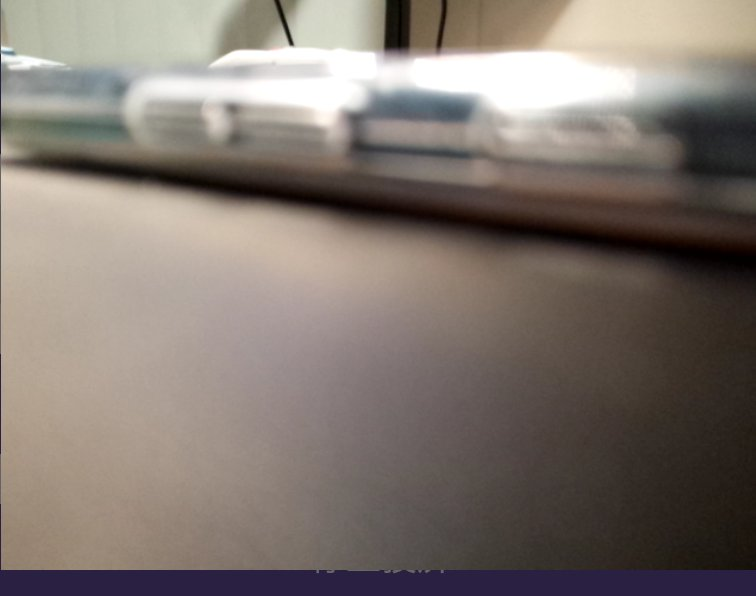
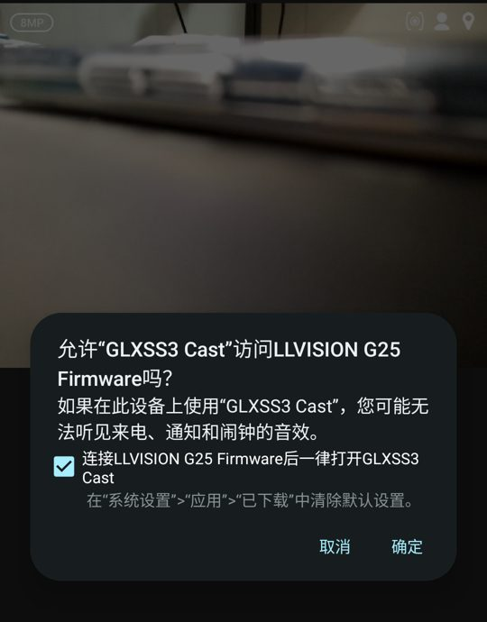
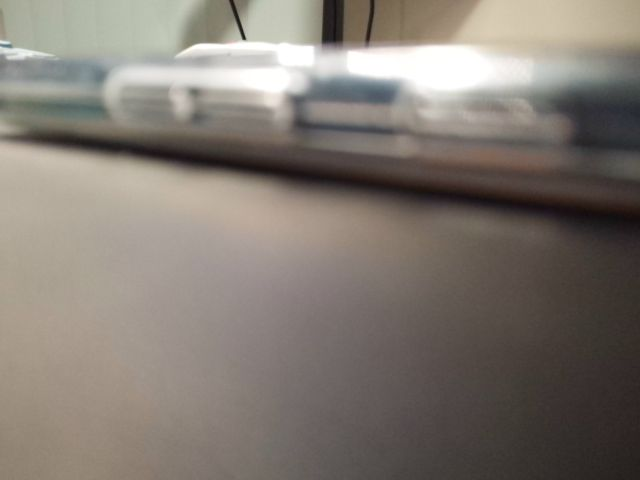
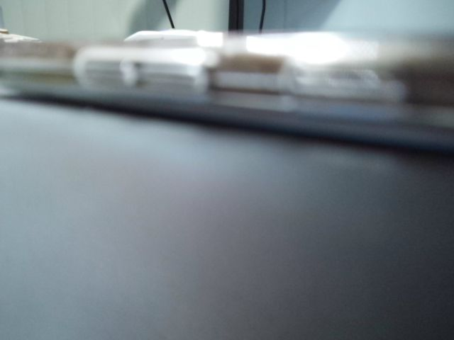

# UVC 摄像头实现方案（GLXSS G25）

> 目标：在替代 App（`glxss3-touying`）里显示眼镜摄像头画面 + 拍照。
> 本文只做研究与本地检查，**没有改任何现有源码**，没有碰设备。
> 新增代码全部在独立包 `com.wzqvip.glxsscast.uvc`，已随 `assembleDebug` 编译通过。

---

## 0. 结论速览

| 项 | 结论 |
|---|---|
| **推荐路径（主线）** | **方案 B：纯 Kotlin 自己实现 UVC**。代码已写好（3 个文件，约 1000 行，已编译通过），零 native、零新依赖。 |
| **最快验证（30 分钟）** | **方案 D**：加一行 `implementation("com.herohan:UVCAndroid:1.0.13")` 跑一下，用来确认"这设备到底是不是标准 UVC"。 |
| **保底回退** | **方案 A**：拷厂商 6 个 `.so` + 生成 153 个 native 声明。可行、已验证符号，但**类名被 .so 写死**，改动成本最高。 |
| **排除** | **方案 C**：external camera HAL。LG G8 / Pixel 都不声明 `android.hardware.camera.external`，Camera2 也看不到这台设备。 |
| **新发现（重要）** | 设备实际喂给 App 的很可能是 **未压缩 YV12 640×480**（不是 MJPEG）。见 §1.2 —— 这直接决定了"`BitmapFactory.decodeByteArray` 一条路走不通"。 |
| **真机已验证（2026-11-21）** | 方案 B 在 LG G8 + 眼镜上跑通：`fps≈20`、YV12 640×480 画面正常。抓包与修复全过程见 **§8**：标准 UVC 1.1 bulk、12B header、一次 transfer 一帧 460812B、YV12=Y\|V\|U；之前的彩色噪点是**眼镜固件挂掉**在灌垃圾流。 |

三个新加的文件：

| 文件 | 作用 |
|---|---|
| `app/app/src/main/java/com/wzqvip/glxsscast/uvc/UvcCamera.kt` | 描述符解析 / probe+commit / bulk 收流 / YUV 解码 / 拍照 |
| `.../uvc/Yuv.kt` | YV12、I420、NV12、NV21、YUY2、UYVY → ARGB（整数运算） |
| `.../uvc/UvcPreview.kt` | Compose 预览 `UvcPreview` + `rememberUvcCamera` + 拍照按钮 |

---

## 1. 先把设备事实钉死

### 1.1 已知（沿用 `docs/usb-capture.md`）

```
2e09:0030  bcdUSB 2.10  7 接口
INTF0  0x0e/0x01  VideoControl
INTF1  0x0e/0x02  VideoStreaming   ep 0x81 BULK IN 512     ← 只有这个跟摄像头有关
INTF2  0x03       HID
INTF3  0xff/0x01  LCD             ep 0x01 BULK OUT 512
INTF4-6 0x01      UAC
```

三条对实现有决定性影响的推论：

1. **是 bulk 不是 isochronous** → 必须 `claimInterface(INTF1 alt=1)` + `setInterface(alt=1)`，
   否则 `0x81` 根本不出数据。iso 那套 `setInterface` 时序不适用。
2. **UVC 1.10（bcdUVC=0x0110）** → probe/commit 结构体按 **34 字节**（UVC 1.1+）发，
   失败再退 26 字节（UVC 1.0）。`dwClockFrequency` 字段要占位。
3. 只有一个 bulk IN、maxpkt 512 → 一帧 640×480 未压缩（460800 B）会被拆成 ~900 个 512B 包，
   但 UVC 的 "payload" 是**带 header 的记录**，`bulkTransfer` 一次拿到的就是一个 payload。

### 1.2 格式到底是 MJPEG 还是 YV12？（厂商日志的正确读法）

厂商日志两行：

```
libUVCCamera: frameSize=(640,480)@YV12
libuvc: bulk transfer mode
frameBufferSize=460822
```

我在本机把 `libUVCCamera.so` 的字符串挖出来对了一遍：

* `[%d*%s:%d:%s]:frameSize=(%d,%d)@%s` —— 这行日志来自 serenegiant 的
  `UVCPreview.cpp::prepare_preview()`：
  ```cpp
  LOGI("frameSize=(%d,%d)@%s", frameWidth, frameHeight, (!requestMode ? "YUYV" : "MJPEG"));
  ```
  上游这里只会打印 `YUYV` 或 `MJPEG`。厂商打印出 `YV12` ⇒ **他们改了这个函数**，
  而且启动了一个 YV12 流。同文件里还留着上游的
  `PIXEL_FORMAT_RAW / YUV / RGB565 / RGBX / YUV20SP / NV21 / YUY2 / YV12` 一整套日志字符串，
  说明这个 fork 把"未压缩多格式"补齐了。
* `460822 = 640×480×1.5 + 22 = 460800 + 22`。
  22 字节正好是"帧长 + 12 字节 UVC payload header 余量"这种量级；
  而 YUY2 应该是 614400、MJPEG 则完全不该是 1.5×w×h。
* `libuvc.so` 的 `DT_NEEDED` 里有 `libjpeg-turbo1500.so`（MJPEG 解码）**和** `libyuvto.so`（YUV 转换），
  两者都在，说明两种都可能；但**实跑的是 YV12**。

**结论：要先按"未压缩 YV12 640×480"做设计，MJPEG 只当备选分支。**
代码里是运行时解析 VS 描述符再决定（见 §5），不写死；第一次跑 logcat 就能确认真实答案。

> 如果一定要在动设备前 100% 确认：把眼镜插到 Linux 主机上
> `lsusb -v -d 2e09:0030`，看 INTF1 alt0 下的 `VideoStreaming Interface Descriptor`：
> `bDescriptorSubtype = 4 (Uncompressed)` 还是 `6 (MJPEG)`，以及 GUID 前 4 字节是不是 `YV12`。
> 这一步比在手机上试快得多。

### 1.3 厂商 APK 里的 native 库（方案 A 的原料）

从 `re/liangliang/app.apk` 实测（`readelf -d` / `nm -D` / `strings`）：

```
libUVCCamera.so   132432 B  NEEDED: libusb100 libuvc libcommon libdl liblog libandroid libstdc++ libc libm
libuvc.so         108680 B  NEEDED: libjpeg-turbo1500 libusb100 libyuvto liblog libstdc++ libc libm libdl
libusb100.so      100160 B  NEEDED: liblog libc libm libstdc++ libdl
libcommon.so        9904 B  NEEDED: libusb100 liblog libstdc++ libc libm libdl
libjpeg-turbo1500.so 317392 B
libyuvto.so       259944 B
liblcd.so / libhid.so / libboot.so 也都 NEEDED libstdc++.so
ABI 目录：arm64-v8a、armeabi-v7a、armeabi、x86、x86_64
```

`libstdc++.so` 是**平台库**（不在 APK 里）。这一点本来是个大坑（gnustl 在 Android 10 之后被删），
但**本地有反证**：`docs/usb-capture.md` 里对原厂 App 的 Frida hook（`libusb_control_transfer`）
是在 Pixel 10 Pro Fold / Android 16 上做的，说明 `liblcd.so`（NEEDED `libstdc++.so`）
在那台机器上**成功加载**了。⇒ 这些设备上 `libstdc++.so` 仍可解析。
不过它终究是"平台给不给"的问题，换 ROM/换机型仍可能炸，方案 A 必须把这条列进风险。

---

## 2. 四个方案横向对比

| | **A. 复用厂商 .so** | **B. 纯 Kotlin（推荐）** | **C. external camera / Camera2** | **D. 现成库 UVCAndroid** |
|---|---|---|---|---|
| 需要什么 | 6 个 `.so` × 2~5 个 ABI + 153 个 native 声明 + 9 个回调/数据类 | 无（只用 `android.hardware.usb`） | 无 | 1 行 Gradle 依赖（AAR 内含 .so） |
| 新增二进制 | ~900 KB/ABI（arm64 + v7a ≈ 1.8 MB） | 0 | 0 | ~1 MB（来自 Maven Central） |
| 新增代码量 | 绑定层 ~250 行（可脚本生成）+ 调用 ~120 行 | ~900 行（已写完） | ~30 行 | ~100 行 |
| 首次跑通概率 | 高（厂商同一套代码在这台设备上跑过） | 中高（协议是标准 UVC，但描述符可能不规范） | **≈0** | 中（取决于它是否支持 YV12 未压缩） |
| 主要坑 | **类名写死在 .so 里**、`libstdc++`、ABI、许可证 | probe/commit 参数要调、CPU 转 YUV | 厂商没编 HAL | 上层 API 可能只认 MJPEG/YUYV |
| 预览方式 | `nativeSetPreviewDisplay(Surface)` 直接画，**CPU 占用最低** | Bitmap → ImageView（或自己画到 Surface） | Camera2 → Surface | SurfaceView/TextureView |
| 许可证 | Apache-2.0（serenegiant）+ 厂商改动，需保留 NOTICE | 无 | — | Apache-2.0 |
| 与 `UsbLink` 共存 | 要自己传 fd/busnum/devnum，不共用 connection | 可直接复用 `UsbLink.connection` | 不适用 | 自己 `openDevice`（多一个 fd） |
| 建议 | 保底 | **主线** | 排除 | 30 分钟验证用 |

### 2.1 为什么 C 直接排除

* `android.hardware.camera.external`（`PackageManager.FEATURE_CAMERA_EXTERNAL`，API 20 起）要求
  **OEM 把 external camera HAL 编进产品**（AOSP 的 `ExternalCameraProvider`）。
  官方文档见 [External USB cameras](https://source.android.com/docs/core/camera/external-usb-cameras)，
  它主要面向 AOSP / 模拟器 / 少数设备。
* LG G8（Android 9/10 时代）没有；Pixel 原厂也没声明这个 feature。
* 就算有，Camera2 的 ID 也不固定，还得写 `CameraManager.cameraIdList` 全扫 + 看
  `LENS_FACING_EXTERNAL`，比方案 B 麻烦得多。
* 一条命令自查（**不用改代码**）：
  ```kotlin
  val has = packageManager.hasSystemFeature(PackageManager.FEATURE_CAMERA_EXTERNAL)
  ```

### 2.2 为什么 A 不是首选（尽管"proven"）

`libUVCCamera.so` **没有导出任何 `Java_*` 符号**（`nm -D` 里 `T` 段只有 `JNI_OnLoad` 一个），
它在 `JNI_OnLoad` 里用 `RegisterNatives` 一次性注册 **153 个** native 方法到一个
**硬编码的类名**：

```
com/llvision/glass3/sdk/camera/UVCCamera
（.so 里的字符串就是这么写的；配套还有 CameraAeData/CameraCapability/CameraExif/
 CameraFdData/CameraFaceLoc/IButtonCallback/IFrameCallback/IStatusCallback 等类型名）
```

后果：

1. 你不能用 GitHub 上 `com.serenegiant.usb.UVCCamera` 的 Java 源码 —— 包名不匹配，
   `FindClass` 直接失败 → `JNI_OnLoad` 返回 -1 → `UnsatisfiedLinkError`。
2. 你必须建一个**同名同包**的类，且 native 声明**一个都不能少**
   （`RegisterNatives` 是按数组整体注册的，缺一个就整体失败）。
   好消息是完整的 153 个声明就在 jadx 里，照抄即可（`UVCCamera.java` 第 147–451 行）。
3. 该类原本依赖厂商一堆类（`usb.b`、`util.a`、`LogUtil`、`ResultCode`、`IUVCCameraService`…），
   **但你不需要搬这些**：只要 native 声明 + 静态 `loadLibrary` 块，剩下的逻辑自己写。
   需要额外补的只有 9 个"出现在签名里"的极简类/接口。
4. 静态块里的加载顺序是厂商写死的：

```java
System.loadLibrary("jpeg-turbo1500");
System.loadLibrary("uvc");
System.loadLibrary("UVCCamera");
```

   `libusb100` / `libcommon` / `libyuvto` 没显式加载，靠 `DT_NEEDED` 自动带进来
   （Android 链接器会在 APK 的 `lib/<abi>/` 里找）。**稳妥做法是显式预加载**：

```kotlin
System.loadLibrary("usb100")
System.loadLibrary("common")
System.loadLibrary("jpeg-turbo1500")
System.loadLibrary("yuvto")
System.loadLibrary("uvc")
System.loadLibrary("UVCCamera")   // JNI_OnLoad 在这一步注册
```

5. `nativeConnect` 的真实参数顺序（`UVCCamera.java#open` 里 `g(),h(),f(),i(),j(),a(...)` 的调用序，
   与上游 `UVCCamera::connect(int vid, int pid, int fd, int busnum, int devaddr, const char *usbfs)` 一致）：

```
nativeConnect(long ptr, int vid, int pid, int fd, int busnum, int devnum, String usbfsDir) : int
                       ↑2e09    ↑0030    ↑getFileDescriptor()  ↑...deviceName 里解析... ↑"/dev/bus/usb"
```

   注意最后一个参数是 **usbfs 目录**（`/dev/bus/usb`），不是设备全路径 ——
   厂商 `util/a.java` 就是把 `getDeviceName()`（`/dev/bus/usb/001/002`）砍掉最后两段得到的。

其余常用（完整表见附录 A）：

```
nativeCreate() : long
nativeOpen(long, int) : int                    // 厂商调用 startCamera() 时传 1
nativeSetPreviewSize(long, w, h, minFps, maxFps, format, bandwidthFactor) : int   // format=0
nativeSetPreviewDisplay(long, Surface) : int
nativeSetFrameCallback(long, IFrameCallback, int pixelFormat) : int
nativeStartPreview(long) / nativeStopPreview(long) / nativeClose(long, int) / nativeDestroy(long)
nativeGetSupportedSize(long) : String          // 返回 "640x480;..." 之类的字符串
```

IFrameCallback 的方法签名（.so 里硬编码查找）：`onFrame(Ljava/nio/ByteBuffer;)V`。

### 2.3 方案 D 的具体形态

```kotlin
// app/app/build.gradle.kts
implementation("com.herohan:UVCAndroid:1.0.13")   // Maven Central，1.0.13 发布于 2026-06
```

* `settings.gradle.kts` 里已经有 `mavenCentral()`（已核对，`dependencyResolutionManagement`
  的 repositories 是 `google()` + `mavenCentral()`），**加依赖就能拉下来**。
* 它内部就是 `com.serenegiant.usb.*` + serenegiant 的 prebuilt `.so`，
  所以跟方案 A 是**同一套血统**，只是别人帮你把绑定写好了。
* 官方要求 Android 5.0+，ProGuard 规则 README 里有。
* 风险：它的上层 `CameraHelper` 默认按 MJPEG/YUYV 走；如果这台设备只有 YV12 未压缩，
  可能在 `uvc_get_stream_ctrl_format_size` 就返回 `UVC_ERROR_NOT_SUPPORTED`。
  **所以它更适合当"探测器"，不适合当唯一方案。**
* 备选：`com.github.jiangdongguo.AndroidUSBCamera`（AUSBC）。老牌但走 JitPack，
  构建时现场编译、偶尔抽风；只在 D 不通时再考虑。

---

## 3. 推荐路径（实现步骤）

### Step 0（可选，10 分钟）：先确认格式

插到 Linux 主机 `lsusb -v -d 2e09:0030`，或者直接跳到 Step 1 用 logcat 看（骨架会把描述符打全）。

### Step 1：直接用上已写好的骨架

文件已在：

```
app/app/src/main/java/com/wzqvip/glxsscast/uvc/UvcCamera.kt
app/app/src/main/java/com/wzqvip/glxsscast/uvc/Yuv.kt
app/app/src/main/java/com/wzqvip/glxsscast/uvc/UvcPreview.kt
```

`assembleDebug` 已通过（见 §6 验证记录）。**不需要改任何现有文件。**

### Step 2：接进 UI（不改 `MainActivity.kt` 的做法）

现在 `MainActivity.kt` 里已经有：
* `CAMERA` 权限申请（UVC 设备要它才给 USB 授权）；
* `UsbLink.ACTION_PERMISSION` 广播；
* `usb = UsbLink.get(this)`、`usb.requestPermission(dev)`。

所以**等 `UsbLink` 那套流程拿到权限、连上设备之后**，只需要在 Compose 里加：

```kotlin
val camera = rememberUvcCamera()
var uvcStatus by remember { mutableStateOf<String?>(null) }

// 放在「亮度和开屏」那一块旁边
Button(onClick = {
    val dev = camera.findDevice()
    when {
        dev == null -> uvcStatus = "没找到眼镜"
        !camera.hasPermission(dev) -> uvcStatus = "先点『连接眼镜』授权 USB"
        else -> {
            // 复用 UsbLink 已打开的 connection：少一个 fd，也不会抢 INTF3
            val ok = camera.open(dev, usb.connection)
            uvcStatus = if (ok) camera.negotiatedInfo() else (camera.lastError() ?: "open 失败")
            if (ok) camera.start()
        }
    }
}) { Text("打开摄像头") }

uvcStatus?.let { Text(it) }
UvcPreview(camera, Modifier.fillMaxWidth().height(200.dp))
UvcCaptureButton(camera) { file -> uvcStatus = "已保存 ${file.name}" }
```

> 想彻底零冲突：先说"连眼镜"（`UsbLink` claim INTF3 开始投屏），再点"打开摄像头"。
> 两者是**不同接口**，`UsbDeviceConnection` 上互不影响。

### Step 3：看 logcat 定论

```powershell
adb logcat -s UvcCamera
```

### Step 4：按 §7 的风险表微调（基本都是"改一个常量再试"）

---

## 4. 方案 B 的协议细节（骨架里已实现，这里写清楚便于改）

### 4.1 打开顺序

```
1. UsbManager.openDevice(dev)                     ← 或复用 UsbLink.connection
2. 找 INTF class=0x0e/sub=0x02 且带 bulk IN 的 alt setting（正常是 #1 alt=1）
3. claimInterface(itf, force=true)                ← force 会 detach kernel driver
4. setInterface(itf)                              ← ★ 不切 alt=1 就永远收不到数据
5. 解析 rawDescriptors 里的 VS_FORMAT_*/VS_FRAME_*
6. SET_CUR(probe) → SET_CUR(commit)
7. bulkTransfer(0x81) 循环
```

### 4.2 probe / commit 控制传输

| 用途 | bmRequestType | bRequest | wValue | wIndex | wLength |
|---|---|---|---|---|---|
| GET_CUR probe | `0xA1` | `0x81` | `0x0100` | VS 接口号（=1） | 26 或 34 |
| GET_DEF probe | `0xA1` | `0x87` | `0x0100` | 1 | 34 |
| **SET_CUR probe** | `0x21` | `0x01` | `0x0100` | 1 | 34 |
| GET_CUR commit | `0xA1` | `0x81` | `0x0200` | 1 | 34 |
| **SET_CUR commit** | `0x21` | `0x01` | `0x0200` | 1 | 34 |

probe 结构（UVC 1.1 = 34 B；UVC 1.0 = 26 B，就是砍掉最后 8 字节）：

```
 0..1   bmHint               bit0=1 表示 dwFrameInterval 有效
 2      bFormatIndex         描述符里的 bFormatIndex
 3      bFrameIndex          描述符里的 bFrameIndex
 4..7   dwFrameInterval      100ns 单位：15fps → 666666，30fps → 333333
 8..9   wKeyFrameRate
10..11  wPFrameRate
12..13  wCompQuality
14..15  wCompWindowSize
16..17  wDelay
18..21  dwMaxVideoFrameSize       ← 用描述符里的 dwMaxVideoFrameBufferSize（实测 460822）
22..25  dwMaxPayloadTransferSize  ← bulk 设备随便给个合理值（这里 16384）
26..29  dwClockFrequency
30      bmFramingInfo
31..33  bPreferedVersion / bMinVersion / bMaxVersion
```

实操顺序（骨架就是这么做的）：

1. `GET_CUR(probe)` 拿设备当前值当基底（拿不到就 `GET_DEF`，再拿不到就全 0 自己填）；
2. 填 `bmHint/bFormatIndex/bFrameIndex/dwFrameInterval/dwMaxVideoFrameSize/dwMaxPayloadTransferSize`；
3. `SET_CUR(probe)`；失败先试 26 字节，再试 `bmHint=0`；
4. `GET_CUR(probe)` 读回看设备认可了什么（**这行日志最有诊断价值**）；
5. 把读回的内容原样 `SET_CUR(commit)`。

### 4.3 收流：UVC payload header

每个 bulk transfer 是一个 payload：

```
byte0  bHeaderLength   = 2 + (PTS?4:0) + (SCR?6:0)   // 通常 2，最大 12
byte1  bmHeaderInfo
        bit0 FID  帧内包序号翻转
        bit1 EOF  ★ 一帧结束
        bit2 PTS  后面跟 4 字节时间戳
        bit3 SCR  后面跟 6 字节
        bit6 ERR  ★ 本帧作废
byte[hdr..]  图像数据
```

处理：`payload = buf[hdr until n]` 追加到 `frameBuf`；`ERR` → 丢帧；`EOF` → 一帧完整，去解码。

骨架里还留了一个兜底：如果 `byte0` 不在 `2..12`，说明设备根本没发标准 header，
自动切成"整包当数据、攒够 `w*h*1.5` 就出帧"的 raw 模式（会打一条 warning）。

### 4.4 MJPEG vs 未压缩

| | MJPEG | 未压缩 YV12/I420/NV12/YUY2 |
|---|---|---|
| 解码 | `BitmapFactory.decodeByteArray`（走硬件/原生，几 ms） | 自己转 ARGB（纯 Kotlin，640×480 约 8–15 ms） |
| 带宽 | 小（约 50–100 KB/帧） | YV12 = 460800 B/帧；15fps ≈ 6.9 MB/s |
| 颜色 | 天然正确 | 容易 U/V 反（YV12 ↔ I420）、NV12 ↔ NV21 反 → 花屏/偏色 |

`Yuv.kt` 里一次性把六种排布都实现了，出问题时只要在 `PixelMapping` 那层换个枚举即可。

### 4.5 预览

骨架走的是 `AndroidView(ImageView)` + 每帧 `setImageBitmap`，**不触发 Compose 重组**
（重组 15fps 会很难看）。这条路简单、够用；如果后面要压 CPU，再换：

* `SurfaceView` + `lockCanvas` 直接画 ARGB（省一次 Bitmap 分配）；
* 或干脆走方案 A 的 `nativeSetPreviewDisplay(surface)`。

每帧 `Bitmap.createBitmap` 会带来 1.2 MB/帧的分配（15fps ≈ 18 MB/s），
GC 会有点忙。骨架里已经复用了 `IntArray`，但没复用 `Bitmap` ——
真要降分配，改成"持有一个 Bitmap + `setPixels` + `view.invalidate()`"即可（代码注释里标了）。

### 4.6 拍照

`camera.saveSnapshot()` → `Android/data/com.wzqvip.glxsscast/files/Pictures/uvc/uvc_yyyyMMdd_HHmmss.png`。

**零权限**（app 专属外部目录）。如果要进系统相册，再走 `MediaStore.Images` +
`RELATIVE_PATH=Pictures/GLXSS`（API 29+）或 `WRITE_EXTERNAL_STORAGE`（26–28）。

---

## 5. 骨架代码地图

### `UvcCamera.kt`

| 成员 | 说明 |
|---|---|
| `findDevice()` / `hasPermission()` | VID/PID 匹配（2e09:0030） |
| `open(dev, reuse)` | claim INTF1 + `setInterface` + 解析描述符 + probe/commit；`reuse` 传 `UsbLink.connection` 可共用连接 |
| `parseFormats(raw)` | 自己写的 `rawDescriptors` 解析器（CONFIG→INTERFACE→CS_INTERFACE） |
| `pickFormat()` | 640×480 优先，顺序 MJPEG > YV12 > I420 > NV12 > YUY2 > UYVY |
| `probeAndCommit()` | §4.2 那一套，含 26/34 双长度回退 |
| `start()` / `readLoop()` / `deliver()` | 收流、组帧、解码、回调 |
| `negotiatedInfo()` / `lastError()` | 给 UI / logcat 看 |
| `currentBitmap()` / `saveSnapshot()` | 拍照 |
| `stop()` / `close()` | 回 alt0、release、关连接 |

诊断辅助：`UvcCamera.describe(usb, dev)` 把 7 个接口 + 端点一次打印出来，
写个 `Log.i(TAG, describe(...))` 就能贴给人看。

### `UvcPreview.kt`

`rememberUvcCamera()`（跟着 Composable 自动 `close()`）、`UvcPreview()`、`UvcCaptureButton()`。

---

## 6. 本地验证记录

```powershell
$env:JAVA_HOME = "C:\Program Files\Microsoft\jdk-17.0.10.7-hotspot"
cd C:\Users\WANGZ\Desktop\sshtest\glxss3-touying\app
C:\gradle\gradle-8.9\bin\gradle.bat :app:compileDebugKotlin --no-daemon --console=plain
# BUILD SUCCESSFUL

C:\gradle\gradle-8.9\bin\gradle.bat assembleDebug --no-daemon --console=plain
# BUILD SUCCESSFUL  → app/app/build/outputs/apk/debug/app-debug.apk
```

**做过的检查**：APK 内 `.so` 清单/大小/ABI、`readelf -d`（DT_NEEDED/SONAME）、
`nm -D`（动态符号：只剩 `JNI_OnLoad`，无 `Java_*`）、`strings`（JNI 类名、native 方法名、
日志格式串）、jadx 里 `UVCCamera.java` 的 153 个 native 声明、`usb.b` 的 `UsbControlBlock`
参数顺序、`util/a` 的 usbfs 路径算法、`IUVCCameraService` 常量。

**没做**：任何真机运行（按要求不动设备）。所以 §7 的风险是"已知未知"，不是"已复现"。

---

## 7. 风险与回退

| 风险 | 现象 | 处理 |
|---|---|---|
| **probe 被拒** | `SET_CUR(probe) -> -1` | 依次试：26 字节 → `bmHint=0` → `dwMaxPayloadTransferSize` 改 3200 / 16384 / 帧长 → `bFormatIndex/bFrameIndex` 换 0-based |
| **commit 成功但没数据** | 2 秒内全是 `bulk in timeout` | 99% 是 `setInterface(alt=1)` 没生效：先 `claim(alt0)` 再 `setInterface(alt1)`；或 `releaseInterface` 后重来；`setInterface` 返回 false 也可能已生效，别只看返回值 |
| **描述符解析不到格式** | `no VS format descriptors parsed` | 骨架会自动退回"硬试 YV12 640×480"，然后再退 MJPEG。同时把 `rawDescriptors` 打出来人工看 |
| **花屏/偏色** | 画面是绿紫或错位 | U/V 顺序错：`PixelMapping.YV12 ↔ I420`、`NV12 ↔ NV21` 改一行 |
| **帧不完整** | 下半截黑 / `frame buffer grown` | 有些设备 `dwMaxVideoFrameBufferSize` 偏小；骨架会自动扩容，只是会打日志 |
| **带宽打架** | 投屏掉帧、摄像头掉帧 | 投屏实测已到 ~39 MB/s（USB2.0 上限附近），UVC 再加 6.9 MB/s 必挤。**同时只跑一个**，或 UVC 降到 5–10fps |
| **`libstdc++.so`（仅方案 A）** | `dlopen failed: library "libstdc++.so" not found` | 换机型/换 ROM 时必查；本机 Pixel/Android 16 有反证说可用（§1.3） |
| **`RegisterNatives` 失败（仅方案 A）** | `JNI_OnLoad` 返回 -1 / `UnsatisfiedLinkError` | 153 个 native 必须全齐、类名包名必须 `com.llvision.glass3.sdk.camera.UVCCamera` |
| **和 `UsbLink` 抢设备** | `claimInterface` 失败 / 投屏断 | 只 claim INTF1；要么复用 `UsbLink.connection`，要么各自 `openDevice`（两个 fd 也合法） |

**回退链**：B 不通 → 用 D 花 30 分钟确认设备是否标准（D 通了就直接用 D）→ D 也不通 → 方案 A。

---

### 7.3 下一步该谁做（历史计划；2026-11-21 已由 §8 完成）

| 谁 | 做什么 |
|---|---|
| **写 UI 的人** | 把 §3 Step 2 那段粘进 `MainActivity.kt` 的 Compose（本任务按要求**没有**改它），加一个"摄像头"页签 |
| **能碰设备的人** | 装 `app-debug.apk` → 连眼镜 → 打开摄像头 → 抓 `adb logcat -s UvcCamera`，把 `VS formats:` / `probe result:` / `fps=` 三行贴回来 |
| **拿到日志后** | 按 §7 对照表改一个常量重试；若 `VS formats` 里只有未压缩格式，确认 `PixelMapping` 选对 |
| **长期** | 若要同时投屏 + 摄像头，考虑把 UVC 降到 5fps 或做互斥开关 |

---

## 8. 真机抓包与修复（2026-11-21，已完成）

> 本节是"抓原厂 App 的 UVC 读帧 → 据此修我们 App → 装机实测"的完整记录。
> 一句话：**设备的帧格式从头到尾都是标准 UVC 1.10 bulk + 12B header + YV12 640×480；
> 之前的彩色噪点是眼镜固件挂掉、在灌垃圾流**。代码修的是"垃圾流不该被当图像画"和
> "URB 尺寸要对齐原厂"，另外加了现场自证用的原始抓包。

### 9.1 抓包环境（为什么不在 Pixel 上抓）

眼镜只有一个，插在 LG G8（`192.168.3.88:37003`，LM-G850N，Android 14，Magisk root，
`/data/local/tmp/frida-server` 17.27.4 已在跑）；Pixel 上 `dumpsys usb` 只有 gadget 事件、
宿主侧一个设备都没有。好在 LG 上同时装了原厂 `com.llvision.glxss3.camera` 和我们的 App，
所以直接在 LG 上抓原厂进程 `:llvision_G25`。

原厂 App 的 UVC 栈（`/data/app/*/com.llvision.glxss3.camera*/lib/arm64/`）：

```
libUVCCamera.so   serenegiant UVCCamera 的厂商 fork（+lcd/hid 初始化）
libuvc.so         厂商 fork 的 libuvc（多了 uvc_stream_start_bandwidth 等函数）
libusb100.so      libusb 1.0.19.10903，自带 android usbfs 后端（android_scan_devices）
liblcd.so/libhid.so/libboot.so/libcommon.so/libyuvto.so/libjpeg-turbo1500.so
```

hook 的是 **`libusb100.so`**：`libusb_control_transfer`、`libusb_bulk_transfer`、
`libusb_submit_transfer`、`libusb_set_interface_alt_setting`、`libusb_claim_interface`，
再对 `struct libusb_transfer`（arm64 偏移 ep=+9 status=+16 length=+20 actual=+24 buf=+48）
在 transfer 回调上取 `status / actual_length / 前 64 字节`。

工具（都在 `re/liangliang/`，可复用）：

| 文件 | 作用 |
|---|---|
| `uvc_hook.js` + `frida_uvc.py` | 文本日志：CLAIM/ALT/CTRL（带 data）/SUBMIT/回调（带 head hex）/每 3 秒统计 |
| `frida_frame_dump.js` + `frida_frames.py` | 把完成的整帧（460812B）通过 frida `send(payload, data)` 落盘到 host |
| `uvc_frame_decode.py` | 解析 12B header、打印 Y/C 平面统计、YV12 与 I420 各解一张 PNG |

用法：`adb forward tcp:27042 tcp:27042` → `python frida_uvc.py uvc_cap.log attach com.llvision.glxss3.camera:llvision_G25 60`
（`spawn` 模式会先挂在主进程，但 `:llvision_G25` 是子进程，attach-by-name 更省事）。

### 9.2 原厂的控制传输序列（34 字节 UVC 1.1 probe）

```
CLAIM iface=2  → HID（GET_REPORT 0x16 / SET_REPORT）
CLAIM iface=3  → LCD（GET_INFO 0x04 → 8002900101b40a00；bulk OUT 0x01 每帧 1024016B 屏幕镜像）
CLAIM iface=0  → VideoControl
CLAIM iface=1  → VideoStreaming（alt=0 就带 0x81，没有别的 alt）
GET_CUR(0x81) wValue=0x0100 wIndex=1 wLength=34 → 01 00 01 04 15 16 05 00 ...
GET_MIN(0x82) / GET_MAX(0x83) 同上
SET_CUR(0x01) wValue=0x0100 34B      ← probe
GET_CUR(0x81) 34B                     ← 设备回填
（libuvc 内部再 uvc_stream_open_ctrl → SET_CUR probe:0 → commit）
之后纯收流：**没有任何 XU / 厂商私有控制请求**
```

GET_CUR 回填解析（34B，UVC 1.1 布局）：

| 偏移 | 值 | 含义 |
|---|---|---|
| 0..1 | `01 00` | bmHint = 1（dwFrameInterval 有效） |
| 2 | `01` | bFormatIndex = 1（YV12） |
| 3 | `04` | bFrameIndex = 4（640×480@30） |
| 4..7 | `15 16 05 00` | dwFrameInterval = 333333（30 fps 上限） |
| 18..21 | `00 08 07 00` | dwMaxVideoFrameSize = 460800 |
| 22..25 | `00 40 00 00` | dwMaxPayloadTransferSize = 16384 |

GET_MAX 回 `dwMaxVideoFrameSize=0x012c7f80 (19693440)`、`maxPayload=0x012c7f8c`
——即 4128×3104 那一档，说明这两个字段只是"上限"，不能拿来当 URB 尺寸。

### 9.3 收流形态（本次最关键的数据）

原厂 `uvc_stream_start_bandwidth` 打印 `frameBufferSize=460822` 共 3 次，然后：

```
SUBMIT#1 ep=0x81 type=BULK len=460822 prevActual=460812
XCB#1 ep=0x81 status=0(COMPLETED) xferLen=460822 actual=460812
     head=0c0fb4020000b4020000b402 9fa1a4a5a6a6a7a6a7a7aaa8a9a9aaaaab...
XCB#2 ep=0x81 status=0(COMPLETED) actual=460812  head=0c0eb5020000b5020000b502 a2a3a3a5...
```

结论：

1. **一次 bulk transfer 就是整整一帧**：`actual_length = 460812 = 460800 + 12`。
   设备在帧末发一个 12 字节的短包（460812 = 900×512 + 12），URB 因此提前完成——
   所以 URB 只要 ≥ 460812 就不会截断，原厂取 460822（+22）留余量。
2. 3 个 URB 轮转（transfer_id 0/1/2），回调间隔 ~50 ms ⇒ **设备实际 20 fps**（30 只是上限）。
3. header 是标准 **UVC 1.1 12 字节**（PTS + SCR 都在）：

```
0c 0f | b4 02 00 00 | b4 02 00 00 b4 02
 │  │    └ PTS(4B LE) = dwPresentationTime = 692
 │  └ bmHeaderInfo = 0x0F：bit0 FID=1、bit1 EOF=1、bit2 PTS=1、bit3 SCR=1
 └ bHeaderLength = 12
    （下一帧 0c 0e …：FID 翻转、PTS 692→693）
```

4. body `460800 = 640×480×1.5`，**没有 stride padding**（dwMaxVideoFrameSize 正好等于净荷）。
5. 平面顺序：用 `uvc_frame_decode.py` 把同一帧按 `Y|V|U`(YV12) 和 `Y|U|V`(I420) 各解一张，
   `Y|V|U` 的桌面木纹是暖棕、白色纸盒干净，与原厂预览一致；`Y|U|V` 整幅偏冷偏蓝。
   ⇒ 设备发的就是 **YV12 = Y | V | U**（我们的 `PixelMapping.YV12(uFirst=false)` 是对的）。

### 9.4 彩色噪点的真正原因（不是 header 偏移、不是 U/V、不是 stride）

证据链：

1. 旧版日志：`bad UVC header len=138 (n=461824)`。
   - `461824` 恰好等于当时我们传给 `bulkTransfer` 的缓冲区大小；
   - `138 (0x8A)` 是一个合理的**亮度值**，不是 header。
   ⇒ 设备在"把 URB 整块灌满"，根本没有帧边界（正常应是 `n=460812`、首字节 `0x0C`）。
2. 本次复现同样的"设备侧发疯"状态：原厂 App 3 个 URB 全部 `status=2 (TIMED_OUT)`，
   5 秒后 `status=1 (ERROR)`，随后的控制传输返回 `-4 (NO_DEVICE)`，dmesg：
   ```
   usb 1-1: USB disconnect, device number 3
   usb 1-1: new high-speed USB device number 2 ... idVendor=03e7, idProduct=2150
            Product: Movidius MA2X5X      ← Myriad 掉回 ROM 引导模式
   ```
   即眼镜的 Myriad 固件挂了（HID 端点同时也开始刷 `input irq status -75`）。
3. 用 App 里「加载固件（引导模式 03E7:2150）」（`MyriadBootLoader`，把 0x174590 字节镜像灌进 DDR，
   **不写 flash**）重建后，设备 ~1.3 s 重新枚举回 `2e09:0030`，
   **原厂 App 立刻出画面**（截图 `re/liangliang/lg_vendor_ok.png`），随后我们的 App 也出画面。
4. 我们的 App 抓到自己的 `uvc_raw_*.bin` 与原厂 `vendor_frame_*.bin` **形态逐字节一致**
   （都是 `0c 0f/0e` + 460800B）。

⇒ 噪点 = 固件异常时的无边界垃圾流被"rawPayloadMode 兜底"当成 YV12 画了出来。
修复方向因此不是改偏移，而是：**不认就不画** + **URB 对齐原厂** + **把异常说清楚**。

### 9.5 代码改动（`uvc/UvcCamera.kt`、`uvc/UvcPreview.kt`、`MainActivity.kt`）

| 改动 | 原因 |
|---|---|
| URB 尺寸 = `dwMaxVideoFrameSize + 22`（460822，与原厂一致） | 原来 `max(need,64K)+1024 = 461824`，比一帧大；固件异常时会把整个 URB 灌满，日志里 `n` 恒等于缓冲区大小，反而看不出问题 |
| 删掉 `rawPayloadMode`，只认合法 header（`bHeaderLength ∈ 2..12` 且 ERR=0） | 兜底会把垃圾画成图像（用户看到的彩色噪点） |
| 连续 10 个无效 URB → `Listener.onError()`，`UvcPreview` 传 `onError` 到 UI 红字显示 | 把"玄学噪点"变成可操作提示：重新上电 / 重新加载固件 |
| 新增 `startRawDump(file, urbs)` + 对话框「抓原始 UVC 字节（诊断）」 | 现场自证：每个 URB 应是 `0c 0f/0e` 开头、460812 字节；以后 30 秒就能分清是设备侧还是代码侧 |
| YV12→ARGB 后改用 A/B 双缓冲 `Bitmap.setPixels` | 去掉每帧 1.2 MB `createBitmap` 分配（20 fps ≈ 24 MB/s）。**帧率不变**，因为设备本身就是 20 fps |
| `negotiatedInfo()` 带上 `urb=`、`hdr=`、无效 URB 计数 | 截图/日志直接能看到 URB 尺寸与真实 header 位 |

`Yuv.kt` **没有改**：BT.601 有限范围 + YV12 `Y|V|U` 的偏移与实测一致。

### 9.6 真机验证结果

- `gradle assembleDebug` 通过，`adb install -r` 到 LG G8。
- 我们 App 预览：`fps≈20.0`、状态行 `format=YV12(idx=1) 640x480 frameIdx=4 maxFrame=460800B urb=460822B`，
  画面正常、颜色正确。

| 我们 App（修复后） | 原厂 App（同一时刻） |
|---|---|
|  |  |

同一帧按两种 U/V 顺序解码（左 Y\|V\|U = YV12，右 Y\|U\|V = I420）——只有左边与上面两张实拍一致：

| YV12（Y\|V\|U，正确） | I420（Y\|U\|V，整体偏冷） |
|---|---|
|  |  |
- logcat 关键行：
  ```
  UvcCamera: selected: format=YV12(idx=1) 640x480 frameIdx=4 maxFrame=460800B interval=333333(=30.0fps)
  UvcCamera: buffers: frameSize=460800 urbSize=460822
  UvcCamera: fps=20.0 (YV12 640x480)
  UvcCamera: raw dump -> /storage/emulated/0/Android/data/com.wzqvip.glxsscast/files/Pictures/uvc/uvc_raw_*.bin (30 URBs)
  UvcCamera: raw dump finished
  ```
- 抓包大小自证：30 × (460812 + 4B 长度前缀) = 13 824 480 B，与设备上文件大小完全一致。
- 复原手法（以后还能用）：`am force-stop` 掉抢设备的 App → 启动我们的 App →
  「加载固件（引导模式 03E7:2150）」→ 等 dmesg 出现 `idVendor=2e09, idProduct=0030` → 「启动/重试」。
  注意 `svc power stayon true` + 唤醒屏幕，否则 `input tap` 全部无效（这一坑踩了两次）。

### 9.7 还没做 / 下一步

- 投屏（LCD bulk OUT，1 MB/帧）和 UVC 同时开时的带宽：§7 里那条风险还在，未实测。
- 若要做高分辨率（1920×1080 YV12 = 3 MB/帧）：URB 要按 `dwMaxVideoFrameSize+22` 跟着放大，
  当前代码是运行时算的，改分辨率只改 `TARGET_W/H` 即可（但仍建议先把带宽实测一遍）。

---

## 附录 A：`libUVCCamera.so` 全量 native 速查（方案 A 用）

`nm -D libUVCCamera.so` 的结论：**145 个动态符号，`.text` 段只导出 `JNI_OnLoad`，
零个 `Java_*`** ⇒ 全靠 `RegisterNatives` + 硬编码类名
`com/llvision/glass3/sdk/camera/UVCCamera`（`.so` 里还有
`serenegiant_usb_UVCCamera.cpp` 的编译路径，证明它就是 serenegiant 那套改了包名/加了功能）。

153 个 native 的完整声明在
`re/liangliang/jadx-out/sources/com/llvision/glass3/sdk/camera/UVCCamera.java` 第 147–451 行。
常用签名（从 `.so` 的 JNI 签名字符串核对过）：

```
(JIIIIILjava/lang/String;)I          nativeConnect(id, vid, pid, fd, busnum, devnum, usbfsDir)
(JIIIIIF)I                           nativeSetPreviewSize(id, w, h, minFps, maxFps, format, bandwidth)
(JLcom/...IFrameCallback;I)I         nativeSetFrameCallback(id, cb, pixelFormat)
(JLandroid/view/Surface;)I           nativeSetPreviewDisplay / nativeSetCaptureDisplay
(J)Ljava/lang/String;                nativeGetSupportedSize
(J)J  (J)I  (JI)I  (JZ)I  (J)V       getCtrlSupports / nativeOpen / setXxx / destroy ...
(J)Lcom/...CameraAeData;             nativeGetAutoExposure
(J)Lcom/...CameraCapability;         nativeGetCameraCapability
(J)Lcom/...CameraExif;               nativeGetExif
(J)Lcom/...CameraFdData;             nativeGetReportFdResult
(ILcom/...CameraFaceLoc;×4)V         nativeStartFaceDetection 一类
(Ljava/nio/ByteBuffer;)V             IFrameCallback#onFrame
```

### A.1 生成绑定层的做法（不想手抄 153 个的话）

```powershell
$src = 'C:\Users\WANGZ\Desktop\sshtest\re\liangliang\jadx-out\sources\com\llvision\glass3\sdk\camera\UVCCamera.java'
$dst = 'app\app\src\main\java\com\llvision\glass3\sdk\camera\UVCCamera.java'
Select-String -Path $src -Pattern 'native ' |
  ForEach-Object {
    $l = $_.Line.Trim()
    $l = $l -replace '^private static final native', 'public static native'
    $l = $l -replace '^private final native',         'public native'
    $l = $l -replace '^private static native',        'public static native'
    $l
  } | Set-Content -Encoding UTF8 $dst
```

再在文件头补上 `package com.llvision.glass3.sdk.camera;` + 类壳 + 静态 `loadLibrary` 块，
然后补 9 个空壳类（`CameraAeData`、`CameraAfData`、`CameraCapability`、`CameraExif`、
`CameraFdData`、`CameraFaceLoc`、`IButtonCallback`、`IFrameCallback`、`IStatusCallback`）。
**注意**：这些类/接口的**包名一个字母都不能改**，因为 `.so` 是按字符串找的。

### A.2 方案 A 的许可证提醒

serenegiant/UVCCamera 是 **Apache-2.0**；厂商二进制是它的衍生版。
拷 `.so` 进自己 App 时要在 `NOTICE.md` 里保留 upstream 版权与 Apache-2.0 声明，
并注明"二进制来自原厂 App、含厂商修改"。仓库已有 `NOTICE.md`，加一段即可。

---

## 附录 B：一句话总结

> 这台眼镜是**标准 UVC 1.10 + bulk 端点 + 大概率未压缩 YV12 640×480**。
> 所以最省事的不是搬厂商那套 native，而是**自己发 5 个控制传输 + 一个 bulk 读循环**，
> 把 YV12 转成 Bitmap 丢给 ImageView —— 这就是已经写好、已经编译过的
> `uvc/UvcCamera.kt` + `uvc/Yuv.kt` + `uvc/UvcPreview.kt`。
