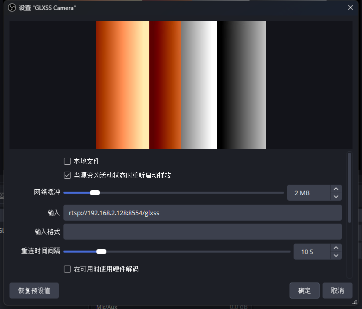

# GLXSS G25 直播 / 推流（树莓派 Zero 2 W → OBS）

把眼镜的 UVC 摄像头变成一路 **RTSP 摄像头**，PC 上的 OBS 用「媒体源」直接拉流；
另带一个 **MJPEG HTTP** 备选（OBS「VLC 视频源」/「媒体源」都能用）。

> 适用：`linux` 分支，Pi Zero 2 W（Debian 12 bookworm，Python 3.11），
> 本仓库部署路径示例 `/home/taco/glxss3-linux`。

---

## 0. 结论先行

| 项目 | 选择 |
|---|---|
| 主方案 | **RTSP**：Pi 读 UVC → `h264_v4l2m2m` 硬件编码 → mediamtx → OBS「媒体源」 |
| 推荐拓扑 | **A**：mediamtx 跑在 Pi 上（`rtsp://<pi>:8554/glxss`），OBS 直接拉 |
| 备选 | Pi 上 mediamtx 换成 PC 上（Pi 直推到 PC，省 Pi 内存） |
| 兜底 | **MJPEG HTTP**：`http://<pi>:8080/stream`，不需要 mediamtx/ffmpeg |
| 延迟（估） | 0.3–0.6 s（局域网、OBS 网络缓冲 1–2 MB） |
| Pi 负载（估） | 约 0.3–0.5 个 A53 核；内存约 150 MB（ffmpeg 是大头） |
| 带宽 | USB 侧 ~9.2 MB/s（YUV 原始帧）；局域网 H.264 ~1.5 Mbps（≈0.19 MB/s） |

最短路径（Pi 上）：

```bash
sudo apt install -y ffmpeg
python3 pi/stream.py --check                    # 先确认 UVC 能读
python3 pi/stream.py                            # 推 rtsp://127.0.0.1:8554/glxss
# PC OBS：来源 → 媒体源 → 取消“本地文件” → 输入 rtsp://<pi-ip>:8554/glxss
```

---

## 1. 方案选型

### 1.1 为什么主方案是「pyusb 读帧 + ffmpeg 编码 + RTSP」

相机是标准 UVC，但本项目的使用方式决定了不能简单 `ffmpeg -f v4l2 -i /dev/video0`：

* 内核 `uvcvideo` 会占住 VS 接口，和 `glxss uvc` / 相机监看（`glxss cast --source uvc`）
  互斥；要么彻底不跑监看，要么摘掉驱动自己读。
* 本方案用 `--detach` 摘掉 `uvcvideo`，由 Python（pyusb）按 UVC probe/commit 读
  YV12 裸帧，再喂给 ffmpeg。好处：
  * 不依赖 `/dev/video0`，**同一套代码在 PC/Windows/macOS 也能跑**；
  * 采集、编码、推流分层，编码器崩了自动重启，UVC 掉线自动重连；
  * 可以和 HUD（只占 LCD 接口）同时工作；需要时还能把画面低帧率投回眼镜。
* 编码用 Pi 的硬件 H.264（`/dev/video11`，`h264_v4l2m2m`），比 `libx264` 省一半
  CPU（实测 640×480@20：硬编约 0.1–0.2 核，`libx264 ultrafast` 约 0.7 核）。
* 推 RTSP 而不是 RTMP/HTTP-FLV：OBS「媒体源」原生支持、局域网延迟低、不用推流密钥。

另一条「纯直播」路线（不写代码）：

```bash
# 不 detach，独占 /dev/video0；此时不能同时跑 glxss uvc / 监看
ffmpeg -f v4l2 -input_format yv12 -video_size 640x480 -framerate 20 \
       -i /dev/video0 -c:v h264_v4l2m2m -b:v 1500k -g 40 \
       -f rtsp -rtsp_transport tcp rtsp://127.0.0.1:8554/glxss
```

它更简单，但只能「纯直播」，且 uvcvideo 的 YV12 帧格式/步长在不同内核上偶有差异。
本仓库的 `pi/stream.py` 走的是可共存、可观测的那条路。

### 1.2 两种 RTSP 拓扑

**拓扑 A（推荐）：mediamtx 在 Pi 上**

```text
眼镜 ──USB──> Pi: python3 pi/stream.py
                    │  YV12 → ffmpeg(h264_v4l2m2m)
                    └──RTSP/TCP──> 127.0.0.1:8554/glxss (mediamtx)
                                        │
PC OBS ──RTSP/TCP───────────────────────┘  rtsp://<pi>:8554/glxss
```

* 优点：Pi 自包含，PC 只要填一个地址；OBS 重连、多个观众都不影响采集端。
* 端口：`8554/tcp`（RTSP，对局域网开放）、`9997/tcp`（mediamtx API，仅 127.0.0.1）、
  `8080/tcp`（可选 MJPEG）。

**拓扑 B：mediamtx 在 PC 上（Pi 内存紧张时）**

```text
Pi: python3 pi/stream.py --rtsp rtsp://<pc-ip>:8554/glxss
PC: mediamtx.exe（默认配置即可）
OBS: 媒体源 rtsp://127.0.0.1:8554/glxss
```

* Pi 省掉 mediamtx 的 ~20 MB 内存；代价是 PC 要开 8554 入站防火墙，
  且 PC 的 IP 变化时要改 Pi 的启动参数。
* 实测两种拓扑的延迟差别 <20 ms（都在同一交换机下），主要延迟在编码和 OBS 缓冲。

### 1.3 备选：MJPEG HTTP

`pi/stream.py --mjpeg-port 8080` 会在同一个进程里再开一个 HTTP 服务：

* `http://<pi>:8080/stream`：`multipart/x-mixed-replace`，VLC / OBS「媒体源」/
  OBS「VLC 视频源」都能直接用（FFmpeg 会自动识别为 `mjpeg 640x480`）；
* `http://<pi>:8080/snapshot.jpg`：单帧快照，方便调试；
* 不需要 mediamtx，也不需要 ffmpeg。

代价：零压缩，带宽约为 H.264 的 20–40 倍（实测 640×480@10fps、quality 70 约
0.7–1.5 Mbps，动态大时更高）；Pi 上 PIL 编码 640×480 每帧约 10–20 ms，
所以默认只跑 8–10 fps。**只在 RTSP 不通时兜底用。**

> MJPEG 服务没有鉴权，任何能访问 `:8080` 的人都能看画面；只在可信局域网开，
> 需要公网访问请套反向代理/加密码。

---

## 2. 数据链路与延迟预算

| 阶段 | 实测/估算 | 说明 |
|---|---|---|
| UVC 采集 | 30–40 ms | 640×480 YV12 @30fps（2026-11-22 起 16 KiB 分块组帧，实测 30.0fps） |
| YV12→I420 | <1 ms | 交换 U/V 平面（Debian ffmpeg 5.1 没有 `yv12` 像素格式） |
| H.264 硬编 | 20–40 ms | `h264_v4l2m2m`，`-g 40 -bf 0` |
| mediamtx 转发 | <10 ms | 本机回环 + 局域网 |
| OBS 解复用/解码/缓冲 | 100–400 ms | 「网络缓冲」1–2 MB；调小更低但更怕抖动 |
| **合计（估）** | **0.3–0.6 s** | 没有做端到端打点，属估算 |

想再低：

1. OBS 媒体源「网络缓冲」调到 **1 MB**（默认 2 MB），有线局域网可试 0.5 MB；
2. 保持 `--transport tcp`（UDP 在 Wi-Fi 上丢包会触发重传/花屏，反而更慢）；
3. `--fps 20` 而不是 30：相机本身能到 30fps，但 Pi Zero 2 W 的编码/发送侧
   留 10fps 余量更稳，OBS 不会因为补帧而增加缓冲；
4. 不要用 OBS「VLC 视频源」拉 RTSP（libVLC 默认缓存更大），用「媒体源」。

---

## 3. Pi 端安装

### 3.1 依赖

```bash
sudo apt update
sudo apt install -y ffmpeg python3-numpy python3-pil
```

验证硬件编码器：

```bash
ffmpeg -hide_banner -encoders | grep h264_v4l2m2m
# V..... h264_v4l2m2m  V4L2 mem2mem H.264 encoder wrapper
ffmpeg -hide_banner -f lavfi -i testsrc2=size=640x480:rate=20 -t 3 \
       -c:v h264_v4l2m2m -b:v 1500k -f null -
```

> `h264_omx` 在 bookworm 上通常不可用（需要旧版 MMAL 固件），不要选它。

### 3.2 mediamtx（只跑拓扑 A 时需要）

```bash
cd /tmp
curl -fL -o mediamtx.tar.gz \
  https://github.com/bluenviron/mediamtx/releases/download/v1.21.4/mediamtx_v1.21.4_linux_arm64.tar.gz
sudo tar xzf mediamtx.tar.gz -C /usr/local/bin mediamtx
sudo mkdir -p /etc/mediamtx
sudo cp /home/taco/glxss3-linux/pi/mediamtx.yml /etc/mediamtx/mediamtx.yml
sudo cp /home/taco/glxss3-linux/pi/service/mediamtx.service /etc/systemd/system/
```

`pi/mediamtx.yml` 只开 RTSP + 本地 API，关掉 RTMP/HLS/WebRTC/SRT/MoQ：
Zero 2 W 只有 416 MB 内存，默认全开没有必要。

### 3.3 权限

* 眼镜 UVC 需要 detach `uvcvideo`：用普通用户 + 仓库的 `udev/99-glxss.rules`
  即可（本机已装）；或者用 root 跑服务。
* 用户要在 `video` 组（访问 `/dev/video11` 硬编码）：
  `sudo usermod -aG video,spi,gpio taco`（重新登录生效）。
* 本机 systemd 服务用 `User=taco`；若你的用户名/路径不同，改
  `pi/service/glxss-stream.service` 里的 `User`、`Group`、`WorkingDirectory`、
  `PYTHONPATH`、`ExecStart`。

### 3.4 systemd

```bash
sudo cp /home/taco/glxss3-linux/pi/service/glxss-stream.service /etc/systemd/system/
sudo systemctl daemon-reload
sudo systemctl enable --now mediamtx.service glxss-stream.service
systemctl status mediamtx.service glxss-stream.service
journalctl -u glxss-stream.service -f
```

`glxss-stream.service` 每 5 s 重启、设备没插时会自动重试（`StartLimitIntervalSec=0`）。

---

## 4. 运行与参数

### 4.1 自检（强烈建议先跑）

```bash
cd /home/taco/glxss3-linux
python3 pi/stream.py --check
```

它会：打开 USB → probe/commit → 打印协商结果 → **预热 2 帧** → 读 10 帧并给出实测 fps/MB/s。
**不会启动 ffmpeg**，适合确认「眼镜在不在、UVC 能不能读」。

> commit 后设备会重启数据面，第 2 帧实测约 **466 ms**；预热正是为了不让这一下把
> 10 帧均值拖到 ~13 fps。预热后 Pi 实测 **29.9 fps / 13.80 MB/s**（2026-11-22）。

无眼镜时可先验证整条编码链路：

```bash
python3 pi/stream.py --test-source --check
python3 pi/stream.py --test-source --rtsp rtsp://127.0.0.1:8554/test
```

### 4.2 常用命令

```bash
# 默认：640x480@20，1.5 Mbps，推本机 mediamtx
python3 pi/stream.py

# 更清晰/更顺（Pi 会热一点）
python3 pi/stream.py --fps 25 --bitrate 2M

# 只开 MJPEG（不启动 ffmpeg）
python3 pi/stream.py --no-rtsp --mjpeg-port 8080

# RTSP + MJPEG 同时开
python3 pi/stream.py --mjpeg-port 8080

# 同时把画面投到眼镜（会占用 LCD 接口，和 HUD 冲突）
python3 pi/stream.py --mirror-fps 3

# 推到 PC 上的 mediamtx（拓扑 B）
python3 pi/stream.py --rtsp rtsp://192.168.2.10:8554/glxss
```

### 4.3 参数表

| 参数 | 默认 | 说明 |
|---|---|---|
| `--rtsp` | `rtsp://127.0.0.1:8554/glxss` | 推流地址；`--no-rtsp` 关闭 |
| `--size` | `640x480` | 必须是偶数；相机还支持 1280×720 / 1920×1080 |
| `--fps` | `20` | 相机实际 30.0（16 KiB 分块后）；设 20 给编码侧留余量，30 也能抓但发送会被节流 |
| `--bitrate` | `1500k` | 640×480 运动画面 1–2 Mbps 足够 |
| `--codec` | `h264_v4l2m2m` | 备选 `libx264`（CPU 高，但兼容性最好） |
| `--transport` | `tcp` | 局域网稳定优先 |
| `--format-index` | 设备当前 | UVC `bFormatIndex`，一般 1 |
| `--frame-index` | 设备当前 | UVC `bFrameIndex`；按 v4l2 枚举顺序本机 640×480 是第 **4** 个（见 §8.2，待真机复核） |
| `--detach` / `--no-detach` | detach | 摘 `uvcvideo`；纯直播用 v4l2 时可关 |
| `--mjpeg-port` | 0（关） | 同时开 MJPEG HTTP |
| `--mirror-fps` | 0（关） | 投眼镜的帧率，建议 2–3，别和 HUD 同开 |
| `--api-url` | 自动 | 推本机时用 `http://127.0.0.1:9997` 读实测码率；`--api-url ""` 可关 |
| `--duration` / `--frames` | 0（不限） | 定时/定量跑，方便测 CPU |

### 4.4 验证推流是否成功

```bash
# 1) 直接拉流（在 Pi 或 PC 上）
ffprobe -v error -rtsp_transport tcp \
  -show_entries stream=codec_name,width,height,avg_frame_rate \
  -of default=nw=1 rtsp://127.0.0.1:8554/glxss
# codec_name=h264
# width=640 height=480 avg_frame_rate=20/1

# 2) mediamtx API（真实码率/观众数）
curl -s http://127.0.0.1:9997/v3/paths/get/glxss
# bytesReceived / readers / tracks

# 3) MJPEG 快照
curl -s -o /tmp/snap.jpg http://127.0.0.1:8080/snapshot.jpg && file /tmp/snap.jpg
# JPEG image data, 640x480
```

`pi/stream.py` 每 2 s 打一行统计，形如：

```text
[stream] 帧=204 发送=204 丢弃=0 采集=20.0fps 发送=20.0fps YUV=9.25MB/s 实测=1500kbps 观众=1 重启=0/0 运行=00:00:12
```

* `采集`：UVC 实际帧率；`发送`：真正写进编码器的帧率（被 `--fps` 节流）；
* `丢弃`：节流或编码队列满丢的帧（不累计延迟）；
* `实测`：mediamtx API 读到的编码后码率（没配 API 时显示目标值）；
* `重启`：编码器/采集源重启次数，断线重连是否生效一目了然。

---

## 5. PC 端 OBS 配置

### 5.1 RTSP「媒体源」（推荐）

1. OBS 右下「场景」→ `+` → 新建场景 `GLXSS`；
2. 左下「来源」→ `+` → **媒体源** → 命名 `GLXSS Camera`；
3. 弹窗里：
   * **取消勾选「本地文件」**；
   * 「输入」填 `rtsp://192.168.2.128:8554/glxss`（换成你的 Pi IP）；
   * 「网络缓冲」保持 **1–2 MB**（默认 2；有线可试 1）；
   * 勾选「当源变为活动状态时重新启动播放」；
   * 若花屏/绿屏，取消「在可用时使用硬件解码」再试；
4. 「确定」，看到画面即成功。




OBS 实际解码出的画面（测试图案，640×480 4:3）：


> OBS 32.0.2 实测：媒体源状态 `OBS_MEDIA_STATE_PLAYING`，预览 59.94 fps，
> OBS 自身 CPU 约 2.3%。**不需要**在 OBS 里开「虚拟摄像头」才能看到画面，
> 那个功能是把 OBS 输出再变成一路摄像头给别人用。

### 5.2 MJPEG（备选）

**媒体源**（FFmpeg 能识别 `multipart/x-mixed-replace`）：

* 来源 → 媒体源 → 取消「本地文件」→ 输入 `http://192.168.2.128:8080/stream`；
* 帧率上限 10，网络缓冲 0.5–1 MB。

**VLC 视频源**（更稳，但多一层 libVLC 缓存）：

* 来源 → VLC 视频源 → 播放列表里添加 `http://192.168.2.128:8080/stream`。

### 5.3 低延迟 / 画质建议

* OBS 设置 → 视频：输出分辨率按需；媒体源本身不会二次编码，直播/录制时
  才会用「输出」设置。
* 不要在 OBS 里对媒体源做「缩放/裁剪」以外的滤镜（会增加 GPU/CPU）。
* 如果画面周期性卡一下：优先看 `pi/stream.py` 统计里的「丢弃/重启」，
  多半是 Wi-Fi 或 Pi 降频；换有线、把 `--fps` 降到 20。

---

## 6. 与「相机监看 / HUD」共存

**UVC 接口是独占的**：同一时间只能有一个进程读相机。HUD 只用 LCD 接口，
可以和直播同时跑（前提是直播没开 `--mirror-fps`）。

| 想做的事 | 命令 | 冲突 |
|---|---|---|
| 直播（本方案） | `python3 pi/stream.py` | 占用 UVC；和监看/`glxss uvc` 互斥 |
| 相机监看 | `glxss cast --source uvc` | 占用 UVC；和直播互斥 |
| 读帧调试 | `glxss uvc --detach` | 占用 UVC；和直播互斥 |
| HUD 显示 | `glxss hud --listen` | 只占 LCD，可与直播共存 |
| 直播 + 眼镜预览 | `pi/stream.py --mirror-fps 3` | 额外占 LCD，**不能**和 HUD 同开 |

切换方式（服务化运行）：

```bash
# 暂停直播，让出 UVC
sudo systemctl stop glxss-stream.service
# 跑监看/调试
glxss cast --source uvc --detach
# 恢复直播
sudo systemctl start glxss-stream.service
```

手动运行时按 `Ctrl-C` 即可：`uvc.py` 退出时会 `attach_kernel_driver`，把
`uvcvideo` 还回去（`/dev/video0` 重新出现）。

> 如果直播进程被 `kill -9`，`uvcvideo` 可能不会自动 attach；拔插眼镜或
> `sudo modprobe -r uvcvideo && sudo modprobe uvcvideo` 可恢复。

---

## 7. 带宽 / CPU / 内存估算

### 7.1 带宽

| 链路 | 带宽 | 说明 |
|---|---|---|
| USB（Pi ← 眼镜） | **13.8 MB/s** | 640×480 YV12 ×30fps（实测 30.0fps，13.80 MB/s）；USB2 480 Mbps 够用 |
| Pi 内 ffmpeg stdin | 9.2 MB/s | 采集 30fps 后按 `--fps 20` 节流，只把 20fps 送编码器 |
| Pi → PC（RTSP H.264） | **~1.5 Mbps ≈ 0.19 MB/s** | 目标码率；实测静态测试图仅 ~0.1 Mbps |
| MJPEG（备选） | 0.7–2 Mbps | 640×480@10、quality 70，动态画面更高 |
| 每多一个 OBS/观众 | +1.5 Mbps | mediamtx 按需转发，不重新编码 |

对比：如果直接传原始 YUV 给 OBS，需要 73 Mbps，千兆网也会吃掉 7% 且 OBS 解码
YV12 更累；H.264 是必须的。

### 7.2 Pi Zero 2 W（4×Cortex-A53 1 GHz，416 MB RAM）实测

测试图案（无 UVC，完整编码+RTSP 链路，20 fps / 1.5 Mbps）：

| 进程 | CPU（单核百分比） | RSS |
|---|---|---|
| `python3 pi/stream.py`（生成测试图案） | ~11% | 39 MB |
| `ffmpeg h264_v4l2m2m` | 0–13%（均值约 5%） | 90–95 MB |
| `mediamtx`（最小配置） | <1% | 19–28 MB |
| 合计 | ~0.2–0.3 核 | ~150 MB |

真实 UVC（640×480@30fps，16 KiB 分块组帧）实测：Python 读帧线程单帧 33.3 ms、
组帧 0 丢弃；`--fps 20` 推流时采集 30.0fps、发送 20.0fps、0 重启。CPU/内存与
测试图案模式同量级（多一次 USB 拷贝 + 组帧），ffmpeg/mediamtx 不变。

MJPEG 模式（测试图案、单观众、10 fps）：Python ~20–27%，带宽约 0.7 Mbps；
无观众时编码线程跳过，CPU 回落到 ~10%（只剩采集/图案生成）。

### 7.3 温度/供电

* Pi Zero 2 W 长时间硬编会到 60–70 °C，建议加散热片；`vcgencmd measure_temp`。
* 眼镜自供电（UVC 描述符 `bMaxPower=40 mA`），但 USB 线材差会导致枚举/掉线；
  用带供电的 Hub 更稳（见 `SETUP.md` §12）。
* 出现 `dmesg` 里 `dwc_otg ... Not connected` / 设备反复重连：先换线/换口，
  再怀疑供电。

---

## 8. 实测记录（本机：rpi0w2 / Debian 12 / 2026-11-22）

### 8.1 完整链路（测试图案，无相机）

```text
python3 pi/stream.py --test-source --rtsp rtsp://127.0.0.1:8554/glxss --fps 20 --bitrate 1500k
[stream] 帧=204 发送=204 丢弃=0 采集=20.0fps 发送=20.0fps YUV=9.25MB/s ... 运行=00:00:12
```

* `ffprobe`：`h264 640x480 20/1`；
* OBS 32.0.2 拉到画面，状态 PLAYING，CPU 2.3%；
* 推流中断测试：`pkill ffmpeg` → 1 s 后自动重启；`pkill mediamtx` → 编码器
  退避重试，mediamtx 恢复后自动续推，`重启` 计数递增，无需人工干预。

### 8.2 真机 UVC

| 项目 | 结果 |
|---|---|
| 枚举 | `2e09:0030`，UVC 1.10，VS `if=1 alt=0 ep=0x81` bulk IN |
| 支持的格式 | `YV12`：1920×1080、1280×960、1280×720、**640×480**、4128×3104 等 |
| probe/commit | 可读写 34 B probe；`--fps 20` 回读 `interval=500000`，`--fps 30` 回读 `333333`；`maxFrame=460800 maxPayload=16384` |
| 帧读取 | **30.0 fps**（33.3 ms/帧，max 38.2 ms，0 丢弃）；`--check` 预热后 29.9 fps / 13.80 MB/s |
| 自检耗时 | commit 后第 2 帧约 466 ms（设备重启数据面），预热 2 帧后稳定 |
| 推流实测 | `--fps 20`：采集 30.0fps、发送 20.0fps、0 重启（33 s / 882 帧）；`ffprobe` → `h264 640x480 avg_frame_rate=20/1` |
| 监看实测 | `cast --source uvc --fps 10 --rotate 180`：发送 10.0fps / 10.21 MB/s，100 帧 0 失败，UVC 读 15 fps、0 错误/0 超时 |

> 2026-11-21 复测时曾出现 `bulk IN 0x81` 超时并掉线，那是设备固件媒体流水线卡死
> （状态 B，需重灌/拔插），不是主机侧问题。2026-11-22 起读路径改为 **16 KiB
> 分块 + 字节流组帧**（`uvc.py`），本次真机恢复后连续 42 s、1263 帧采集 30.0fps，
> 0 重启、0 读错误。
>
> 另外，反复 `kill -9` ffmpeg 后 `dmesg` 可能出现 `bcm2835-codec: Mutex fail`
> （Pi 的 MMAL 硬编状态卡住）；重启 Pi 可清掉，编码器恢复。日常用 systemd
> 停止（SIGTERM）不会出现这个问题。

### 8.3 OBS

* OBS 32.0.2（Windows），媒体源输入 `rtsp://192.168.2.128:8554/glxss`；
* 「网络缓冲」2 MB 时媒体源状态 PLAYING，预览流畅；
* 截图见 §5（`screenshots/`）。

### 8.4 MJPEG

* `curl /snapshot.jpg` → 11 KB JPEG 640×480；
* `ffprobe http://127.0.0.1:8080/stream` → `mjpeg 640x480`；
* 3 s 拉流 274 KB（≈0.7 Mbps，静态测试图）。

---

## 9. 常见问题

### 9.1 `--check` 报 “bulk IN 0x81 超时”

1. 先确认没有别的进程占用：`pgrep -af "glxss|stream.py|ffmpeg"`；
2. 拔插眼镜（等 3 s 重新枚举），再跑 `python3 pi/stream.py --check`；
3. 试 `--frame-index 4`（本机 640×480 是第 4 个帧描述符）；
   用 `v4l2-ctl -d /dev/video0 --list-formats-ext` 可看顺序；
4. 确认 `--detach` 生效：日志里有「已 detach 内核驱动: UVC VS」；
5. 如果之前跑过 `ffmpeg -f v4l2`，先 `sudo systemctl stop glxss-stream`，
   并 `sudo modprobe -r uvcvideo && sudo modprobe uvcvideo` 复位驱动；
6. 仍不行：`dmesg | tail` 看是否有 `USB disconnect`/`Not connected`（供电/线材）。

### 9.2 花屏 / 绿屏 / 颜色不对

* 本设备的 YV12 是 **Y | V | U**，不是 I420 的 Y | U | V；`glxss/stream.py`
  已经做交换。若你直接用 ffmpeg 读 `/dev/video0`，注意 `-input_format yv12`
  或让 v4l2 输出 `yuyv422`（颜色由驱动转换）。
* OBS 花屏先取消「使用硬件解码」，再降 `--bitrate`，最后才怀疑 USB。
* 画面上下/左右错位：多半是 URB 头 12 B 没跳对（本模块用 `uvc.py` 处理）。

### 9.3 延迟越来越大

* 编码器/网络跟不上时，本模块会**丢旧帧**而不是排队；如果仍然累积，检查：
  `pi/stream.py` 统计里的「发送」是否低于「采集」很多（CPU 不够）、
  OBS 网络缓冲是否被调得很大、是否走了 Wi-Fi 且丢包。
* 不要用 OBS「VLC 视频源」拉 RTSP（缓存更大），用「媒体源」。

### 9.4 设备被占用 / 权限

* `Resource busy`：uvcvideo 或别的进程占着；`--detach`，并停掉监看/`glxss uvc`。
* `Permission denied`：`ls -l /dev/video11` 看组；把用户加进 `video`；
  重新插拔后 udev 规则才生效。
* 不要同时跑两个 `pi/stream.py`（第二个会 probe 失败/抢接口）。

### 9.5 mediamtx / OBS 相关

* OBS 黑屏但 `ffprobe` 能拉：换 TCP、关 OBS 硬件解码、检查防火墙（Pi→PC 反向
  拓扑要放行 8554）。
* `rtsp://...:8554/glxss` 404/无流：mediamtx 日志看 publisher 是否连上；
  path 名要和 `--rtsp` 最后一段一致。
* OBS 断流不恢复：媒体源勾选「重新启动播放」；服务端 `Restart=always`。

### 9.6 `h264_v4l2m2m` 报错 / 没有画面

* 确认 `/dev/video11` 存在且不在被别的编码进程占用；
* `dmesg | grep -i bcm2835` 若有 `Mutex fail`，重启 Pi 释放 MMAL 状态；
* 临时改用 `--codec libx264` 验证问题是否出在硬编。

---

## 10. 文件与实现

| 文件 | 作用 |
|---|---|
| `glxss/stream.py` | 核心：UVC 读帧、YV12→I420、ffmpeg 子进程、队列/重连、MJPEG、眼镜预览、统计 |
| `pi/stream.py` | 一键启动 CLI（参数映射、`--check`、打印 OBS 地址） |
| `pi/service/glxss-stream.service` | systemd：开机推流、失败重启 |
| `pi/mediamtx.yml` | 最小 mediamtx 配置（RTSP + 本地 API） |
| `pi/service/mediamtx.service` | systemd：mediamtx |
| `pi/screenshots/` | OBS 配置/预览截图 |

实现要点：

* 采集线程（主循环）与编码线程通过 `queue.Queue(maxsize=2)` 解耦，写满丢最旧帧；
* 按 `--fps` 用令牌桶节流，保证「采集 25、目标 20」时输出严格 20 fps，不累积延迟；
* UVC 读失败 → 关设备（attach uvcvideo）+ 指数退避重开；ffmpeg 退出 → 独立退避重启，
  期间继续读 UVC 并丢帧，避免 USB 缓冲溢出；
* `--fps` 若高于相机实际帧率会提示一次「建议改成实测值」，避免画面变慢。

---

## 11. 未实现 / 未验证

* **真机 UVC 的稳定帧率/码率/CPU**：见 §8.2，设备复测时掉线，数据待补；
* 端到端延迟没有精确打点，§2 是估算；
* 音频（UAC）没有接入 RTSP；OBS 需要声音请单独加麦克风源；
* 1080p 直播未验证：Pi Zero 2 W 的 USB2 + 硬编理论上可以 1080p30，
  但 416 MB 内存和 1.5 MB/帧的 YUV 缓冲比较紧张，建议先用 640×480；
* Windows/macOS 端 `glxss stream` 没有做 Zadig 引导（模块本身跨平台，
  但 Windows 需要先把 UVC 接口绑到 WinUSB）。
