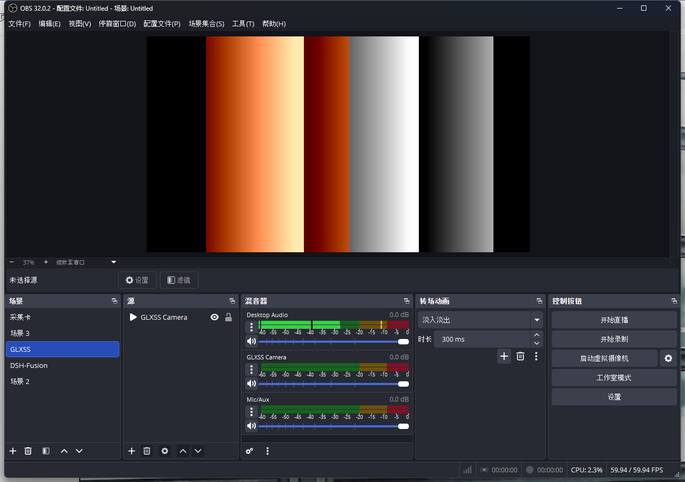

# GLXSS G25 直播 / 推流（树莓派 Zero 2 W → OBS）

把眼镜的 UVC 摄像头变成一路 **RTSP 摄像头**，PC 上的 OBS 用「媒体源」直接拉流；
另带一个 **MJPEG HTTP** 备选（OBS「VLC 视频源」/「媒体源」都能用）。

> 适用：`linux` 分支，Pi Zero 2 W（Debian 12 bookworm，Python 3.11），
> 本仓库部署路径示例 `/home/taco/glxss3-linux`。

---

## 0. 结论先行

| 项目 | 选择 |
|---|---|
| 主方案 | **RTSP**：Pi 读 UVC → `h264_v4l2m2m` 硬件编码 → mediamtx → OBS「媒体源」 |
| 推荐拓扑 | **A**：mediamtx 跑在 Pi 上（`rtsp://<pi>:8554/glxss`），OBS 直接拉 |
| 备选 | Pi 上 mediamtx 换成 PC 上（Pi 直推到 PC，省 Pi 内存） |
| 兜底 | **MJPEG HTTP**：`http://<pi>:8080/stream`，不需要 mediamtx/ffmpeg |
| 眼镜预览 | `--mirror-fps N`：**同一帧共享**给编码线程和 LCD 线程；**长按 Fn** 在 camera preview ↔ HUD 间切换（HUD 由 stream 进程内渲染，不释放 LCD）；短按循环数字变焦 |
| Fn 按键 | 长按 ≥0.9 s（只看时间）= camera preview ↔ HUD；短按（preview 下）= 数字变焦 1.0x/1.5x/2.0x 循环，HUD 下忽略；RTSP 开关改用 `ctl rtsp on\|off`；见 §8.6.2 |
| 延迟（估） | 0.3–0.6 s（局域网、OBS 网络缓冲 1–2 MB） |
| Pi 负载（实测） | 720p30 只推流 **python ~1.28 核 + ffmpeg ~0.31 核**；再加 10 fps 眼镜预览 **python ~1.08 核 + ffmpeg ~0.23 核**（GIL 是双路瓶颈，见 §7.2） |
| 带宽 | USB 侧 720p30 **~40–42 MB/s**（YUV 原始帧）；局域网 H.264 ~0.9–3 Mbps |
| 分辨率 | **1280×720 全画幅**（`bFrameIndex=3`）；640×480 用 `--size 640x480` |

最短路径（Pi 上）：

```bash
sudo apt install -y ffmpeg python3-usb1
python3 pi/stream.py --check                    # 先确认 UVC 能读（异步 16 URB，实测 30.7 fps）
python3 pi/stream.py --fps 30 --bitrate 2M      # 推 rtsp://127.0.0.1:8554/glxss
# PC OBS：来源 → 媒体源 → 取消“本地文件” → 输入 rtsp://<pi-ip>:8554/glxss
# 眼镜预览：长按 Fn ≥0.9 s（或 python3 -m glxss ctl display preview）
```

---

## 1. 方案选型

### 1.1 为什么主方案是「pyusb 读帧 + ffmpeg 编码 + RTSP」

相机是标准 UVC，但本项目的使用方式决定了不能简单 `ffmpeg -f v4l2 -i /dev/video0`：

* 内核 `uvcvideo` 会占住 VS 接口，和 `glxss uvc` / 相机监看（`glxss cast --source uvc`）
  互斥；要么彻底不跑监看，要么摘掉驱动自己读。
* 本方案用 `--detach` 摘掉 `uvcvideo`，由 Python（pyusb）按 UVC probe/commit 读
  YV12 裸帧，再喂给 ffmpeg。好处：
  * 不依赖 `/dev/video0`，**同一套代码在 PC/Windows/macOS 也能跑**；
  * 采集、编码、推流分层，编码器崩了自动重启，UVC 掉线自动重连；
  * 可以和独立 HUD 进程同时工作；开 `--mirror-fps` 后眼镜屏由本进程接管
    （preview ↔ HUD，长按 Fn 切换），不要再同时跑 `glxss hud`。
* 编码用 Pi 的硬件 H.264（`/dev/video11`，`h264_v4l2m2m`），比 `libx264` 省一半
  CPU（实测 640×480@20：硬编约 0.1–0.2 核，`libx264 ultrafast` 约 0.7 核；
  720p 硬编实测 ffmpeg 只占 ~6–9%，瓶颈在 USB 采集）。
* 推 RTSP 而不是 RTMP/HTTP-FLV：OBS「媒体源」原生支持、局域网延迟低、不用推流密钥。

另一条「纯直播」路线（不写代码）：

```bash
# 不 detach，独占 /dev/video0；此时不能同时跑 glxss uvc / 监看
ffmpeg -f v4l2 -input_format yv12 -video_size 1280x720 -framerate 15 \
       -i /dev/video0 -c:v h264_v4l2m2m -b:v 3M -g 30 \
       -f rtsp -rtsp_transport tcp rtsp://127.0.0.1:8554/glxss
```

它更简单，但只能「纯直播」，且 uvcvideo 的 YV12 帧格式/步长在不同内核上偶有差异。
本仓库的 `pi/stream.py` 走的是可共存、可观测的那条路。

### 1.2 两种 RTSP 拓扑

**拓扑 A（推荐）：mediamtx 在 Pi 上**

```text
眼镜 ──USB──> Pi: python3 pi/stream.py
                    │  YV12 → ffmpeg(h264_v4l2m2m)
                    └──RTSP/TCP──> 127.0.0.1:8554/glxss (mediamtx)
                                        │
PC OBS ──RTSP/TCP───────────────────────┘  rtsp://<pi>:8554/glxss
```

* 优点：Pi 自包含，PC 只要填一个地址；OBS 重连、多个观众都不影响采集端。
* 端口：`8554/tcp`（RTSP，对局域网开放）、`9997/tcp`（mediamtx API，仅 127.0.0.1）、
  `8080/tcp`（可选 MJPEG）。

**拓扑 B：mediamtx 在 PC 上（Pi 内存紧张时）**

```text
Pi: python3 pi/stream.py --rtsp rtsp://<pc-ip>:8554/glxss
PC: mediamtx.exe（默认配置即可）
OBS: 媒体源 rtsp://127.0.0.1:8554/glxss
```

* Pi 省掉 mediamtx 的 ~20 MB 内存；代价是 PC 要开 8554 入站防火墙，
  且 PC 的 IP 变化时要改 Pi 的启动参数。
* 实测两种拓扑的延迟差别 <20 ms（都在同一交换机下），主要延迟在编码和 OBS 缓冲。

### 1.3 备选：MJPEG HTTP

`pi/stream.py --mjpeg-port 8080` 会在同一个进程里再开一个 HTTP 服务：

* `http://<pi>:8080/stream`：`multipart/x-mixed-replace`，VLC / OBS「媒体源」/
  OBS「VLC 视频源」都能直接用（FFmpeg 会自动识别为 `mjpeg 1280x720`）；
* `http://<pi>:8080/snapshot.jpg`：单帧快照，方便调试；
* 不需要 mediamtx，也不需要 ffmpeg。

代价：零压缩，带宽约为 H.264 的 20–40 倍（实测 640×480@10fps、quality 70 约
0.7–1.5 Mbps，动态大时更高）；Pi 上 PIL 编码 720p 每帧约 25–45 ms，
所以默认只跑 8–10 fps。**只在 RTSP 不通时兜底用。**

> MJPEG 服务没有鉴权，任何能访问 `:8080` 的人都能看画面；只在可信局域网开，
> 需要公网访问请套反向代理/加密码。

---

## 2. 数据链路与延迟预算

| 阶段 | 实测/估算 | 说明 |
|---|---|---|
| UVC 采集 | **33 ms**（30fps） | 1280×720 YV12 异步 16 URB；同步回退 50–60 ms（17–19fps） |
| YV12→yuv420p | 0 拷贝 | 只换 U/V 的**写入顺序**，分三次写 ffmpeg stdin（见 §8.5） |
| H.264 硬编 | 20–40 ms | `h264_v4l2m2m`，`-g 60 -bf 0` |
| 眼镜预览（旁路） | 渲染 22–28 ms + 发送 29–39 ms | 独立线程，10 fps；发送时暂停 UVC，不阻塞推流 |
| mediamtx 转发 | <10 ms | 本机回环 + 局域网 |
| OBS 解复用/解码/缓冲 | 100–400 ms | 「网络缓冲」1–2 MB；调小更低但更怕抖动 |
| **合计（估）** | **0.3–0.6 s** | 没有做端到端打点，属估算 |

想再低：

1. OBS 媒体源「网络缓冲」调到 **1 MB**（默认 2 MB），有线局域网可试 0.5 MB；
2. 保持 `--transport tcp`（UDP 在 Wi-Fi 上丢包会触发重传/花屏，反而更慢）；
3. `--fps` 按实测值填：异步 16 URB 下 720p 实测 30 fps，用 `--fps 30`；
   同步回退只有 17–19 fps，用 `--fps 15`。按实测值编码，OBS 不会因为时间戳
   补帧而增加缓冲；
4. 不要用 OBS「VLC 视频源」拉 RTSP（libVLC 默认缓存更大），用「媒体源」。

---

## 3. Pi 端安装

### 3.1 依赖

```bash
sudo apt update
sudo apt install -y ffmpeg python3-numpy python3-pil python3-usb1
```

> `python3-usb1` 提供 `usb1`（python-libusb1），是 720p30 异步多 URB 需要的；
> 不装也能跑，会自动回退同步 16 KiB 读（720p ~18–19 fps）。
> 卸载/禁用异步：`--async-urb 0`。

验证硬件编码器：

```bash
ffmpeg -hide_banner -encoders | grep h264_v4l2m2m
# V..... h264_v4l2m2m  V4L2 mem2mem H.264 encoder wrapper
ffmpeg -hide_banner -f lavfi -i testsrc2=size=640x480:rate=20 -t 3 \
       -c:v h264_v4l2m2m -b:v 1500k -f null -
```

> `h264_omx` 在 bookworm 上通常不可用（需要旧版 MMAL 固件），不要选它。

### 3.2 mediamtx（只跑拓扑 A 时需要）

```bash
cd /tmp
curl -fL -o mediamtx.tar.gz \
  https://github.com/bluenviron/mediamtx/releases/download/v1.21.4/mediamtx_v1.21.4_linux_arm64.tar.gz
sudo tar xzf mediamtx.tar.gz -C /usr/local/bin mediamtx
sudo mkdir -p /etc/mediamtx
sudo cp /home/taco/glxss3-linux/pi/mediamtx.yml /etc/mediamtx/mediamtx.yml
sudo cp /home/taco/glxss3-linux/pi/service/mediamtx.service /etc/systemd/system/
```

`pi/mediamtx.yml` 只开 RTSP + 本地 API，关掉 RTMP/HLS/WebRTC/SRT/MoQ：
Zero 2 W 只有 416 MB 内存，默认全开没有必要。

### 3.3 权限

* 眼镜 UVC 需要 detach `uvcvideo`：用普通用户 + 仓库的 `udev/99-glxss.rules`
  即可（本机已装）；或者用 root 跑服务。
* 用户要在 `video` 组（访问 `/dev/video11` 硬编码）：
  `sudo usermod -aG video,spi,gpio taco`（重新登录生效）。
* 本机 systemd 服务用 `User=taco`；若你的用户名/路径不同，改
  `pi/service/glxss-stream.service` 里的 `User`、`Group`、`WorkingDirectory`、
  `PYTHONPATH`、`ExecStart`。

### 3.4 systemd

```bash
sudo cp /home/taco/glxss3-linux/pi/service/glxss-stream.service /etc/systemd/system/
sudo systemctl daemon-reload
sudo systemctl enable --now mediamtx.service glxss-stream.service
systemctl status mediamtx.service glxss-stream.service
journalctl -u glxss-stream.service -f
```

`glxss-stream.service` 每 5 s 重启、设备没插时会自动重试（`StartLimitIntervalSec=0`）。
服务里 `GLXSS_SOCK=/run/glxss/glxssctl.sock`，从 SSH 控制时：

```bash
GLXSS_SOCK=/run/glxss/glxssctl.sock python3 -m glxss ctl status
GLXSS_SOCK=/run/glxss/glxssctl.sock python3 -m glxss ctl display hud
GLXSS_SOCK=/run/glxss/glxssctl.sock python3 -m glxss ctl rtsp off
```

> `glxss ctl` 也支持 `--socket /run/glxss/glxssctl.sock`，两者等价。
> 如果同时跑 `glxss hud --listen`，两个进程都用这个 socket 会冲突；HUD 用
> 默认路径或 `--socket` 换一个。

---

## 4. 运行与参数

### 4.1 自检（强烈建议先跑）

```bash
cd /home/taco/glxss3-linux
python3 pi/stream.py --check
```

它会：打开 USB → probe/commit → 打印协商结果 → **预热 2 帧** → 读 10 帧并给出实测 fps/MB/s。
**不会启动 ffmpeg**，适合确认「眼镜在不在、UVC 能不能读」。

> commit 后设备会重启数据面，第 2 帧实测约 **466 ms**；预热正是为了不让这一下把
> 10 帧均值拖到 ~13 fps。预热后 Pi 实测：640×480 **29.9 fps / 13.80 MB/s**；
> **1280×720（默认）同步读 18.6–19.0 fps / 25.7–26.2 MB/s；异步 16 URB
> 30.7 fps / 42.4 MB/s**（2026-11-22 晚，见 §8.6）。

无眼镜时可先验证整条编码链路：

```bash
python3 pi/stream.py --test-source --check
python3 pi/stream.py --test-source --rtsp rtsp://127.0.0.1:8554/test
```

### 4.2 常用命令

```bash
# 默认：1280x720@15，1500k，推本机 mediamtx（异步 16 URB，采集可到 30）
python3 pi/stream.py

# 720p30：采集/编码都跑到 30 fps（Pi 会热一点）
python3 pi/stream.py --fps 30 --bitrate 2M --async-urb 16

# 强制同步读（对照/没有 python3-usb1 时）
python3 pi/stream.py --async-urb 0

# 只开 MJPEG（不启动 ffmpeg）
python3 pi/stream.py --no-rtsp --mjpeg-port 8080

# RTSP + MJPEG 同时开
python3 pi/stream.py --mjpeg-port 8080

# 同时把画面投到眼镜（本进程接管 LCD；长按 Fn 在 preview/HUD 间切换）
# 同一帧共享给编码线程 + LCD 线程；LCD 发送时暂停 UVC，单帧 29–39 ms
python3 pi/stream.py --fps 30 --async-urb 16 --mirror-fps 10
python3 pi/stream.py --mirror-fps 5              # 5 fps 预览换 23.7 fps 采集
python3 pi/stream.py --mirror-fps 10 --mirror-fit cover --no-mirror-level
python3 pi/stream.py --mirror-fps 10 --zoom 1.5   # 启动即 1.5x（853×480 居中裁切）
python3 pi/stream.py --mirror-fps 10 --mirror-rotate 180   # 画面上下颠倒时
# 水平仪方向调试（默认 180 下 preview 的 pitch/roll 都取反）
python3 pi/stream.py --mirror-fps 10 --mirror-rotate 180 \
    --level-invert-x --no-level-invert-y

# Fn 按键 / 状态：默认启动控制 socket
#   长按 = preview ↔ HUD；短按 = 循环 1.0/1.5/2.0x（HUD 下忽略）；RTSP 不绑键
python3 -m glxss ctl status
python3 -m glxss ctl display preview     # 也可 hud/toggle
python3 -m glxss ctl zoom 1.5            # 也可 1.0/2.0/cycle
python3 -m glxss ctl rtsp off            # 也可 on/toggle
python3 -m glxss ctl button click        # 无硬件时注入 click/long（调试）

# 旧的 640×480 裁切视角（回退/对比用）
python3 pi/stream.py --size 640x480 --bitrate 1500k

# 推到 PC 上的 mediamtx（拓扑 B）
python3 pi/stream.py --rtsp rtsp://192.168.2.10:8554/glxss
```

### 4.3 参数表

| 参数 | 默认 | 说明 |
|---|---|---|
| `--rtsp` | `rtsp://127.0.0.1:8554/glxss` | 推流地址；`--no-rtsp` 关闭 |
| `--size` | `1280x720` | 720p 是**全画幅**（frame 3）；`640x480` 是旧的裁切档（frame 4） |
| `--fps` | `15` | 编码帧率，同时作为 UVC interval；异步 16 URB 下单路实测 30 fps，双路 10fps 预览约 17.5–18.4 fps |
| `--async-urb` | `16` | libusb1 异步 URB 数；0=同步 16 KiB 读；实测 2 个就够纯读 40 MB/s，16 个在 HID/ffmpeg 并发下更稳 |
| `--async-timeout` | `1000` | 单个异步 URB 超时毫秒 |
| `--hid-poll` | `0.1` | HID/Fn 轮询间隔（设备报告周期 300 ms） |
| `--no-fn` | 关 | 禁用 Fn 按键（长按切显示 / 短按变焦；仍可用 `ctl display/zoom`） |
| `--fn-long-press` / `--fn-long-packets` | `0.9` / 废弃 | 长按**只看按住时间**（≥0.9 s）；`--fn-long-packets` 仅为兼容旧脚本保留 |
| `--hud-fps` | `2` | 长按 Fn 切到 HUD 后的重绘/发送帧率 |
| `--nav-port` | `9999` | 手机导航 UDP 端口（0=不监听）；`--nav-bind` 默认 `0.0.0.0` |
| `--nav-stale` | `5` | 多少秒没收到导航包就回「等待手机…」 |
| `--no-nav-udp` | 关 | 不监听手机 UDP；`glxss ctl nav` 手动注入仍可用 |
| `--ctl-socket` / `--no-ctl` | 自动 | 控制 socket 路径；`--no-ctl` 关闭（只靠状态行/日志） |
| `--preview-fps` | 0 | 长按 Fn 打开预览时的帧率；0=使用 `--mirror-fps` 或 10 |
| `--zoom` | `1.0` | 启动档位 `1.0/1.5/2.0`；只影响眼镜预览（RTSP 始终全画幅）。运行中短按 Fn 或 `ctl zoom` 切换，重启回该值（不落盘） |
| `--bitrate` | `1500k` | 代码默认 1500k；720p 运动画面建议 2–3M |
| `--codec` | `h264_v4l2m2m` | 备选 `libx264`（CPU 高，但兼容性最好） |
| `--transport` | `tcp` | 局域网稳定优先 |
| `--format-index` | 设备当前 | UVC `bFormatIndex`，一般 1 |
| `--frame-index` | 自动 | 按 VS 描述符选；720p=**3**，480p=4（`glxss uvc --list-modes` 可列） |
| `--detach` / `--no-detach` | detach | 摘 `uvcvideo`；纯直播用 v4l2 时可关 |
| `--mjpeg-port` | 0（关） | 同时开 MJPEG HTTP |
| `--mirror-fps` | 0（关） | 启动即投眼镜的帧率；0=不投，长按 Fn 打开（默认 10 fps）。共享帧，不额外读 UVC |
| `--mirror-fit` | `fit` | `cover`（居中裁满、无黑边）/ `fit`（等比、上下黑边）/ `stretch` |
| `--mirror-rotate` | `0` | `180` = 画面上下颠倒时翻转；preview 水平仪默认同时取反 pitch/roll |
| `--level-invert-x` / `--level-invert-y` | 自动 | 强制取反 roll（左右倾）/ pitch（上下）；`--no-level-invert-x/y` 强制不取反 |
| `--mirror-level` | 开 | 读 HID 加速度计画水平仪；`--no-mirror-level` 只画三分线 + 准星 |
| `--no-lcd-pause` | 关 | LCD 发送时不暂停 UVC（对照用：发送窗口 37–43 ms、采集 19.9–21.9 fps；默认暂停 32–39 ms） |
| `--api-url` | 自动 | 推本机时用 `http://127.0.0.1:9997` 读实测码率；`--api-url ""` 可关 |
| `--duration` / `--frames` | 0（不限） | 定时/定量跑，方便测 CPU |

### 4.4 验证推流是否成功

```bash
# 1) 直接拉流（在 Pi 或 PC 上）
ffprobe -v error -rtsp_transport tcp \
  -show_entries stream=codec_name,width,height,avg_frame_rate \
  -of default=nw=1 rtsp://127.0.0.1:8554/glxss
# codec_name=h264
# width=1280 height=720 avg_frame_rate=25/1   （--fps 25 时；默认 15/1）

# 2) mediamtx API（真实码率/观众数）
curl -s http://127.0.0.1:9997/v3/paths/get/glxss
# bytesReceived / readers / tracks

# 3) MJPEG 快照
curl -s -o /tmp/snap.jpg http://127.0.0.1:8080/snapshot.jpg && file /tmp/snap.jpg
# JPEG image data, 640x480
```

`pi/stream.py` 每 2 s 打一行统计，形如：

```text
[stream] 帧=204 发送=204 丢弃=0 采集=20.0fps 发送=20.0fps YUV=9.25MB/s 实测=1500kbps 观众=1 重启=0/0 运行=00:00:12
```

* `采集`：UVC 实际帧率；`发送`：真正写进编码器的帧率（被 `--fps` 节流）；
* `丢弃`：节流或编码队列满丢的帧（不累计延迟）；
* `实测`：mediamtx API 读到的编码后码率（没配 API 时显示目标值）；
* `重启`：编码器/采集源重启次数，断线重连是否生效一目了然。

---

## 5. PC 端 OBS 配置

### 5.1 RTSP「媒体源」（推荐）

1. OBS 右下「场景」→ `+` → 新建场景 `GLXSS`；
2. 左下「来源」→ `+` → **媒体源** → 命名 `GLXSS Camera`；
3. 弹窗里：
   * **取消勾选「本地文件」**；
   * 「输入」填 `rtsp://192.168.2.128:8554/glxss`（换成你的 Pi IP）；
   * 「网络缓冲」保持 **1–2 MB**（默认 2；有线可试 1）；
   * 勾选「当源变为活动状态时重新启动播放」；
   * 若花屏/绿屏，取消「在可用时使用硬件解码」再试；
4. 「确定」，看到画面即成功。




OBS 实际解码出的画面（测试图案，640×480 4:3）：


> OBS 32.0.2 实测：媒体源状态 `OBS_MEDIA_STATE_PLAYING`，预览 59.94 fps，
> OBS 自身 CPU 约 2.3%。**不需要**在 OBS 里开「虚拟摄像头」才能看到画面，
> 那个功能是把 OBS 输出再变成一路摄像头给别人用。

### 5.2 MJPEG（备选）

**媒体源**（FFmpeg 能识别 `multipart/x-mixed-replace`）：

* 来源 → 媒体源 → 取消「本地文件」→ 输入 `http://192.168.2.128:8080/stream`；
* 帧率上限 10，网络缓冲 0.5–1 MB。

**VLC 视频源**（更稳，但多一层 libVLC 缓存）：

* 来源 → VLC 视频源 → 播放列表里添加 `http://192.168.2.128:8080/stream`。

### 5.3 低延迟 / 画质建议

* OBS 设置 → 视频：输出分辨率按需；媒体源本身不会二次编码，直播/录制时
  才会用「输出」设置。
* 不要在 OBS 里对媒体源做「缩放/裁剪」以外的滤镜（会增加 GPU/CPU）。
* 如果画面周期性卡一下：优先看 `pi/stream.py` 统计里的「丢弃/重启」，
  多半是 Wi-Fi 或 Pi 降频；换有线、把 `--fps` 降到 20。

---

## 6. 与「相机监看 / HUD」共存

**UVC 接口是独占的**：同一时间只能有一个进程读相机。不开 `--mirror-fps` 时
直播不碰 LCD，独立 HUD 进程可以同时跑；开了 `--mirror-fps` 后眼镜屏由 stream
接管（preview ↔ HUD 由 Fn 短按切换），**不要**再同时跑 `glxss hud`。

| 想做的事 | 命令 | 冲突 |
|---|---|---|
| 直播（本方案） | `python3 pi/stream.py` | 占用 UVC；和监看/`glxss uvc` 互斥 |
| 相机监看 | `glxss cast --source uvc` | 占用 UVC；和直播互斥 |
| 读帧调试 | `glxss uvc --detach` | 占用 UVC；和直播互斥 |
| HUD 显示（独立） | `glxss hud --listen` | 只占 LCD；直播开 `--mirror-fps` 时不能同开 |
| 直播 + 眼镜预览/HUD | `pi/stream.py --mirror-fps 10` | 占用 LCD；HUD 由 stream 自己渲染；共享帧，不额外读 UVC |

切换方式（服务化运行）：

```bash
# 暂停直播，让出 UVC
sudo systemctl stop glxss-stream.service
# 跑监看/调试
glxss cast --source uvc --detach
# 恢复直播
sudo systemctl start glxss-stream.service
```

手动运行时按 `Ctrl-C` 即可：`uvc.py` 退出时会 `attach_kernel_driver`，把
`uvcvideo` 还回去（`/dev/video0` 重新出现）。

> 如果直播进程被 `kill -9`，`uvcvideo` 可能不会自动 attach；拔插眼镜或
> `sudo modprobe -r uvcvideo && sudo modprobe uvcvideo` 可恢复。

---

## 6.5 导航 HUD：手机 Wi-Fi UDP → 箭头/距离/动作

眼镜屏的 HUD 模式现在是**导航 HUD**（`glxss/hud.py`）：

```text
┌────────────────────────────────────────────────────────────┐
│ 01:18 LOCAL  HEADING 040°  ● PHONE LINK        2.0 fps    │
├──────────┬───────────────────────────────┬─────────────────┤
│ LIGHT    │             N                 │ ATTITUDE        │
│  321 lux │          ╱  ▲  ╲             │  PITCH  -2.2    │
│ TEMP     │        W │  ARROW  │ E        │  ROLL   +0.7    │
│  36.5°C  │          ╲       ╱             │  GYRO  +2 -1 0  │
│ SENSOR OK│             120 m              │                 │
├──────────┴───────────────────────────────┴─────────────────┤
│                     右转（NEXT ACTION）                    │
└────────────────────────────────────────────────────────────┘
```

* 大箭头旋转角 = `bearing - heading`；手机没给 `heading` 时直接用
  `bearing`（`ctl nav` 手动测试就是这个语义）；
* 箭头下方为距离（`120 m` / `1.2 km`），底部为动作文字（中文 UTF-8）；
* 顶部 heading 优先用手机的 `heading`，否则用眼镜 HID 罗盘；
* 无数据/超时：中心「等待手机…」，顶部 `WAITING PHONE`。

### 6.5.1 数据链路

```text
Android App（导航 HUD 开关）
  └─ 每秒 1 包 UDP JSON → 192.168.2.128:9999
        └─ stream: nav.NavListener → nav.LatestNav（线程安全单槽）
              └─ HudSource._poll_nav()（变化才重绘）→ 640×400 HUD
```

`nav.LatestNav` 与 `pipeline.LatestFrame` 同思路：只保留最新一帧，旧包直接
覆盖，不排队、不阻塞 UVC 读线程。UDP 帧带 `expires_at = now + --nav-stale`；
`ctl nav` 注入的帧 `ttl=0` 持久，直到 `ctl nav-clear` 或手机新包覆盖。

### 6.5.2 JSON 协议

```json
{"bearing": 45, "distance": 120, "label": "右转", "heading": 40}
```

| 字段 | 类型 | 说明 |
|---|---|---|
| `bearing` | number | 目标绝对方位（deg，0=北，顺时针） |
| `distance` | number | 距离（米） |
| `label` | string | 下一动作文字，UTF-8，最长 48 字 |
| `heading` | number? | 手机当前朝向（deg）；省略/`null` 时箭头直接用 bearing |

* 端口默认 **UDP 9999**，绑定 `0.0.0.0`（不需要 root，>1024）；
* 手机 1 Hz 发包；Pi 端 5 s 没新包就显示等待；
* 坏包（非 JSON/字段非数字）只丢该包并记 `dropped`，不会清掉上一帧。

### 6.5.3 启动 / 测试

systemd 的 `glxss-stream.service` 默认就会监听 9999；需要改端口/关闭时：

```bash
# /etc/systemd/system/glxss-stream.service 的 ExecStart 追加：
--nav-port 9999 --nav-bind 0.0.0.0 --nav-stale 5
# 或完全关闭 UDP（仍可用 ctl nav）
--no-nav-udp
sudo systemctl daemon-reload && sudo systemctl restart glxss-stream
```

无手机时命令行验证（Pi 本地）：

> systemd 单元把控制 socket 固定到 `/run/glxss/glxssctl.sock`：
> `export GLXSS_SOCK=/run/glxss/glxssctl.sock`，或每条 `ctl` 加
> `--socket /run/glxss/glxssctl.sock`。否则默认客户端会去
> `/run/user/1000/glxssctl.sock`，报“控制服务未启动”。

```bash
# 1) 注入一帧：bearing=45，距离 120 m，动作“右转”，手机 heading=40
export GLXSS_SOCK=/run/glxss/glxssctl.sock
glxss ctl nav 45 --distance 120 --label 右转 --heading 40
glxss ctl status                 # 应出现“导航 / 导航UDP”两行
glxss ctl nav-clear

# 2) 模拟手机 UDP（PC 上执行，IP 换成 Pi）
python3 -c 'import json,socket; socket.socket(socket.AF_INET,socket.SOCK_DGRAM).sendto(json.dumps({"bearing":90,"distance":1200,"label":"右转","heading":80},ensure_ascii=False).encode(),("192.168.2.128",9999))'

# 3) 看端口/收包
ss -lunp | grep 9999
journalctl -u glxss-stream -f | grep -E '\[nav\]|导航'
```

`ctl status` 里的字段：

```text
导航    : bearing=45° distance=120 m heading=40° label='右转' age=0.12s fresh=True
导航UDP : alive 0.0.0.0:9999，收 12 包，坏包 0
```

### 6.5.4 防火墙 / 字体 / 权限

* **防火墙**：Debian 默认无 ufw；如果装了，放行 UDP：
  `sudo ufw allow 9999/udp` 或 nftables 加 `udp dport 9999 accept`。
  用 `ss -lunp | grep 9999` 确认进程确实绑定（`nav` 会打印
  `[nav] UDP 导航监听 0.0.0.0:9999`）。
* **权限**：9999 > 1024，taco 用户即可绑定；不需要 root/cap_net_bind_service。
* **中文字体**：HUD 动作文字需要 CJK 字体，否则自动降级英文。
  ```bash
  sudo apt install fonts-wqy-zenhei     # 约 15 MB，够用
  fc-list :lang=zh | head
  ```
  装完重启 `glxss-stream` 即可（Pillow 每次启动找字体，不需要重启系统）。

### 6.5.5 Android 端入口

App 首页「导航 HUD（Wi-Fi UDP → Pi）」：

* 开关：开=启动 GPS heading 监听 + 每秒 UDP；关=停止（Pi 5 s 后回等待）；
* Pi IP / 端口输入，默认 `192.168.2.128:9999`；
* bearing 滑块（0..359°）+ 左转/直行/右转/到达快捷键；
* 距离滑块（0..2000 m）；
* 手动 heading 开关（无 GPS 或需要固定角度测试时用）；
* heading 默认来自 `LocationManager` 的 `Location.getBearing()`，
  未定位/静止没有 bearing 时 JSON 省略 `heading`。

---

## 7. 带宽 / CPU / 内存估算

### 7.1 带宽

| 链路 | 带宽 | 说明 |
|---|---|---|
| USB（Pi ← 眼镜，720p30 异步） | **40–42 MB/s** | 1280×720 YV12 ×30 fps = 41.5 MB/s；`--check` 实测 42.4 MB/s |
| USB（Pi ← 眼镜，720p 同步回退） | **23–29 MB/s** | 同步单 URB 上限，对应 17–21 fps |
| USB（480p 回退） | **13.8 MB/s** | 640×480 YV12 ×30fps（历史） |
| Pi 内 ffmpeg stdin | 14–41 MB/s | 按 `--fps` 节流；720p `--fps 30` 时 ~41.5 MB/s |
| Pi → PC（RTSP H.264） | **0.8–3 Mbps ≈ 0.1–0.4 MB/s** | 目标码率 3M；静态场景实测 ~0.65–0.9 Mbps |
| MJPEG（备选） | 1–4 Mbps | 720p 的 PIL 编码更慢，只作调试 |
| 每多一个 OBS/观众 | +1–3 Mbps | mediamtx 按需转发，不重新编码 |

> 720p30 需要 41.5 MB/s。2026-11-22 晚的异步多 URB 实测单路 **29.7–30.7 fps /
> 40.6–42.4 MB/s**，说明 Pi 的 dwc_otg 和眼镜都能跑满；同步读的 ~26–29 MB/s
> 只是单 URB 往返开销。1080p 异步实测 43.64 MB/s / 14 fps，可作为管道上限的
> 交叉验证。详见 [`docs/ch-uvc.md` §7.5](../../docs/ch-uvc.md#75-720p30异步多-urb2026-11-22-晚)。

### 7.2 Pi Zero 2 W（4×Cortex-A53 1 GHz，416 MB RAM）实测

**当前实现：一次采集 + 多消费者分发**（2026-11-22 真机 `2e09:0030`，眼镜插在 Pi 上；
CPU 为 `/proc/<pid>/stat` 的 utime+stime 增量，单位 = 1 个 A53 核）。

默认 1280×720（`--size` 默认值）：

| 场景（`pi/stream.py`） | 采集 | 编码 | 眼镜 | python | ffmpeg | 合计 |
|---|---|---|---|---|---|---|
| `--fps 30 --async-urb 16`（只推流） | **29.7–30.7 fps** | 30.0 fps | — | ~128% | ~31% | ~1.59 核 |
| `--fps 30 --async-urb 16 --mirror-fps 10`（暂停） | **17.5–18.4 fps** | 17.5–18.4 fps | **10.0 fps** | ~108% | ~23% | ~1.31 核 |
| `--fps 30 --async-urb 16 --mirror-fps 10 --no-lcd-pause` | **19.9–21.9 fps** | 同采集 | 10.0 fps | — | — | — |
| `--fps 30 --async-urb 16 --mirror-fps 5` | **23.7 fps** | 23.7 fps | 5.0 fps | — | — | — |
| `--fps 30 --async-urb 16 --mirror-fps 15` | 14.1 fps | 14.1 fps | 15.0 fps | — | — | — |
| `--fps 30 --async-urb 16 --mirror-fps 20` | 12.4 fps | 12.4 fps | 17.1–17.5 fps | — | — | — |
| 旧：同步 `--fps 25`（只推流） | 16.9–17.2 fps | 16.9–17.2 fps | — | ~53–55% | ~6–9% | ~61–64% |
| 旧：同步 `--fps 25 --mirror-fps 10` | 13.0–13.2 fps | 13.2 fps | 10.0 fps | ~73% | ~6% | ~79% |

> 双路 10 fps 时 4 个 A53 核没跑满（合计 ~1.3 核），但 **CPython GIL** 让
> LCD 线程的墙钟被拉长（渲染 22–28 ms、发送 29–39 ms），所以采集是 17.5–18.4
> 而不是 30。单路 30 fps 时 `--check` 实测 **42.4 MB/s / 30.7 fps**；
> `ffprobe` 同步校验 `codec_name=h264 width=1280 height=720 avg_frame_rate=30/1`。
> 温度 45–52°C、`throttled=0x0`。

640×480 回退档（历史，2026-11-22 早些时候，同一套多消费者实现）：

| 场景（`pi/stream.py`） | 采集 | 编码 | 眼镜 | python | ffmpeg | 合计 |
|---|---|---|---|---|---|---|
| `--fps 25`（只推流） | 30.0 fps | 25.1 fps | — | 36.7% | 9.6% | **41.0%** |
| `--fps 25 --mirror-fps 10` | 30.0 fps | 25.0 fps | 10.0 fps | 60.3% | 10.0% | **65.7%** |
| **优化前**同一命令 | **4.6 fps** | 4.6 fps | 4.6 fps | 85.8% | 5.3% | **87.8%** |

> 640×480 双路那行重复测了 3 次：**64.4% / 65.7% / 68.5%**（Pi Zero 2 W 的
> ondemand 调频 + 同机其它进程会有几个百分点抖动）。

720p 眼镜这一路的单帧成本（10 fps 时约占 1 个核的 50%）：

| 阶段 | 耗时 | 说明 |
|---|---|---|
| YV12 → 4×4 抽样 YCbCr | ~10 ms CPU（墙钟 22–28 ms） | 720p cover 裁 1152×720 → 288×180；`Image.frombuffer` + PIL LUT/merge/convert（全在 C）。与 UVC/编码线程抢 GIL 后墙钟变长 |
| 三分线 / 水平仪 | 0.4 ms | 在 320×200 上画；2× 放大后线宽正好 2 px |
| 2× 放大 + 写帧包 | 3.8 ms | numpy 四象限 uint32 赋值（见 §8.5） |
| 1 MB bulk OUT | **29–39 ms** | 发送前 `pause_reader()` 暂停 UVC 异步读、等在途 URB 排空；旧同步实现 40–56 ms，异步无暂停 37–43 ms |

> 实测 `--mirror-fps 10` 稳定 10.0 fps；暂停总时长约 30 ms/帧（异步 reader 的
> `pauses`/`pause_ms` 可在 `glxss ctl status` 看）。1 MB 帧始终一次 bulk OUT，
> 不分块、不与控制请求交错（见 §8.6）。

测试图案（无 UVC，完整编码+RTSP 链路，20 fps / 1.5 Mbps）：

| 进程 | CPU（单核百分比） | RSS |
|---|---|---|
| `python3 pi/stream.py`（生成测试图案） | ~11% | 39 MB |
| `ffmpeg h264_v4l2m2m` | 0–13%（均值约 5%） | 90–95 MB |
| `mediamtx`（最小配置） | <1% | 19–28 MB |
| 合计 | ~0.2–0.3 核 | ~150 MB |

MJPEG 模式（测试图案、单观众、10 fps）：Python ~20–27%，带宽约 0.7 Mbps；
无观众时编码线程跳过，CPU 回落到 ~10%（只剩采集/图案生成）。

### 7.3 温度/供电

* Pi Zero 2 W 长时间硬编会到 60–70 °C，建议加散热片；`vcgencmd measure_temp`。
* 眼镜自供电（UVC 描述符 `bMaxPower=40 mA`），但 USB 线材差会导致枚举/掉线；
  用带供电的 Hub 更稳（见 `SETUP.md` §12）。
* 出现 `dmesg` 里 `dwc_otg ... Not connected` / 设备反复重连：先换线/换口，
  再怀疑供电。

---

## 8. 实测记录（本机：rpi0w2 / Debian 12 / 2026-11-22）

### 8.1 完整链路（测试图案，无相机）

```text
python3 pi/stream.py --test-source --rtsp rtsp://127.0.0.1:8554/glxss --fps 20 --bitrate 1500k
[stream] 帧=204 发送=204 丢弃=0 采集=20.0fps 发送=20.0fps YUV=9.25MB/s ... 运行=00:00:12
```

* `ffprobe`：`h264 640x480 20/1`（当时 `--size 640x480`；现在默认 1280×720，测试图案同样跟随 `--size`）；
* OBS 32.0.2 拉到画面，状态 PLAYING，CPU 2.3%；
* 推流中断测试：`pkill ffmpeg` → 1 s 后自动重启；`pkill mediamtx` → 编码器
  退避重试，mediamtx 恢复后自动续推，`重启` 计数递增，无需人工干预。

### 8.2 真机 UVC

| 项目 | 结果 |
|---|---|
| 枚举 | `2e09:0030`，UVC 1.10，VS `if=1 alt=0 ep=0x81` bulk IN |
| 支持的格式 | `YV12`：1920×1080、1280×960、1280×720（frame 3）、640×480（frame 4）、4128×3104 等 |
| probe/commit | 可读写 34 B probe；720p 默认 `frame=3 interval=333333 maxFrame=1382400`；480p 回退 `frame=4 interval=333333 maxFrame=460800`；`maxPayload=16384` |
| 帧读取（同步回退） | 720p：17–19 fps / 25–26 MB/s（0 丢弃）；480p 历史：30.0 fps / 13.80 MB/s |
| 帧读取（异步 16 URB） | **720p：29.7–30.7 fps / 40.6–42.4 MB/s**（0–5 丢弃/45 s）；`--check` 30.7 fps |
| 自检耗时 | commit 后第 2 帧约 466 ms（设备重启数据面），预热 2 帧后稳定 |
| 推流实测 | 720p30 异步：采集 30.0 fps、编码 30.0 fps、0 重启；`ffprobe` → `h264 1280x720 avg_frame_rate=30/1`；同步 720p `--fps 25` 历史：16.9–17.2 fps |
| 监看实测 | 720p30 异步 + `--mirror-fps 10`：眼镜 10.0 fps（渲染 22–28 + 发送 29–39 ms），采集 17.5–18.4 fps；480p 历史 `cast --source uvc --fps 10`：10.0 fps / 10.21 MB/s |

> 2026-11-21 复测时曾出现 `bulk IN 0x81` 超时并掉线，那是设备固件媒体流水线卡死
> （状态 B，需重灌/拔插），不是主机侧问题。2026-11-22 起读路径改为 **16 KiB
> 分块 + 字节流组帧**（`uvc.py`），本次真机恢复后连续 42 s、1263 帧采集 30.0fps，
> 0 重启、0 读错误。
>
> 另外，反复 `kill -9` ffmpeg 后 `dmesg` 可能出现 `bcm2835-codec: Mutex fail`
> （Pi 的 MMAL 硬编状态卡住）；重启 Pi 可清掉，编码器恢复。日常用 systemd
> 停止（SIGTERM）不会出现这个问题。

### 8.3 OBS

* OBS 32.0.2（Windows），媒体源输入 `rtsp://192.168.2.128:8554/glxss`；
* 「网络缓冲」2 MB 时媒体源状态 PLAYING，预览流畅；
* 截图见 §5（`screenshots/`）。

### 8.4 MJPEG

* `curl /snapshot.jpg` → JPEG **1280×720**（480p 源时 640×480）；
* `ffprobe http://127.0.0.1:8080/stream` → `mjpeg 1280x720`；
* 3 s 拉流实测约 0.7 Mbps（静态测试图，480p 历史）；720p 会更高。

### 8.5 一次采集、多消费者分发（2026-11-22 优化）

**问题**：旧实现把 `--mirror-fps` 做在读 UVC 的主循环里——同步跑
`uvc.yv12_to_rgb`（全分辨率 640×480，**实测 83–112 ms/帧**）+ `_fit_rgba` +
1 MB bulk OUT，于是读线程被拖住：`--fps 25 --mirror-fps 10` 实测
**采集 4.6 fps**，推流跟着掉到 4.6 fps，CPU 反而更高（87.8%）。
两个消费者各读一次 UVC 的老路（`pi/stream.py` + `glxss cast`）也一样会抢 CPU。

**架构**（对齐原厂 `:llvision_G25`：单线程读、共享一帧、各消费者取最新）：

```text
读线程（主循环；异步 16 URB / 16 KiB 分块组帧，720p30 实测 ~30 fps；
同步回退 ~17–19 fps）
  → 发布：只把 bytes 引用放进「最新帧槽」LatestFrame（旧的直接丢，不排队）
       ├─ 编码线程 EncoderSink：取最新帧 → YV12→yuv420p 零拷贝 → ffmpeg stdin
       │                        （令牌桶按 --fps 节流，跟不上就丢旧帧）
       └─ LCD 线程 LcdSink：取最新帧 → 4×4 抽样 288×180/320×180 → YUV→RGB(C)
                              → 640×400 → 三分线/水平仪 → bulk OUT（按 --mirror-fps 限速）
```

三条不变量：**读线程永不阻塞**（`publish()` 只加锁换个引用）、
**消费者各自丢帧**（LCD 10 fps 时自然丢掉 3 帧里的 2 帧，不影响编码）、
**不排队**（慢消费者拿到的永远是最新画面，延迟不累积）。

实测（同一台 Pi、同一条命令 `--fps 25 --mirror-fps 10`，各 20–30 s 稳态）。
640×480 是历史数据；720p 是 2026-11-22 切到全画幅后的当前数据：

| 指标 | 480p 优化前 | 480p 优化后 | **720p 同步（当时）** |
|---|---|---|---|
| 采集 fps | 4.6 | **30.0** | **13.0–13.2** |
| 编码 fps（ffprobe 25/1） | 4.6 | **25.0** | **13.2** |
| 眼镜 fps | 4.6 | **10.0** | **10.0** |
| CPU（python + ffmpeg） | 87.8% | **65.7%**（三次 64.4–68.5%） | **~79%** |
| 眼镜路径单帧 | ~150 ms | **~13 ms**（渲染）+ 24–37 ms（发送） | **~10 ms**（渲染）+ 40 ms（发送） |

> 上表是**同步读时代**的历史数据。720p 的采集从 30 掉到 ~17 fps 是单 URB
> USB 读上限（~26 MB/s），不是 CPU。2026-11-22 晚的异步 16 URB 把单路拉到
> 29.7–30.7 fps；双路 10 fps 受 GIL 限制为 17.5–18.4 fps，见 §8.6。

**发现 1：`-vf shuffleplanes` 不是零转换。** ffmpeg 5.1 的 `shuffleplanes`
只接受带 alpha 的 `yuva420p`，会在它前后各自动插入一个 `auto_scale`
（`yuv420p → yuva420p → …`，`-loglevel verbose` 能看到），等于多做一次 swscale
外加一整块 alpha 平面，比 Python 侧的交换还慢。正确做法是**按 Y→U→V 分三次写
ffmpeg stdin**：YV12 = Y|V|U、yuv420p = Y|U|V，rawvideo 解复用按字节流读满一整帧
（`avio_read` 会循环读），三次 `write()` 与一次 `write()` 完全等价。已用
`ffmpeg -f rawvideo … -f rawvideo pipe.i420` 做字节级比对：输出与
`yv12_to_i420()` **逐字节相同**，Python 侧零拷贝。

**发现 2：Pi 上 PIL 的 `BILINEAR` 要 29 ms**（320×240→640×400），`NEAREST`
只要 2.7 ms；但连 `resize()+tobytes()` 都不要——每帧那两次 1 MB 新分配光缺页就
要 ~7 ms。直接把 2× 最近邻放大做成**四象限 uint32 赋值写进复用的帧包**，
3.8 ms 完成，并且 `bulk_write_all` 对 `offset == 0` 走原对象直通
（pyusb 的 `as_array` 对 `array('B')` 不拷贝），每帧又省两次 1 MB memcpy。

**发现 3：限速要按截止时间睡，不能按「等下一帧」。** 相机 30 fps、眼镜目标
10 fps 时，如果发送循环在 `next_at` 之前用 `hub.take()`（阻塞到下一帧）来等，
每轮会被相机的 33 ms 帧间隔拖后十几毫秒，实测只能到 **8.4–8.7 fps**；改成
`Event.wait(deadline - now)` 到点再取当前最新帧，才稳定 **10.0 fps**。

配套改动：

* `glxss/pipeline.py`（新）：`LatestFrame` 最新帧槽、`write_yv12_as_i420`、
  `LcdRenderer`（半分辨率 + 范围 LUT + PIL C 转换 + 四象限放大）、
  `LcdSink`（LCD 线程）、`LevelPoller`（HID 加速度计做水平仪，10 fps 下 ~1%
  CPU，`--no-mirror-level` 可关）；
* `glxss/stream.py`：`EncoderPipeline`（有界队列）→ `EncoderSink`（拉最新帧 +
  令牌桶）；`GlassesMirror` → `pipeline.LcdSink`；主循环只剩「读 + 发布」；
* `glxss/usb.py`：`bulk_write_all` 的零拷贝直通；
* `pi/stream.py`：新增 `--mirror-level / --no-mirror-level`（默认开）。

回归/边界实测：

| 场景 | 结果 |
|---|---|
| `--mirror-fps 5` | 眼镜 5.0 fps，采集仍 30.0–30.2 fps |
| 运行中 `pkill ffmpeg` | 1 s 内报「编码器退出…重启」，新 pid 起来后编码恢复 25 fps，采集不受影响 |
| `--check --fps 30` | 30.3 fps / 13.96 MB/s |
| 只推流 40 s | 采集 30.0 / 编码 25.1 / 0 重启 / CPU 41% |

### 8.6 720p30 异步 URB + Fn 按键 + 撕裂（2026-11-22 晚）

#### 8.6.1 720p30 实测

`tools/uvc_async_exp.py`（Pi Zero 2 W，720p frame 3，16 KiB URB）：

| 读法 | 吞吐 | 720p 帧率 |
|---|---|---|
| 同步单读（旧） | 28.9 MB/s | 20.9 fps |
| 2 线程同步读 | 40.2 MB/s | 29.1 fps |
| 异步 2/4/8/16 URB | 40.25 MB/s | 29.1 fps |
| 异步 8 URB + 组帧（跳过前 3 s） | 40.5 MB/s | **30.10 fps（中位 33.3 ms）** |

接入 `pi/stream.py` 后（`--async-urb 16`）：

```text
[check] 实测 1280x720，30.7 fps，42.38 MB/s
[stream] 帧=1888 编码=1548 ... 采集=29.7fps 编码=29.7fps YUV=38.00MB/s 显示=hud 异步=16URB 推流=ON 运行=00:01:08
```

* 单路 30 fps：**29.7–30.7 fps / 40.6–42.4 MB/s**，45–73 s 长时间运行 0–5 帧丢弃；
* 双路 10 fps 预览：采集 **17.5–18.4 fps**、眼镜 **10.0 fps**（渲染 22–28 ms +
  发送 29–39 ms）；双路 5 fps 预览：采集 **23.7 fps**；
* 实现/回退细节、GIL 分析见 [`docs/ch-uvc.md` §7.5](../../docs/ch-uvc.md#75-720p30异步多-urb2026-11-22-晚)。

#### 8.6.2 Fn 按键

`pi/stream.py` 默认启动 HID 轮询（100 ms）和控制 socket：

| 操作 | 行为 | 日志 |
|---|---|---|
| 长按 Fn（≥0.9 s，**只看时间**） | camera preview ↔ HUD；**只切 `LcdSink` 模式，不 release LCD**；HUD 由 stream 进程内渲染（时间/罗盘/姿态/lux，`--hud-fps` 默认 2）；松开时若实际按住够 0.9 s 也补发长按 | `[hid] key 0x71 down 00:04:26` / `up（按住 1.34 s）` + `Fn 按键：长按（0.92 s，10 包） → display toggle（当前 hud）` |
| 短按 Fn（**preview 下**） | 循环数字变焦 `1.0x → 1.5x → 2.0x → 1.0x`：720p 源画面**居中裁切**（1.5x 853×480、2.0x 640×360）再映射到 640×400；三分线/水平仪在裁切后绘制、保持正立；**不重启 LCD/ffmpeg**，双路不冻结 | `[hid] key 0x71 down/up（按住 0.21 s）` + `Fn 按键：单击（0.21 s，2 包） → zoom 1.5x（源中心 853×480；居中裁切后缩放）` |
| 短按 Fn（**HUD 下**） | **忽略**（只打日志）；要回视频请长按 | `Fn 按键：单击（0.11 s，1 包） → 忽略（当前 HUD 视图，短按不变焦；长按 Fn 切回视频）` |
| `glxss ctl zoom 1.0\|1.5\|2.0\|cycle` | 与短按同一路径，供无按键/脚本控制；`ctl status` 回显 `zoom/zoom_crop` | `[stream] ctl zoom → 1.5x（源中心 853x480）` |
| 状态 | 状态行追加 `显示=preview 变焦=1.5x ...`；`glxss ctl status` 有 `view/lcd_mode/zoom/zoom_crop/last_button/level/hid/RTSP` | — |
| 无硬件调试 | `glxss ctl button click` / `button long` 注入同一事件队列 | `Fn 按键：单击（0.00 s，0 包）…` |

**数字变焦实现与成本**：`pipeline.zoom_box()` 只算源裁切窗口，`LcdRenderer.zoom`
在 `_ycbcr()` 里先裁后采样；抽样步长按裁切窗口重算（720p 1.0x → 4×4 得
320×180；1.5x → 2×2 得 426×240 再缩到 320×180；2.0x → 2×2 得 320×180）。
Pi Zero 2 W 上同机 60 帧中位（`process_time`，当时后台还有双路直播）：

| 档位 | 源裁切 | 抽样 | 单帧渲染 CPU | 相对 1.0x |
|---|---|---|---|---|
| 1.0x | 1280×720 | 4×4 → 320×180 | 17.7 ms | — |
| 1.5x | 853×480（对齐后 852×480） | 2×2 → 426×240 | 21.4 ms | **+3.7 ms** |
| 2.0x | 640×360 | 2×2 → 320×180 | 17.0 ms | −0.7 ms |

变焦只作用在**眼镜预览**，RTSP 始终推全画幅 1280×720；档位不落盘，重启回到
`--zoom`（默认 1.0，避免上次放大后忘掉、误判为镜头/对焦故障）。

实测（2026-11-23 00:12 UTC，Pi 真机：真实 Fn 按压 + `ctl button` 注入混合）：

```text
=== 真实短按（preview 下）：循环 1.5x / 2.0x / 1.0x ===
[hid] key 0x71 down  00:12:16
[hid] key 0x71 up    00:12:16（按住 0.10 s）
[stream] Fn 按键：单击（0.10 s，1 包） → zoom 1.5x（源中心 853x480；居中裁切后缩放）
[stream] Fn 按键：单击（0.21 s，2 包） → zoom 2.0x（源中心 640x360；居中裁切后缩放）
[stream] Fn 按键：单击（0.21 s，2 包） → zoom 1.0x（源中心 1280x720；居中裁切后缩放）

=== 注入 long → HUD；HUD 下真实短按被忽略；再注入 long 回 preview ===
[stream] Fn 按键：长按（0.00 s，0 包） → display toggle（当前 preview）
[stream] 显示模式 -> HUD（时间/罗盘/水平仪；LCD 保持占用；长按 Fn 回视频，HUD 下短按 Fn 忽略）
[stream] Fn 按键：单击（0.22 s，2 包） → 忽略（当前 HUD 视图，短按不变焦；长按 Fn 切回视频）
[stream] Fn 按键：长按（0.00 s，0 包） → display toggle（当前 hud）
[stream] 显示模式 -> camera preview（眼镜预览 10.0 fps）
```

> 注入事件的 `duration=0.00 s / 0 包` 是 `ctl button` 的正常输出（没有真实按住）；
> 真实长按的日志形如 `Fn 按键：长按（1.34 s，13 包）`，00:04 已由用户实测。
> 变焦发生在**双路（RTSP + 预览）运行中**：眼镜始终 9.8–10.0 fps、采集
> 17.7–19.0 fps、`重启=0/0`，切换档位不重启动 LCD/ffmpeg，未出现冻结/掉帧。
>
> **短按“冻结”根因**（2026-11-22 实机反馈）：旧实现在切 HUD 时
> `LcdSink.release()` 释放 LCD 接口，等一个并不存在的 `glxss hud` 进程接管；
> 现在 HUD 由 stream 自己渲染，问题消失。

#### 8.6.3 撕裂

主机侧三项检查全部通过：LCD 整帧 1,024,016 B 一次 bulk OUT；`UsbGate` 保证
HID/控制请求不插进 1 MB 帧；`LcdSink` 同步发送完才取下一帧（`_send_lock` +
短写检查）。根因是设备把 payload 直接写面板帧缓冲、无 vsync/双缓冲
（`docs/ch-display.md §2.2`），1 MB 写入窗口 ~30 ms 跨 1–2 次面板刷新。

本轮修法：`LcdSink` 发送前 `pause_reader()`（等在途 URB 排空），发送后
`resume_reader()`。10 fps 预览、异步 16 URB 下实测：

| 条件 | 单帧发送 | 采集 | 眼镜 |
|---|---|---|---|
| 同步 + 无暂停（旧） | 40–56 ms | 13.0–13.2 fps | 10.0 fps |
| 异步 + 无暂停（`--no-lcd-pause`） | 37–43 ms | **19.9–21.9 fps** | 10.0 fps |
| 异步 + 暂停（默认） | **32–39 ms** | 16.8–18.4 fps | 10.0 fps |

暂停把窗口再压 5–10 ms，代价 2–4 fps；30 ms 已接近原厂 App 抓包。把预览从
10 提到 15/20 fps **不会缩短单帧窗口**（仍 30–39 ms），只会降低采集 fps
（18→14→12），因此推荐 10 fps。详见
[`docs/ch-uvc.md` §7.6](../../docs/ch-uvc.md#76-眼镜预览撕裂排查与修法2026-11-22-晚)。

#### 8.6.4 复现

```bash
sudo apt install -y python3-usb1
cd ~/glxss3-linux
python3 pi/stream.py --check --fps 30 --async-urb 16
python3 pi/stream.py --fps 30 --bitrate 2M --async-urb 16
python3 pi/stream.py --fps 30 --bitrate 2M --async-urb 16 --mirror-fps 10 --mirror-rotate 180
python3 -m glxss ctl status
python3 -m glxss ctl zoom cycle        # 无硬件时验证变焦
python3 -m glxss ctl button click     # 无硬件时验证变焦（preview）/忽略（HUD）
python3 -m glxss ctl button long      # 无硬件时验证 preview ↔ HUD
python3 -m glxss ctl rtsp off         # RTSP 开关已不绑 Fn
```

---

## 9. 常见问题

### 9.1 `--check` 报 “bulk IN 0x81 超时”

1. 先确认没有别的进程占用：`pgrep -af "glxss|stream.py|ffmpeg"`；
2. 拔插眼镜（等 3 s 重新枚举），再跑 `python3 pi/stream.py --check`；
3. 先 `python3 -m glxss uvc --list-modes --detach` 看 VS 帧档位（720p=frame 3、
   480p=frame 4）；不要用 App 文档里的零基 idx 2/6（那是 1280×960 / 3264×2448）；
4. 确认 `--detach` 生效：日志里有「已 detach 内核驱动: UVC VS」；
5. 如果之前跑过 `ffmpeg -f v4l2`，先 `sudo systemctl stop glxss-stream`，
   并 `sudo modprobe -r uvcvideo && sudo modprobe uvcvideo` 复位驱动；
6. 仍不行：`dmesg | tail` 看是否有 `USB disconnect`/`Not connected`（供电/线材）。

### 9.2 花屏 / 绿屏 / 颜色不对

* 本设备的 YV12 是 **Y | V | U**，不是 I420 的 Y | U | V；`glxss/stream.py`
  现在按 **Y→U→V 分三次写 stdin** 完成交换（零拷贝，见 §8.5 发现 1），不再拼
  460 KB 新 buffer。若你直接用 ffmpeg 读 `/dev/video0`，注意 `-input_format yv12`
  或让 v4l2 输出 `yuyv422`（颜色由驱动转换）。
* 眼镜上的预览颜色发灰/发白：说明色度没做**有限范围 → 全范围**的换算
  （`pipeline._Y_LUT/_C_LUT`）。PIL 的 `YCbCr` 模式按 JPEG 全范围解释，
  直接喂 16–235 的 Y 会整体发灰。
* OBS 花屏先取消「使用硬件解码」，再降 `--bitrate`，最后才怀疑 USB。
* 画面上下/左右错位：多半是 URB 头 12 B 没跳对（本模块用 `uvc.py` 处理）。

### 9.3 延迟越来越大

* 编码器/网络跟不上时，本模块会**丢旧帧**而不是排队；如果仍然累积，检查：
  `pi/stream.py` 统计里的「发送」是否低于「采集」很多（CPU 不够）、
  OBS 网络缓冲是否被调得很大、是否走了 Wi-Fi 且丢包。
* 不要用 OBS「VLC 视频源」拉 RTSP（缓存更大），用「媒体源」。

### 9.4 设备被占用 / 权限

* `Resource busy`：uvcvideo 或别的进程占着；`--detach`，并停掉监看/`glxss uvc`。
* `Permission denied`：`ls -l /dev/video11` 看组；把用户加进 `video`；
  重新插拔后 udev 规则才生效。
* 不要同时跑两个 `pi/stream.py`（第二个会 probe 失败/抢接口）。

### 9.5 mediamtx / OBS 相关

* OBS 黑屏但 `ffprobe` 能拉：换 TCP、关 OBS 硬件解码、检查防火墙（Pi→PC 反向
  拓扑要放行 8554）。
* `rtsp://...:8554/glxss` 404/无流：mediamtx 日志看 publisher 是否连上；
  path 名要和 `--rtsp` 最后一段一致。
* OBS 断流不恢复：媒体源勾选「重新启动播放」；服务端 `Restart=always`。

### 9.6 `h264_v4l2m2m` 报错 / 没有画面

* 确认 `/dev/video11` 存在且不在被别的编码进程占用；
* `dmesg | grep -i bcm2835` 若有 `Mutex fail`，重启 Pi 释放 MMAL 状态；
* 临时改用 `--codec libx264` 验证问题是否出在硬编。

### 9.7 异步 URB / Fn / 眼镜撕裂

* **`异步 URB 不可用（… claim VS … LIBUSB_ERROR_BUSY）`**：上一次进程没退干净，
  或另一个取流程序占着 VS；`pgrep -af "stream.py|glxss uvc"`，等 2–3 s 重试。
  仍失败就 `--async-urb 0` 回退同步（18–19 fps）。
* **`No module named usb1`**：`sudo apt install -y python3-usb1`；或
  `python3 -m pip install libusb1`。
* **Fn 没反应**：先看 journal 有没有 `[hid] key 0x71 down/up`。有 down/up 但没
  `Fn 按键：…` → 看阈值（长按必须 ≥0.9 s；现在只看时间）；完全没有 `[hid]` →
  `glxss ctl status` 的 `HID` 行是否 `alive`，并确认没有别的进程 claim HID
  （先停掉 `glxss hud`）。
* **短按没变焦/画面没放大**：`ctl status` 看 `变焦`（`zoom`）和 `zoom_crop`；
  HUD 下短按按设计忽略（只打 `→ 忽略（当前 HUD 视图…）`），先长按回 preview；
  RTSP 观众看到的是全画幅，变焦只影响眼镜这一路。
* **短按后画面冻结**：确认运行的是 2026-11-23 后的版本；日志应为
  `显示模式 -> HUD（时间/罗盘/水平仪；LCD 保持占用）`，且状态行
  `眼镜≈2.0fps ... 显示=hud`。旧版会 release LCD 并等一个不存在的 HUD 进程。
* **眼镜仍有撕裂**：主机侧已整帧、串行、暂停 UVC；剩余是设备无 vsync 的
  固有限制。把 `--mirror-fps` 降到 5 可换更高采集帧率，但单帧窗口不变（§8.6.3）。
* **双路只有 17–18 fps**：这是 GIL 限制，不是 USB；单路 30 fps 已达成。
  需要更高双路帧率时先 `--mirror-fps 5`（23.7 fps），或把 RTSP 编码关掉。

---

## 10. 文件与实现

| 文件 | 作用 |
|---|---|
| `glxss/pipeline.py` | **共享帧分发**：`LatestFrame` 最新帧槽、`write_yv12_as_i420`（零拷贝）、`LcdRenderer`（含 1.0/1.5/2.0x 数字变焦）、`LcdSink`、`LevelPoller`（水平仪 + Fn 按键） |
| `glxss/uvc_async.py` | **720p30 异步多 URB**：独立 libusb handle claim VS、16 URB、零拷贝交接、pause/resume |
| `glxss/uvc.py` | probe/commit、16 KiB 组帧；异步模式下 VS 控制请求委托给 reader |
| `glxss/stream.py` | 核心：UVC 读帧/发布、`EncoderSink`（ffmpeg + 令牌桶）、Fn 事件（长按切显示/短按变焦）、显示/变焦/RTSP 控制、控制 socket、重连、MJPEG、统计 |
| `pi/stream.py` | 一键启动 CLI（参数映射、`--check`、打印 OBS 地址） |
| `tools/uvc_async_exp.py` | 同步/多线程/异步吞吐实验台（不依赖 glxss 包） |
| `pi/service/glxss-stream.service` | systemd：开机推流、失败重启 |
| `pi/mediamtx.yml` | 最小 mediamtx 配置（RTSP + 本地 API） |
| `pi/service/mediamtx.service` | systemd：mediamtx |
| `pi/screenshots/` | OBS 配置/预览截图 |

实现要点：

* 读线程只做「读 + 发布」，`pipeline.LatestFrame` 是一个槽（旧的直接丢）；
  编码线程和 LCD 线程各自 `take/latest`，谁慢谁丢自己的帧，互不影响；
* 编码线程按 `--fps` 用令牌桶节流，保证「采集 17、目标 15」时输出严格 15 fps，
  不累积延迟；
* YV12→yuv420p 是**换写入顺序**而不是换 buffer（零像素拷贝、零色彩转换）；
* LCD 线程按 `--mirror-fps` 用「睡到截止时间」限速，到点取当时最新帧；
* LCD 渲染按整数步长抽样（720p 1.0x 4×4、1.5x/2.0x 2×2、480p 2×2），芯片只解码
  288×180/426×240 级别的小图；数字变焦只是改**源裁切窗口**，不额外解码整帧；
* LCD 发送前暂停 UVC 异步读（在途 URB 排空），发送后恢复：1 MB 帧不被 bulk IN
  抢总线，单帧 29–39 ms，控制请求仍走 `UsbGate` 不插帧；
* UVC 读失败 → 关设备（attach uvcvideo）+ 指数退避重开；ffmpeg 退出 → 独立退避
  重启，期间继续读 UVC 并丢帧，避免 USB 缓冲溢出；
* HID 轮询/加速度计/Fn 在独立线程，所有控制请求走 `UsbGate`；UVC 读线程
  只从事件队列取按键事件，永不因 HID 阻塞；
* `--fps` 若高于相机实际帧率会提示一次「建议改成实测值」；异步下 720p 实测
  30 fps，双路 10fps 预览约 17.5–18.4 fps。

---

## 11. 未实现 / 未验证

* **720p30 满帧**：已实现（异步 16 URB，单路 29.7–30.7 fps，见 §8.6）；
  同步回退仍是 17–19 fps；
* **双路 30fps 采集 + 10fps 预览**：当前受 CPython GIL 限制（python ~108%，
  4 核未满），若必须做到，需要把 LCD 渲染/发送移出 Python 线程或改 C 扩展；
* **眼镜撕裂的彻底消除**：设备端无 vsync/双缓冲，主机只能把 1 MB 发送窗口压到
  ~30 ms；需要继续 RE 固件的 LCD 接收路径（是否有页面翻转/局部刷新命令）；
* **1080p 直播**未验证：净荷 3,110,400 B，异步实测 43.64 MB/s / 14 fps，
  30fps 需 93 MB/s，USB2 实际达不到；
* **设备模式切换**：同一会话从 720p commit 回 480p 时，设备回读会说 frame 4
  但数据面仍发 720p（按 460,800 组帧会斜纹花屏）；需要 480p 时重新打开设备，
  必要时重新插拔；
* 端到端延迟没有精确打点，§2 是估算；
* 音频（UAC）没有接入 RTSP；OBS 需要声音请单独加麦克风源；
* Windows/macOS 端 `glxss stream` 没有做 Zadig 引导（模块本身跨平台，
  但 Windows 需要先把 UVC 接口绑到 WinUSB）。
